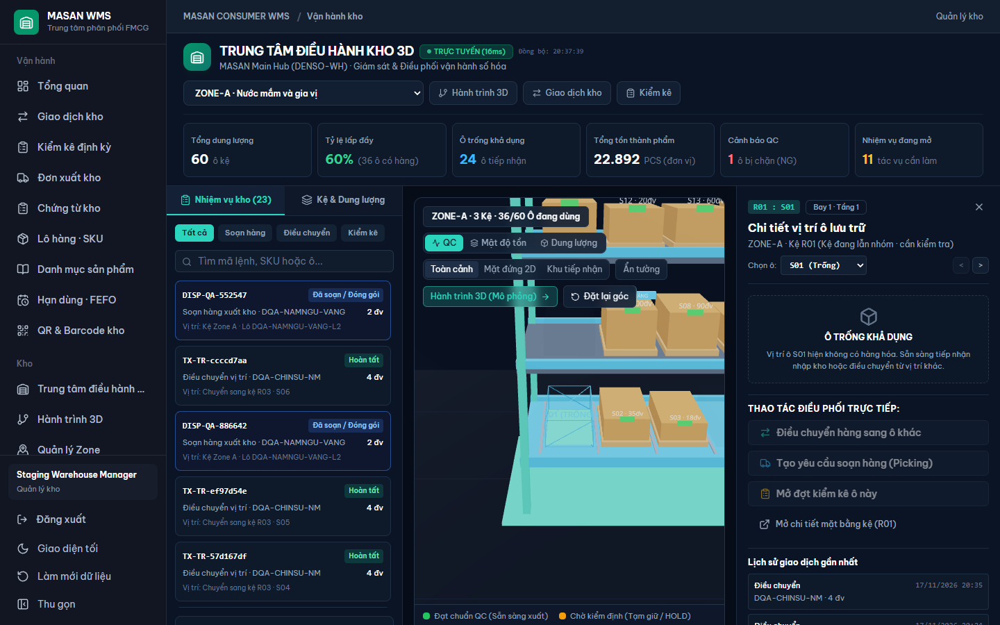
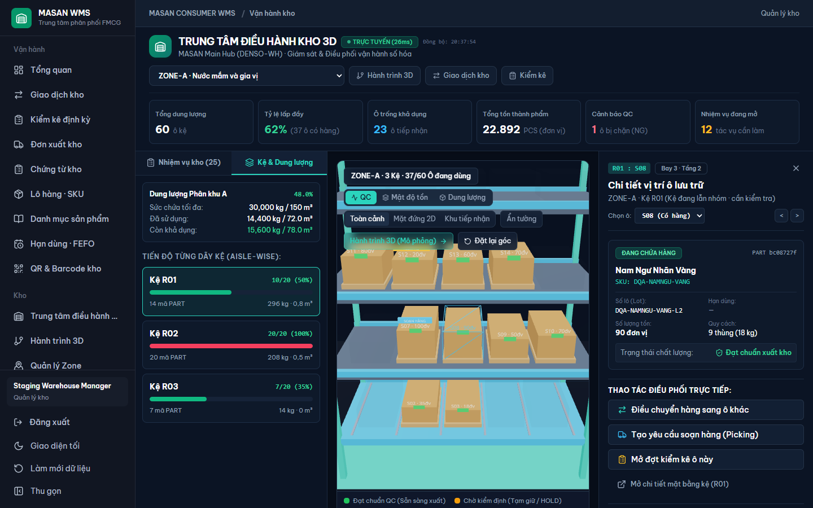
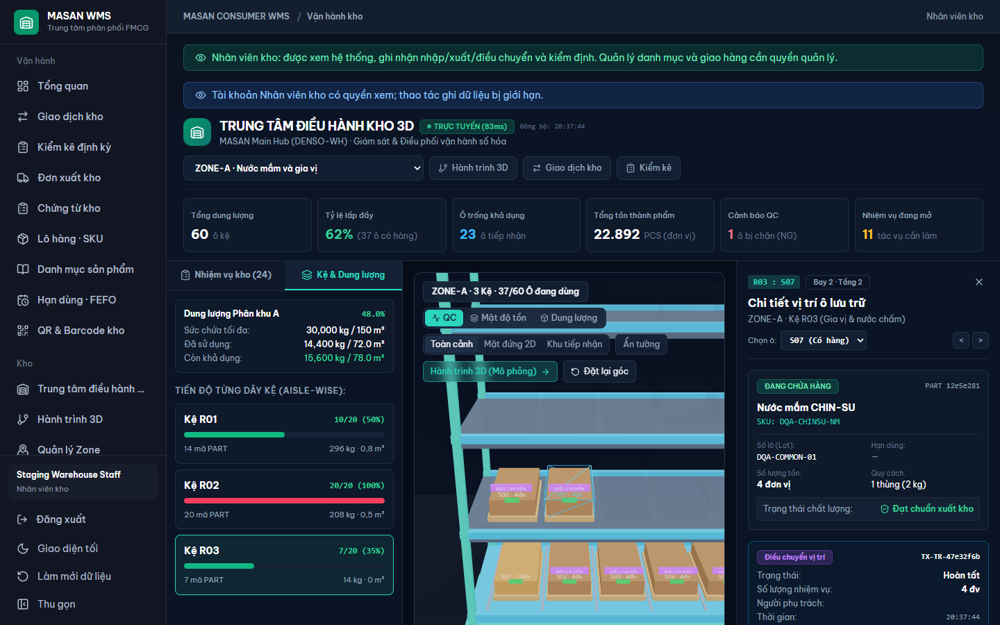
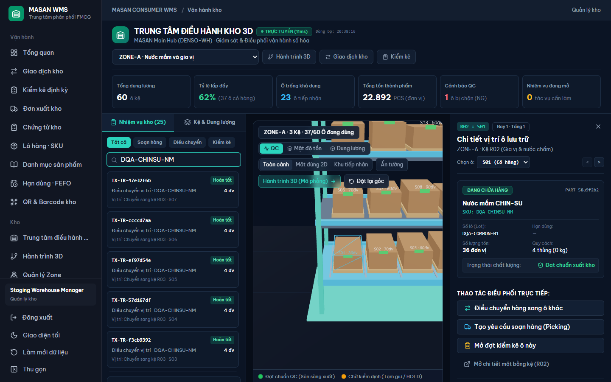
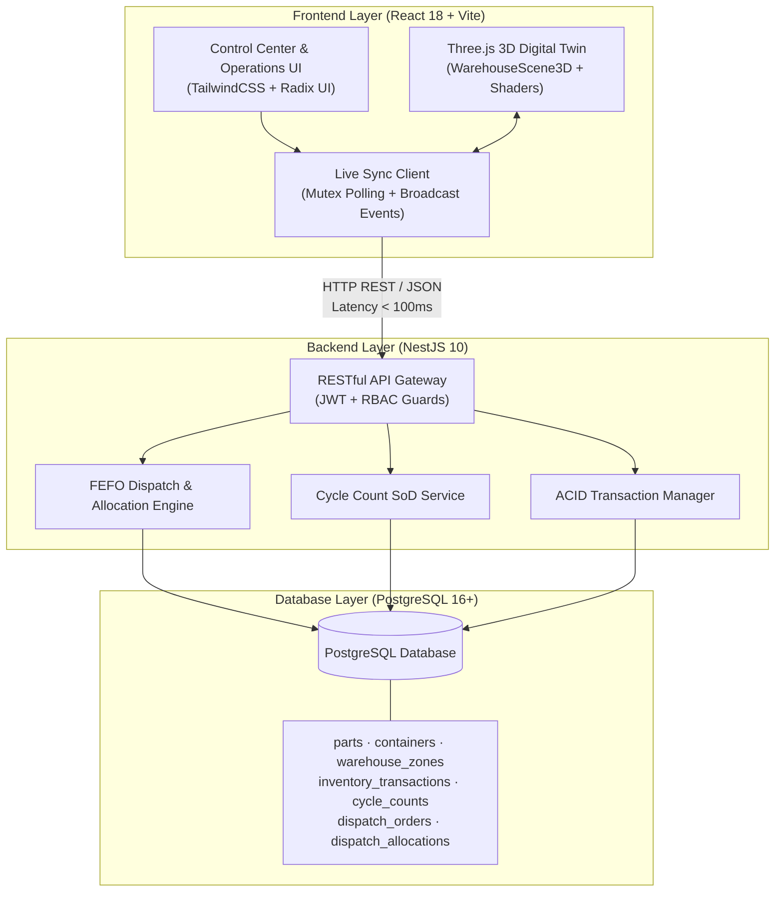

# Masan Consumer WMS · 3D Digital Twin & Real-Time Operations Control Center

[](https://react.dev/)
[](https://threejs.org/)
[](https://nestjs.com/)
[](https://www.typescriptlang.org/)
[](https://www.postgresql.org/)
[](https://tailwindcss.com/)
[](LICENSE)

An enterprise-grade **Warehouse Management System (WMS)** built for high-throughput consumer goods distribution, featuring an interactive **Three.js 3D Digital Twin** and a **Real-Time Operations Control Center**. 

The system provides sub-1.2s multi-client live synchronization without page reload, automated **FEFO (First-Expired, First-Out)** picking algorithms, dual-round cycle counting with strict **Segregation of Duties (SoD)**, and a physical sandbox simulating forklift kinematics and pallet collision geometry.

---

## 📸 Key Previews

| Real-Time 3D Control Center | 3D Illuminated Task Badges |
| :---: | :---: |
|  |  |
| *Full 3D warehouse floor with occupancy KPI, Zone/Rack/Slot navigation, and live telemetry* | *Visual operational badges (`SOẠN HÀNG`, `KIỂM KÊ`, `ĐIỀU CHUYỂN`) dynamically attached to slots* |

| Live Sync Without Reload (<1.2s) | SKU Auto-Focus Navigation |
| :---: | :---: |
|  |  |
| *Cross-client state synchronized dynamically across Manager & Staff sessions* | *Instant SKU/Lot search with automated 3D camera zoom & slot focus* |

---

## 🌟 Core Highlights & Capabilities

### 1. 🏢 3D Digital Twin & Control Center
- **Interactive 3D Warehouse Floor:** Complete structural visualization of warehouse zones (Zone A, B, C...) and high-density industrial racks with individual slot coordinates.
- **Multi-Layer Visualization Modes:**
  - **Normal Mode:** Real-time rack occupancy and carton distribution.
  - **Heatmap Mode:** Visualizes stock velocity, turnover frequency, and pallet movement hotspots.
  - **Space & Weight Capacity:** Real-time volumetric utilization ($m^3$) and load-bearing weight stress percentages.
  - **QC & Quarantine Status:** Highlights batches marked `RELEASED`, `QUARANTINE`, or `REJECTED`.
- **Right Inspector Panel:** Instant inspection of lot numbers, expiration dates, unit carton counts, net weight, QC certifications, and active warehouse work orders.

### 2. ⚡ Multi-Session Live Synchronization (< 1.2s)
- **Zero Page Reload:** When a warehouse manager commits an inventory relocation or outbound dispatch, field staff screens immediately reflect the new inventory state within **1,184 ms**.
- **Heartbeat & Telemetry HUD:** Constant latency pinging with status indicators (`TRỰC TUYẾN (<latency>ms)`).
- **Network Fault Tolerance:** Automatic offline disconnection detection (`MẤT KẾT NỐI (DỮ LIỆU CŨ)`) with zero-loss auto-reconnection once network connectivity resumes.
- **Illuminated 3D Task Tags:** Active warehouse tasks render 3D glowing markers directly over designated slots:
  - 🔵 **Soạn hàng (Picking):** Blue beacon (`#0284c7`)
  - 🟠 **Kiểm kê (Cycle Count):** Amber beacon (`#d97706`)
  - 🟣 **Điều chuyển (Transfer):** Purple beacon (`#7c3aed`)

### 3. 📦 FEFO Outbound Engine & Two-Step Picking
- **Smart FEFO Allocation:** Automatically allocates stock based on the nearest expiration date, eliminating product obsolescence for perishable FMCG inventory.
- **Two-Step Picking Lifecycle:**
  1. **`RESERVED`:** Soft reservation decrements available quantity while preserving physical stock on rack until pickers approach.
  2. **`PICKED`:** Barcode/pallet scan confirms physical removal, writing immutable audit trails into `inventory_transactions` and `dispatch_events`.
- **Concurrency & Idempotency:** Built-in `Idempotency-Key` headers prevent accidental duplicate dispatch creation, while over-allocation requests are rejected with HTTP 400.

### 4. 📋 Dual-Round Cycle Counting & Segregation of Duties (SoD)
- **Multi-Tier Approval Workflow:**
  - **Round 1:** First counter (Warehouse Staff) performs blind physical count $\rightarrow$ Status moves to `SECOND`.
  - **Round 2:** Independent counter (Inventory Controller) executes second recount $\rightarrow$ Status moves to `REVIEW`.
  - **Approval:** Only authorized Admin/Manager can review discrepancy reports and approve closure $\rightarrow$ Status moves to `CLOSED`.
- **Anti-Fraud Guard:** Staff counters are strictly barred from approving their own counts (HTTP 403 Forbidden).

### 5. 🚚 Physical Sandbox Simulation
- Custom wooden pallet geometry featuring realistic fork pockets and support blocks.
- Kinematic forklift controller with mast elevation, fork reach, and transport physics.
- Clear demarcation between physical sandbox simulation and real-world WMS telemetry to prevent operational ambiguity.

---

## 🏗️ System Architecture



---

## 🛠️ Technology Stack

| Layer | Technologies |
| :--- | :--- |
| **Frontend** | React 18, Three.js, Vite, Tailwind CSS, Lucide React, React Query (TanStack), Canvas 3D Shaders |
| **Backend** | NestJS 10, TypeORM, TypeScript, PostgreSQL Driver (`pg`), Passport.js, JWT, Class Validator |
| **Database** | PostgreSQL 16+ (ACID compliant, relational integrity, partial indexing) |
| **Testing & QA** | Playwright (End-to-End & Multi-browser sync), Jest (Unit/Integration) |
| **Architecture** | Monorepo structure, Event-driven state updates, Mutex lock concurrency |

---

## 📁 Repository Structure

```text
├── assets/
│   └── screenshots/              # High-resolution UI captures for documentation
├── denso-wms-frontend/           # React 18 frontend with Three.js 3D engine
│   ├── src/
│   │   ├── api/                  # Axios & Fetch API clients
│   │   ├── components/
│   │   │   ├── operations/       # Quick Transfer, Picking, Cycle Count modals
│   │   │   ├── ui/               # Reusable UI primitives (Shadcn/Radix)
│   │   │   └── viz/              # Three.js 3D Warehouse scenes & rack geometries
│   │   ├── lib/                  # Coordinate mappers & layout adapters
│   │   └── pages/                # Control Center, Inbound, Outbound, Dashboard
│   ├── package.json
│   └── vite.config.js
├── denso-wms-backend/            # NestJS backend API service
│   ├── src/
│   │   ├── auth/                 # JWT Authentication & RBAC guards
│   │   ├── database/             # TypeORM migrations & connection config
│   │   ├── inventory/            # Inventory transactions, stock movement
│   │   ├── cycle-counting/       # 2-round SoD cycle counting service
│   │   ├── reservations/         # FEFO outbound allocations
│   │   └── receiving/            # Inbound dock & quarantine management
│   ├── package.json
│   └── nest-cli.json
├── sample-data/                  # Demo catalog & rack slot seed datasets
├── tests/                        # Regression & E2E Playwright test suites
├── package.json                  # Root monorepo orchestration scripts
└── README.md
```

---

## 🚀 Quick Start Guide

### Prerequisites
- **Node.js:** `v18.x` or higher
- **PostgreSQL:** `15.x` or `16.x` (or Docker container)
- **Package Manager:** `npm` or `yarn`

---

### 1. Database Setup
Create a PostgreSQL database for the application:
```sql
CREATE DATABASE masan_wms_db;
```

---

### 2. Backend Setup
1. Navigate to the backend directory:
   ```bash
   cd denso-wms-backend
   ```
2. Copy environment configuration:
   ```bash
   cp .env.example .env
   ```
3. Update `.env` with your PostgreSQL credentials:
   ```env
   PORT=5001
   DB_HOST=localhost
   DB_PORT=5432
   DB_USERNAME=postgres
   DB_PASSWORD=your_password
   DB_DATABASE=masan_wms_db
   JWT_SECRET=your_jwt_secret_key
   ```
4. Install dependencies and run migrations:
   ```bash
   npm install
   npm run migration:run
   npm run start:dev
   ```
   The backend API will be available at `http://localhost:5001`.

---

### 3. Frontend Setup
1. In a new terminal, navigate to the frontend directory:
   ```bash
   cd denso-wms-frontend
   ```
2. Copy frontend environment configuration:
   ```bash
   cp .env.example .env
   ```
3. Install dependencies and start the Vite development server:
   ```bash
   npm install
   npm run dev
   ```
   Open your browser at `http://localhost:4380` (or the port specified in terminal).

---

### 4. Monorepo Scripts (Optional)
From the project root directory, you can also use:
```bash
npm run start:backend     # Runs NestJS backend in watch mode
npm run start:frontend    # Runs Vite frontend development server
npm run build:frontend    # Builds production frontend bundle
npm run build:backend     # Compiles NestJS backend
```

---

## 👥 Role-Based Access Control (Default Roles)

| Role | Access Scope |
| :--- | :--- |
| **Admin** | Full system administration, user management, audit review, cycle count approvals |
| **Warehouse Manager** | Inventory transfers, outbound dispatch creation, KPI monitoring, picking authorization |
| **Inventory Controller**| Round 2 cycle counts, inventory reconciliation, quarantine inspections |
| **Warehouse Staff** | Round 1 cycle counts, physical picking confirmation, barcode scanning |

---

## 📄 License
This project is open-source under the [MIT License](LICENSE).
