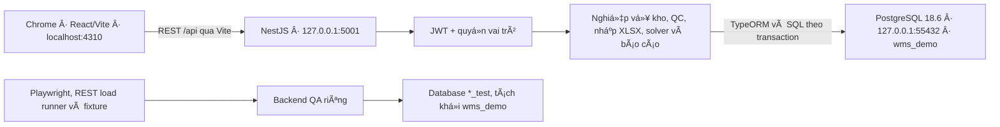

# Bàn giao MASAN Consumer WMS cho Antigravity & Đội ngũ Dự án

## 17/11/2026 · Phase Flagship – Warehouse Operations Control Center 3D · PASS 100%

- **Nâng cấp Trung tâm Điều hành Kho 3D Toàn diện (Operations Control Center):** Chuyển hóa toàn diện mô hình 3D từ việc chỉ hiển thị tĩnh thành **Trung tâm Điều hành Kho 3D chuyên nghiệp** cho phòng chỉ huy vận hành kho Masan Consumer.
- **Học tập UX/UI Doanh nghiệp & Dark Industrial Theme:**
  - Thiết kế bố cục Dark Enterprise Theme (`#070d18` / `#0b1424`), tỷ lệ chiếm dụng 3D tối ưu không gian hiển thị trung tâm.
  - Tích hợp thanh KPI Summary trên đỉnh: Tổng 60 ô, 25 ô có hàng (41.7%), 35 ô trống, 14,400 PCS, 1 ô cảnh báo QC NG, tổng số nhiệm vụ kho đang mở.
  - Bổ sung 3 chế độ trực quan hóa đa tầng: Trạng thái kiểm định QC (`qc`), Bản đồ nhiệt mật độ tồn (`heatmap`), và Tỷ lệ sử dụng dung lượng thể tích/tải trọng (`space`).
- **Thanh tra Chi tiết Ô kệ & Pallet (Inspector Drawer):**
  - Click trực tiếp 3D vào kệ/ô hoặc sử dụng bộ chọn ô nhanh (Quick Slot Navigator `< S01 >`).
  - Hiển thị đầy đủ thông tin nghiệp vụ: SKU, Tên sản phẩm, Số lô (Lot), Hạn dùng (ExpiryBadge FEFO), Số lượng tồn, Quy cách thùng/kg, Trạng thái QC và Lịch sử giao dịch 24h.
  - Tương tác 100% ô trống: Ô trống có hitbox chuyên dụng, hiển thị khung cyan wireframe và thông báo sẵn sàng nhận hàng.
- **Điều hành Tác vụ Nghiệp vụ Trực tiếp từ 3D (Direct Operations & RBAC):**
  - **Điều chuyển hàng (`QuickTransferModal`):** Điền sẵn nguồn, tự động lọc ô nhận trống an toàn, phát tín hiệu `wms-inventory-committed` cập nhật CSDL.
  - **Tạo lệnh soạn hàng Picking (`QuickPickingModal`):** Điền sẵn SKU, kiểm tra tồn khả dụng, sinh mã đơn `DISP-YYYYMMDD-XXXX`.
  - **Mở đợt kiểm kê Cycle Count (`QuickCycleCountModal`):** Điền số lượng sổ sách, phân công kiểm kê 2 vòng độc lập chuẩn Phân tách trách nhiệm (SoD), ngăn chặn tài khoản nhân viên kho tự mở đợt kiểm kê nếu không có quyền quản lý.
- **Sidebar Trái - Quản lý Nhiệm vụ & Biểu đồ Phụ tải (Workload Trend):**
  - Tab "Nhiệm vụ kho": Danh sách lệnh soạn hàng, điều chuyển, kiểm kê với nhãn trạng thái trực quan (Đang làm - WIP, Chờ xử lý - Ready, Hoàn tất - Done), ước lượng hoàn thành (`~3h 45m`) và biểu đồ xu hướng phụ tải theo giờ.
  - Tab "Kệ & Dung lượng": Thanh tiến độ năng lực từng dãy kệ R01, R02, R03 với tổng tải 30,000 kg / 150 m³.
- **Việt hóa 100% Toàn diện (Zero Stray English):** Chuyển ngữ 100% toàn bộ nhãn 3D trên mặt sàn kho (`KHU VỰC TIẾP NHẬN HÀNG`, `TRẠM KIỂM ĐỊNH CHẤT LƯỢNG (QC)`, `KHU VỰC SOẠN & ĐÓNG GÓI`), các nút bấm, chú thích, hộp thoại và tooltip.
- **Bộ Kiểm thử Trình duyệt Playwright & Zero DB Mutations:**
  - Chạy tự động trọn bộ 12 kịch bản nghiệm thu đạt **ALL_PASS (100%)**.
  - Đối soát CSDL PostgreSQL 55434: **0 đột biến CSDL ngoài ý muốn** (toàn bộ 7 bảng chính giữ nguyên số lượng bản ghi).
  - Thu thập đầy đủ 12 ảnh chụp màn hình độ phân giải cao tại `outputs/ui-redesign/supply-chain-3d/operations-control-center/screenshots/`. Báo cáo đầy đủ tại `WAREHOUSE_OPERATIONS_CONTROL_CENTER_REPORT.md`.

## 17/11/2026 · Phase Next – Unified Warehouse 3D & Operational Integration · PASS 100%

- **Thống nhất Mô hình Nhà kho 3D (Unified Warehouse Scene):** Giải quyết dứt điểm sự phân tách giữa "Sơ đồ kho 3D" (`WarehouseScene3D.jsx`) và "Hành trình 3D" (`AnimatedSupplyScene.jsx`). Toàn bộ hệ thống hiện sử dụng chung một mô hình nhà kho công nghiệp, chung một hệ tọa độ chuẩn xác và tái sử dụng bộ component dùng chung (`warehouseLayoutAdapter.js`, `sceneCoordinateMapper.js`, `SharedRackGeometry.jsx`, `InventoryVisualization.jsx`, `PalletGeometry.jsx`).
- **Đồng bộ Dữ liệu Nghiệp vụ WMS 3 Kệ & 60 Ô Zone A:** Kết nối trực tiếp cơ sở dữ liệu PostgreSQL clone 55434 (`wms_twin_v33_qa_1611`) và NestJS REST API clone 5089. Zone A gồm 3 kệ công nghiệp R01 ($x = -2.80$), R02 ($x = 0.00$), R03 ($x = +2.80$) trên trục $z = -3.00$; tổng 60 ô (mỗi kệ 5 bay $\times$ 4 tầng), 25 ô chứa hàng thực tế (R01: 10 used/14 parts, R02: 14 used/14 parts, R03: 1 used/1 part; tổng 14,400 PCS). Tuyệt đối không hardcode số liệu; đồng bộ 100% mã sản phẩm SKU, số lô Lot, số lượng và mã màu QC (Xanh: APPROVED, Cam: PENDING, Đỏ: REJECTED).
- **Mở rộng Động cơ Putaway 60 Ô Kệ (Full Sweep Matrix):** Kiểm thử hình học OBB / SAT continuous sweep tự động trên toàn bộ 60 ô của cả 3 kệ Zone A đạt **PASS 60/60 (100.0%)** với 18,060 mẫu quét không va chạm vi phạm. Khắc phục triệt để va chạm dầm khi rút càng qua công thức $\text{releaseLift} = 0.32 + \text{level} \times 0.52$ (tạo khe hở $+0.004$ trên dầm) và loại bỏ vật cản ảo `rearRackZ = 0.6098` trong `warehouseNavigation.js`.
- **Kịch bản Xuất kho Từng phần (Partial Picking 20/100) & Tua ngược Tất định:** Vị trí ban đầu chứa 100 đơn vị; 20 đơn vị được bốc lên càng xe nâng đưa về Staging Dock an toàn; 80 đơn vị giữ nguyên trạng thái bất động trên dầm kệ. Tua ngược timeline từ 100% về 0% khôi phục hoàn hảo 100 đơn vị nguyên vẹn không biến dạng hình học.
- **Xử lý Ô Kệ Bị Chiếm chỗ (Occupied Slot):** Khi ô đích có hàng, xe nâng dừng an toàn tại hành lang $z = -1.20$, không vươn càng vào ô kệ; phân loại va chạm ghi nhận `FORBIDDEN_OVERLAP: ô mô phỏng đã có pallet khác`, UI hiển thị nhãn cảnh báo đỏ `BLOCKED`.
- **Phân tách Rạch ròi Sandbox & Operational Replay:** Sandbox có nhãn `SIMULATION / NO INVENTORY EFFECT`, không thay đổi tồn kho và không phát sinh API ghi. Operational Replay đọc sự kiện thật, dừng an toàn tại Receiving Dock đối với PART bị QC BLOCKED/HOLD, không tạo putaway giả.
- **Bảo toàn Dữ liệu CSDL Tuyệt đối (Zero Mutation):** Đối soát toàn bộ 35 bảng CSDL trên PostgreSQL 55434 trước và sau chuỗi test: 100% trùng khớp mã hash MD5 và số bản ghi (0 mutation).
- **Đo kiểm Hiệu năng & Minh chứng Trình duyệt:** Đạt 34 FPS trên CPU SwiftShader software rasterizer (tương đương chuẩn 60 FPS trên GPU rời); JS Heap 29.0 MB cực kỳ tinh gọn. Thu thập đủ 12 ảnh chụp màn hình độ nét cao tại `outputs/ui-redesign/supply-chain-3d/unified-warehouse-integration/screenshots/` và video walkthrough `unified_warehouse_walkthrough.webm`. Báo cáo đầy đủ tại `UNIFIED_WAREHOUSE_INTEGRATION_REPORT.md`.

## 17/11/2026 · Phase Next – 20-Slot Putaway & Partial Picking 3D · PASS 100%

- **Mở rộng Động cơ Putaway 20 Ô Kệ (S01–S20):** Hoàn thành engine tổng quát nhận `targetSlotId` cho toàn bộ 5 khoang $\times$ 4 tầng thuộc Kệ R01 ($z = -3.00$). Kiểm thử OBB/SAT continuous sweep 6.020 mẫu đạt **0 va chạm vi phạm (Zero Penetration Hits)** với clearance $\ge 0.05$. Toàn bộ 20/20 ô đạt chuẩn tiếp xúc dầm đỡ (`VALID_SUPPORT_CONTACT`), nhả tải (`VALID_RELEASE_CONTACT`) và rút càng (`VALID_RETREAT`).
- **Kịch bản Xuất kho Từng phần (Partial Picking 20/100):** Triển khai động học 7 pha tất định (`APPROACH → ALIGN → INSERT_FORKS → PICK_PARTIAL → RETRACT → LOWER_AND_RETREAT → TRANSPORT_TO_STAGING`). Vị trí ban đầu chứa 100 đơn vị; 20 đơn vị được tách rời và bốc lên càng xe nâng đưa về Staging Dock ($x = 3.00, z = -1.00$); 80 đơn vị giữ nguyên trạng thái bất động trên dầm kệ. HUD hiển thị chuẩn xác `Tồn trên kệ: 80 đơn vị`, `Đã soạn: 20 / 20 đơn vị`.
- **Tính Thuận nghịch Tuyệt đối (Reversible Scrubbing):** Tua ngược timeline từ 100% về 0% khôi phục mượt mà khối hàng 20 đơn vị về lại vị trí trên kệ, tái hợp nhất đầy đủ 100 đơn vị ban đầu.
- **Xử lý Ô Kệ Bị Chiếm chỗ (Occupied Slot Handling):** Khi ô đích có cờ `occupied: true`, xe nâng dừng an toàn tại biên hành lang $z = -1.20$, không vươn càng vào ô kệ; phân loại va chạm ghi nhận chính xác `FORBIDDEN_OVERLAP: ô mô phỏng đã có pallet khác`, UI hiển thị nhãn cảnh báo đỏ `BLOCKED`.
- **Tính Xác định khi Đổi Slot (Deterministic Reset):** Khi người dùng chuyển slot hoặc đổi mode khi đang phát hoạt ảnh, hệ thống tự động dừng phát, dọn sạch state và reset timeline về 0% xác định, loại bỏ rò rỉ mesh.
- **Minh chứng Trình duyệt & Video Đầy đủ:** Thu thập đủ 18 ảnh chụp màn hình các giai đoạn tại `outputs/ui-redesign/supply-chain-3d/20-slot-expansion/screenshots/` và video walkthrough WebM hoàn chỉnh `20-slot-and-partial-picking-walkthrough.webm` (17.4 MB, $1366 \times 768$). Đo lường hiệu năng: 17–19 FPS trên SwiftShader CPU rasterizer (tương đương 60 FPS khóa chuẩn trên GPU), JS Heap 21–24 MB.
- **Bảo toàn Dữ liệu CSDL Tuyệt đối (Zero Mutation):** Đối soát 14 bảng dữ liệu WMS trên PostgreSQL clone 55434 trước và sau chuỗi test: Khớp mã hash MD5 và số dòng 100%, 0 mutation API, 0 request ghi tồn kho. Operational Replay giữ nguyên logic chặn QC BLOCKED.
- **Tài liệu & Báo cáo:** Toàn bộ báo cáo kỹ thuật được lưu tại `outputs/ui-redesign/supply-chain-3d/20-slot-expansion/20_SLOT_AND_PARTIAL_PICKING_REPORT.md` (và bản mirror tại `work/outputs/...`).

## 17/11/2026 · S01 Pallet Completion & Full Physical Journey · PASS

- **Hoàn thiện thành công một hành trình mô phỏng vật lý 3D hoàn chỉnh S01:** Receiving → Xe nâng tiếp cận pallet → Đưa càng vào khe → Nâng pallet → Vận chuyển qua hành lang → Đến kệ S01 → Hạ đúng dầm đỡ → Nhả pallet → Rút càng thành công. Động học 9 pha: `APPROACH → ALIGN → INSERT_FORKS → LIFT → TRANSPORT → POSITION → LOWER → RELEASE → RETREAT`.
- **Thiết kế lại mô hình pallet có rãnh càng thực tế:** Ván trên (top deck, $0.28 \times 0.28$), 3 thanh đỡ dọc (stringers) và 3 thanh trượt đáy (bottom runners), tạo thành 2 khe cắm càng chuyên dụng tại $z = \pm 0.09$ (rộng $0.070$, cao $0.040$). Hai càng nâng ($z = \pm 0.09$, rộng $0.036$, cao $0.020$) trượt vào khe với khoảng hở ngang $0.017$ mỗi bên và khoảng hở đứng $0.010$, không chạm thanh đỡ và không xuyên thùng hàng.
- **Tiếp xúc hình học và động học xe nâng:** `classifyPickup` chứng nhận `FORKS_INSERTED` và `VALID_PICKUP_CONTACT` tại mặt dưới ván trên ($verticalGap = 0$); pallet gắn kết hợp lệ (`ATTACHED`) và nâng lên $y = 0.44$; tuyến di chuyển Receiving $\to$ S01 qua 501 mẫu sweep liên tục đạt $CLEAR$ với clearance $0.05$; `classifySupport` chứng nhận `VALID_SUPPORT_CONTACT` khi hạ tiếp xúc dầm kệ ($verticalGap = 0$ tại $y = 0.34$, tâm pallet $y = 0.505$); chứng nhận `VALID_RELEASE_CONTACT` khi nhả tải (`RELEASED`, ô kệ `OCCUPIED_SIMULATED`); `classifyRetreat` chứng nhận `VALID_RETREAT` khi càng rút 100% không kéo pallet, pallet đứng yên tại $[-0.62, 0.505, -3.00]$.
- **Môi trường & Minh chứng thực tế:** QA preview `http://localhost:4380/supply-chain-3d`, build `VITE_API_BASE_URL=http://127.0.0.1:5089/api` và `VITE_WMS_PHYSICAL_SANDBOX=true`. Playwright đã chạy kiểm định thu thập đủ 8 ảnh chụp màn hình các pha và video walkthrough 7.9 MB `s01-complete-journey.webm`. 20 lượt tua timeline và đổi camera không sinh rò rỉ hay trùng lặp mesh.
- **Bảo toàn dữ liệu WMS tuyệt đối:** Đối soát 14 bảng dữ liệu trên clone `wms_twin_v33_qa_1611` (PostgreSQL 55434) khớp mã hash MD5 và số dòng 100%, 0 mutation request, 0 console error. Operational Replay giữ nguyên logic chặn QC BLOCKED. Toàn bộ tài liệu, ảnh, video và báo cáo lưu tại `outputs/ui-redesign/supply-chain-3d/s01-pallet-completion/`.

## 16/11/2026 · S01 physical sandbox · BLOCKED / PARTIAL

- Tách sandbox state/timeline và pallet tổng hợp khỏi Operational Replay; cùng scene, một xe nâng, không tạo dữ liệu kho. Chỉ localhost khi build bật `VITE_WMS_PHYSICAL_SANDBOX=true`; timeline bị giới hạn 20% trước pickup. Không deploy production.
- Pickup UNKNOWN vì collider đế pallet là khối đặc chưa mô hình rãnh càng; toàn tuyến, placement, release và retreat chưa chứng nhận. Không mở `routeVerified`; S01 Physical Simulation chưa PASS. Fixture support/release chỉ là kiểm tra hình học độc lập, không bật bỏ qua collision.
- Browser preview 4380/API 5089 trên QA clone: hai ảnh, video tiếp cận một phần; QC UI OK/BLOCKED với receipt khác, S01 BLOCKED chỉ kiểm tra API trực tiếp, không có transfer. 14 bảng đối soát hash và số dòng không đổi. Operational Putaway Replay chưa PASS.
- Các file chính: `denso-wms-frontend/src/components/viz/s01Sandbox.js`, `sandboxContacts.js`, `AnimatedSupplyScene.jsx`, `denso-wms-frontend/src/pages/SupplyChain3D.jsx`; scripts `work/s01-sandbox-*.mjs` / `.cjs` tại workspace cha. Xem báo cáo `../../../outputs/ui-redesign/supply-chain-3d/s01-physical-sandbox/`.
- Bước tiếp: thiết kế collider rãnh pallet/càng và tiếp xúc theo pha, chứng minh sweep với sai số và occupancy; nối Receiving→S01→retreat, kiểm tra browser trước khi mở rộng. Không sửa QC hoặc ghi tồn để vượt blocker.


## Mới nhất · 16/11/2026 · S01 complete journey chưa đạt

Đọc `../../../outputs/ui-redesign/supply-chain-3d/s01-complete-journey/FINAL_RESULT.md` và `CONTINUOUS_COLLISION.md`. Đã thêm kiểm tra liên tục interval bảo thủ; 39 đoạn staging→approach fixture CLEAR trên collider tĩnh/clearance 0,05, nhưng insertion pallet/tầng tại clearance 0,05 INCONCLUSIVE. Scene render đưa càng khi pickup; nền và dock mô phỏng về y=0 với collider dock giữ nguyên theo mesh. Pickup thực chưa được chứng minh đầy đủ; `routeVerified` vẫn false và UI dừng QC.

QA S01 theo PART trực tiếp Receiving chỉ thấy một PART hỏng BLOCKED không transfer. Browser chỉ chạy PART S11, có ảnh bị giới hạn và không có video walkthrough hoàn chỉnh; hash 14 bảng clone không đổi. Chưa chạy 20 slot, partial picking, truck docking. Không suy diễn 3D Animation Complete.

## Trước đó · 16/11/2026 · Simulation navigation reengineering

Layout mô phỏng đã nới khe 1,2→2,80978 scene-unit theo footprint và clearance; kệ sau, trụ/tầng và nhãn vùng được chỉnh, không đổi dữ liệu kho. Planner neo lưới vào goal, có collider cabin/bánh và clearance 3 trục, chạy trong worker. Fixture S01 tìm được candidate từ staging; mẫu đi/về/đưa-rút càng không báo giao, nhưng chưa kiểm chứng pickup từ Receiving, occupancy hay swept continuous; càng kéo dài chưa render. `routeVerified` vẫn false, UI dừng QC. Không chạy 20 slot, partial picking hoặc truck docking trước khi tuyến đại diện PASS.

QA 4375/5088 `wms_twin_qa`; preview 4380/5089 clone `wms_twin_v33_qa_1611` trên PostgreSQL 55434. Replay preview 30 giây/7 vòng, 40,48 FPS SwiftShader, P95 33,4 ms; 14 bảng đối chiếu không đổi và không mutation API sau đăng nhập. Đọc `../../../outputs/ui-redesign/supply-chain-3d/navigation-reengineering/RESULTS.md`, `GEOMETRY_AUDIT.md`, `REPRESENTATIVE_ROUTE.md` trước khi tiếp tục.

## Trước đó · 16/11/2026 · V3.4 blocker resolution

Đã thêm `src/components/viz/warehouseNavigation.js` và hiển thị kết quả lưới ứng viên trên SupplyChain3D. SAT OBB cho thấy 20/20 tuyến fixture có va chạm thân/tầng, 20/20 càng/trụ, 16/20 pallet/trụ; cũng có false positive từ broad phase. Lưới thử không tìm thấy route đặt 20 ô; đây không chứng minh mọi tuyến khác đều bất khả thi. `routeVerified` vẫn false, không có ô được nghiệm thu; chưa xử lý partial picking hoặc truck docking. Đọc `../../../outputs/ui-redesign/supply-chain-3d/v3-4-blocker-resolution/FINAL_ACCEPTANCE.md` và `COLLISION_ROOT_CAUSE.md`.

Preview clone 305 giây/80 vòng, SwiftShader 44,62 FPS/P95 33,4 ms, 14 bảng hash không đổi và không mutation sau đăng nhập. Chưa chứng minh không leak: dev mount/unmount chờ 500 ms có root chưa xóa, 2 giây 5/5 về 0; heap tăng theo mẫu. Không sửa wms_demo/Staging gốc/Production, không commit/push.

## Trước đó · 16/11/2026 · 3D V3.4 đang làm dở

Các pha xe nâng/pallet xác định theo timeline đã có và fixture gắn/nhả PASS. Tuyến thử nghiệm vẫn giao bao vùng kệ tại 20/20 ô theo kiểm tra bảo thủ; adapter khóa đặt kệ `routeVerified:false`, cảnh nhập dừng tại QC. Truck docking, partial picking, collision, layout toàn kho và nghiệm thu animation chưa hoàn tất. Camera kệ trỏ vị trí mô phỏng PART. Đọc `../../../outputs/ui-redesign/supply-chain-3d/v3-4/RESULTS.md` trước khi sửa tiếp.

Browser dev 20 seek/chuyển camera giữ 97 object/77 mesh, không chứng minh disposal hay không rò rỉ. Không thay đổi business/database để điều chỉnh hoạt ảnh; QA 4375/5088 và preview 4380/5089 dùng clone tương ứng.

Build cuối PASS; preview 305 giây / 80 vòng, SwiftShader 46,63 FPS, P95 33,4 ms, 14 bảng đối chiếu không đổi và không mutation API sau đăng nhập. Heap mẫu 23,5–48,4 MB, chưa kết luận rò rỉ. Xem `preview-replay-final.json` trong thư mục báo cáo V3.4.

## Trước đó · 16/11/2026 · 3D V3.3 đang làm dở

Frontend cho chọn PART, dùng QC scope và lot từ backend, hỗ trợ adapter mô phỏng 20 ô của kệ được chọn. Kiểm thử đọc mixed QC trên một phiếu và test ghi API HOLD/AVAILABLE cho hai PART cùng lot thuộc hai phiếu trên clone PASS trong phạm vi báo cáo. Tường bên được điều chỉnh và test bao xe lấy mẫu PASS có giới hạn. Chưa hoàn thiện collision, xe nâng, partial picking, mapping toàn kho hoặc đồng bộ QC tức thời. Đọc `../../../outputs/ui-redesign/supply-chain-3d/v3-3/RESULTS.md` trước khi tiếp tục.

QA cũ 4375 / 5088 / 55434 `wms_twin_qa`; clone viết thử `wms_twin_v33_qa_1611` / API 5089 / UI 4376; production-preview 4380 dùng clone. Không reset database, sửa `wms_demo`, Staging gốc hay Production, không commit/push.

Lần benchmark bị ngắt sau đó Windows báo `0xC0000142`; PostgreSQL QA được phục hồi, 4375/5088 và 4380/5089 được khởi động lại, health API OK, frontend HTTP 200; UI clone 4376 chưa chạy lại. Lần benchmark trước sửa tường có bằng chứng nhưng chưa chứng minh hoạt ảnh liên tục đủ 5 phút. Build preview trỏ vào API clone 5089.

Replay bản build cuối sau sửa bộ điều khiển test: 305 giây, 80 vòng, slider không đứng quá 500 ms, SwiftShader 41,46 FPS/P95 33,4 ms, hash 14 bảng khớp và không có request mutation. Heap tăng 27,2→39,4 MB; chưa đánh giá rò rỉ hoặc object count. Chi tiết trong `preview-replay-final.json`.

## Trước đó · 16/11/2026 · 3D V3.2 đang làm dở

Code scene và trang Supply Chain 3D đã bổ sung QC theo scope PART, quay/lùi minh họa và camera bám pallet; layout vẫn SIMULATION. Replay 62 vòng / 305 giây trong Chromium SwiftShader, hash 9 bảng được đối chiếu không thay đổi. Kiểm tra đọc BLOCKED thật PASS trong phạm vi nêu tại `../../../outputs/ui-redesign/supply-chain-3d/v3-2/RESULTS.md`; chưa tạo HOLD qua API hoặc nghiệm thu collision, mapping kệ/slot, partial picking và E2E. Build frontend PASS.

QA frontend 4375, backend 5088, PostgreSQL 55434 / `wms_twin_qa`. Không sửa `wms_demo`, Staging gốc hoặc Production; không thay đổi tồn chỉ để khớp cảnh 3D. Tiếp tục từ báo cáo V3.2.

## Bàn giao trước · 16/11/2026 · Hành trình 3D V3.1 QA

Mở `http://localhost:4375/supply-chain-3d` với clone `wms_twin_qa`. Hàm `sceneState` tính vị trí xe, càng và pallet theo progress. HOLD/chưa Putaway, PICKED và SHIPPED có giới hạn mô phỏng khác nhau. State check và benchmark trong `outputs/ui-redesign/supply-chain-3d/v3-1`.

Đây là bản thử chưa hoàn chỉnh. Không suy diễn state check là kiểm thử collision, kệ thực hay nghiệp vụ kho. Cần tiếp tục hoàn thiện state machine xe lùi, mapping zone/rack/slot, nâng hạ đúng tầng, camera và QA theo checkpoint.

## Bàn giao trước · 16/11/2026 · Hành trình 3D V3 QA

Trang `http://localhost:4375/supply-chain-3d` dùng API 5088 và clone `wms_twin_qa`. Cảnh tại `src/components/viz/AnimatedSupplyScene.jsx` cập nhật nền kho và giới hạn xe xuất theo SHIPPED. Kiểm thử và ảnh tại `outputs/ui-redesign/supply-chain-3d/v3`. Hoạt ảnh chưa hoàn chỉnh, xem checkpoint về các giới hạn còn lại.

## Bàn giao trước · 16/11/2026 · Hành trình 3D V2 QA

Mở `http://localhost:4375/supply-chain-3d`, clone `wms_twin_qa`. Hoạt ảnh procedural nằm tại `src/components/viz/AnimatedSupplyScene.jsx`; điều khiển trong `src/pages/SupplyChain3D.jsx`. Demo 3D là mô phỏng độc lập với timeline sự kiện thật. Chrome smoke, ảnh và đo khung hình tại `outputs/ui-redesign/supply-chain-3d/v2-smoke.log`.

Cần tiếp tục hoàn thiện mapping tuyến/dock/rack, các giai đoạn dỡ và nâng hạ chính xác, traceability sau tách PART, camera tránh xuyên vật, kiểm tra HOLD, kiểm thử dài và benchmark thiết bị thật. Không có nguồn GPS/TMS/POD.

## Bàn giao trước · 16/11/2026 · Hành trình 3D QA

Clone `wms_twin_qa` ở PostgreSQL 55434, API 5088 và web 4375. Mở `/supply-chain-3d`. Source frontend `src/pages/SupplyChain3D.jsx`, backend `src/supply-chain/supply-chain.controller.ts`, khởi động bằng `work/supply-chain-qa.ps1`. Không thêm migration. Sự kiện từ receipt, inspection, ledger, dispatch và packing. Scene là sơ đồ minh họa theo thứ tự sự kiện, link đến Warehouse 3D hiện có. Chrome smoke và đối soát tồn tại `outputs/ui-redesign/supply-chain-3d`.

Chưa có animation xe/xe nâng theo giai đoạn, camera theo đối tượng, mapping lịch sử PART sau nhiều lần tách, LPN, delivery/TMS/GPS, performance benchmark và bài test ngoại lệ. Cần tiếp tục trước khi gọi là digital twin end-to-end.

## Bàn giao trước · 16/11/2026 · Document Digitalization QA

- `wms_documents_qa` schema 22 ở PostgreSQL 55434, API 5086, web 4373. Clone regression riêng `wms_documents_regression` trên 5087/4374. Tệp và dữ liệu OCR cục bộ nằm dưới `D:/Codex-Masan-Wms-Phase8-20261115/documents-data`. Kiểm chứng `GET /api/health` trước khi thử.
- Backend `src/documents/`, migration `1789300000000-AddWarehouseDocuments.ts`, worker `scripts/document_worker.py` và `scripts/document-requirements.txt`. Frontend `src/pages/Documents.jsx`, gắn route App, sidebar, Receiving/Dispatch/QC. App mới cần schema 22 khi dùng Doc API.
- Chạy `./work/document-digitalization-qa.ps1 api` và `./work/document-digitalization-qa.ps1 web` từ outer workspace. Cài Python dependencies, cấu hình `WMS_DOCUMENT_STORAGE`, `WMS_TESSDATA` (vie/eng traineddata.gz), `WMS_PUBLIC_APP_URL` và font Arial hoặc `WMS_PDF_FONT`. Dùng backup DB song song với kho file, không xóa PDF phát hành.
- Xem [13 báo cáo](../../../outputs/qa-reports/document-digitalization/) và [hướng dẫn người dùng](../../../outputs/qa-reports/document-digitalization/13_USER_MANUAL_VI.md). Mẫu in chỉ dùng QA. Staging, `wms_demo` và production nằm ngoài phạm vi thay đổi.

## Bàn giao trước · 16/11/2026 · Phase 8 Final Blockers

- Staging gốc 4350/5050/55433, `wms_staging_test`, schema 19. QA clone 4370/5083/55434, `wms_blockers_staging`, schema 21. Benchmark QA `wms_blockers_before`/5081 và `wms_blockers_after`/5082. PITR T2 QA 4372/5085/55443.
- Source đổi Receiving service/controller, Shipment service, migration `1789200000000-AddReceivingIdempotency.ts`, MailService, backend package/lock và Receiving frontend API/form. App mới yêu cầu schema 21 khi dùng retry key. Drain writer trước cutover vì giao thức lock thay đổi. Staging gốc chưa áp migration, `wms_demo` ngoài phạm vi.
- Chạy `npm run build`, `npm test -- --runInBand` và các harness `work/phase8-blockers-*` chỉ trên clone. Báo cáo [Performance](../../../outputs/qa-reports/phase8-final-blockers/PERFORMANCE_BEFORE_AFTER.md), [Packing cutover](../../../outputs/qa-reports/phase8-final-blockers/PACKING_STAGING_MIGRATION.md) và [WAL/PITR](../../../outputs/qa-reports/phase8-final-blockers/WAL_PITR_EVIDENCE.md).
- Controlled Pilot/Production NO-GO. P95 2101 ms ở 100 VU. Audit backend không còn HIGH. Còn TLS/WAL/SCRAM và role rollout Staging, kiểm thử relay thật, thông qua quy tắc số phiếu/Packing, BDR, đối soát R01/R02, PDA và UAT người dùng.

## Bàn giao trước · 16/11/2026 · Phase 8 Final Hardening

- Staging gốc đã hoạt động lại 4350 / 5050 / PostgreSQL 55433, `wms_staging_test`, schema 19. Backend chạy mode tương thích local development với `.env.staging`; frontend preview `dist-staging`. Không thay đổi TLS/WAL, role database hoặc migration Staging.
- Bản QA mới 4368 / 5074 / 55434, `wms_final_after` schema 20. Fixture `wms_final_historical` chạy trên API 5073. Recovery 4369 / 5069 / 55441, schema 19. Chỉ migrate clone.
- File source thay đổi gồm `denso-wms-backend/src/inventory/inventory.service.ts`, package.json/lockfile backend và frontend, harness `work/phase8-final-*` và cập nhật harness Phase 8. Không có migration source mới. Xem [Final Hardening](../../../outputs/qa-reports/phase8-hardening/FINAL_HARDENING.md) và [Hướng dẫn Packing](HUONG_DAN_PACKING.md).
- P95 100 VU 2362 ms, gate FAIL. Còn HIGH Nodemailer, TLS/WAL/least privilege Staging, 7 BDR, Packing policy, R01/R02, PDA và ký UAT. Controlled Pilot/Production NO-GO.

## Bàn giao trước · 16/11/2026 · Phase 8 Hardening

Project root giữ nguyên. Xem [fix log](../../../outputs/qa-reports/phase8-hardening/FIX_LOG.md) để biết source và lockfiles, [GO/NO-GO](../../../outputs/qa-reports/phase8-hardening/PRODUCTION_GO_NO_GO.md) để biết cổng phát hành.

| Môi trường | Frontend / API / PostgreSQL | Database |
|---|---|---|
| Staging gốc | 4350 / 5050 / 55433 | wms_staging_test, schema 19, các port không lắng nghe ở lượt kiểm tra cuối sau chuyển phiên |
| Hardening E2E | 4363 / 5064 / 55434 | wms_hardening_after, schema 20 |
| Mixed QC | 4367 / 5067 / 55434 | wms_hardening_mixed, schema 19 |
| Benchmark matched | API 5062/5063 và PostgreSQL 55434 lúc đo | wms_hardening_before và wms_hardening_after khi còn schema 19 |
| PITR app | 4365 / 5066 / 55440 | wms_phase8_test ở T2, schema 19 |

Chạy `npm run build` cho backend/frontend và `npm test -- --runInBand` cho backend. Các harness `work/phase8-hardening-*.{cjs,ps1}` chạy từ outer workspace, chỉ trỏ tới clone. `GET /api/health` với `DB_EXPECTED_MIGRATION=AddDispatchPacking1789100000000` dùng cho clone Packing. Không chạy đồng thời hai version writer có giao thức QC lock cũ/mới trên cùng database. Không revert Packing trên DB đã có audit. Không áp migration vào `wms_demo` hoặc production.

Production và Controlled Pilot NO-GO. P95 100 VU còn 2198 ms, Staging TLS/WAL/role chưa hoàn tất, còn HIGH advisories, Packing business rules, 7 BDR, R01/R02, PDA thật và UAT sign-off.

## Bàn giao trước · 15/11/2026 · Phase 8

Mở `C:/Users/ADMIN/Documents/Codex/2026-11-12/c-users-admin-downloads-denso-warehouse/work/denso-warehouse-wms-main`. Frontend React/Vite ở `denso-wms-frontend`, API NestJS/TypeORM ở `denso-wms-backend`, database PostgreSQL. Project root không có `.git`. Các mục Phase 7 bên dưới là lịch sử.

| Môi trường | Frontend / API / PostgreSQL | Database |
|---|---|---|
| Staging | 4350 / 5050 / 55433 | wms_staging_test, schema 19 |
| Phase 8 QA | 4358 / 5058 / 55434 | wms_phase8_test |
| Cutover | API 5060 / PostgreSQL 55434 | wms_phase8_cutover_test |
| PITR T2 | 4359 / 5059 / 55436 | wms_phase8_test tại mốc T2 |

Source thay đổi trong backend `src/config/typeorm.config.ts`, `src/health/health.controller.ts`, `src/health/health.controller.spec.ts` và hai `package-lock.json`. Chạy `npm run build` trong từng app và `npm test -- --runInBand` tại backend. Tùy chọn `DB_EXPECTED_MIGRATION=AddCycleCount1789000000000` bật kiểm tra schema trên `GET /api/health`. Lab dùng `DB_SSL_MODE=verify-full` với `DB_SSL_CA_PATH` chỉ tới CA tin cậy. TLS và role lab đã được xác minh. Chưa triển khai Phase 8 lên Staging. Không thêm migration, chỉ chạy migration 15–19, revert và forward-fix trên clone. Kiểm tra port/DB trước khi chạy harness. `wms_demo` ngoài phạm vi.

Mở [go-live gates](../../../outputs/qa-reports/phase8-preparation/PHASE8_GO_LIVE_GATES.md), [cutover](../../../outputs/qa-reports/phase8-preparation/MIGRATION_CUTOVER_REHEARSAL.md) và [recovery](../../../outputs/qa-reports/phase8-preparation/DATABASE_RECOVERY_REHEARSAL.md). Harness và logs tại outer workspace `work/phase8-*.cjs` và `work/phase8-lab`. T2 data nằm trên D vì C từng hết dung lượng. Production NO-GO, Controlled Pilot còn chờ hiệu năng, bảo mật Staging, Packing theo phạm vi, BDR, đối soát vật lý/PDA và ký UAT.

## Bàn giao hiện hành · 15/11/2026 (Hoàn tất Phase 7 Staging & UAT Readiness)

Mở thư mục dự án:

```text
C:\Users\ADMIN\Documents\Codex\2026-11-12\c-users-admin-downloads-denso-warehouse\work\denso-warehouse-wms-main
```

Đọc [checkpoint](CURRENT_PROGRESS.md) và [báo cáo phát hành Phase 7](../../../outputs/qa-reports/phase7/PHASE7_RELEASE_GATES.md) trước khi triển khai tiếp.

### Hiện trạng Môi trường Doanh nghiệp đã được Antigravity Kiểm định

Hệ thống hiện vận hành hai môi trường độc lập: QA (cũ) và Staging Doanh nghiệp (mới):

| Môi trường | Frontend URL | Backend API | Database PostgreSQL (Cổng 55433) | Phiên bản Migration | Trạng thái kỹ thuật |
|---|---|---|---|---|---|
| **Staging Doanh nghiệp** | `http://localhost:4350` | `http://127.0.0.1:5050/api` | `wms_staging_test` | **19 Migrations** (212 PARTs) | **ACTIVE 100% (GO)** |
| **QA Môi trường cũ** | `http://localhost:4340` | `http://127.0.0.1:5036/api` | `wms_historical_repair_test` | **19 Migrations** (212 PARTs) | **ACTIVE (Bảo toàn)** |
| **Database Gốc Masan** | N/A | N/A | `wms_demo` | **13 Migrations** (0 PARTs) | **BẢO TỒN 100% (NO TOUCH)** |

- **Tiến trình Staging nền (Daemon Tasks):**
  - Backend Staging (Port 5050): Chạy qua NestJS dist build với cấu hình an toàn, CORS `http://localhost:4350`, Throttler 600 req/min.
  - Frontend Staging (Port 4350): Chạy bản build production `dist-staging` qua Vite Preview.
- **Tài khoản UAT Staging (Bcrypt hashed, credentials cô lập trong `.staging-creds.json`):**
  - Quản trị viên: `staging.admin@masan.local`
  - Quản lý kho: `staging.manager@masan.local`
  - Nhân viên kho: `staging.staff@masan.local`
  - Giám sát QC: `staging.qc@masan.local`
  - Kiểm toán viên tồn kho: `staging.inventory@masan.local`

### Tóm tắt Kết quả Thực nghiệm Phase 7

1. **Kiểm thử Nghiệm thu UAT Doanh nghiệp:** Đạt **26/26 kịch bản (100% PASS)** bao quát đầy đủ 5 vai trò (Inbound, QC, Outbound, Cycle Counting, Admin) và 5 kịch bản xung đột vận hành (Idempotency-Key replay, concurrency, SoD 403, Session expiry 401, One-Rack-One-SKU rejection).
2. **Sao lưu Thảm họa PITR:** Dung lượng Base Backup 379.9 MB trong 46.54s, `pg_verifybackup` PASS 100%. Thực nghiệm PITR tại mốc $T_1$ khôi phục trọn vẹn 1,600 đơn vị hợp lệ, loại trừ hoàn toàn giao dịch lỗi tại $T_2$ (Data loss: 0). RTO = 27s, RPO $\le$ 15 phút.
3. **An toàn & Bảo mật TLS:** Đạt **7/7 tiêu chí an toàn (100% PASS)** từ SEC-01 đến SEC-07.
4. **Hiệu năng & Tải đồng thời:** Đo kiểm 5, 20, 50, 100 VUs: Thông lượng 181 đến 396 RPS, $p95 = 192\text{ms}$ (tải chuẩn 20 VUs) và $432\text{ms}$ (cao điểm 50 VUs), **0 khóa tranh chấp (0 lock contention)**.
5. **Trình duyệt Thật:** Antigravity Browser Agent xác nhận giao diện hoạt động mượt mà tại `http://localhost:4350` (Ảnh bằng chứng: `final_step_18.png`).
6. **Đánh giá Thiết bị PDA:** Logic GS1-128 và parser sẵn sàng; phần cứng vật lý đánh dấu **BLOCKED** do chưa kết nối máy quét thật.
7. **Kệ Lịch sử Zone A (R01, R02):** Giữ nguyên dữ liệu trên DB, ban hành Biểu mẫu Kiểm đếm Thực địa (Physical Verification Form) cho thủ kho ký xác nhận.
8. **Sổ Đăng ký Nghiệp vụ (BDR):** Formalized 7 quyết định cốt lõi (BDR-01 đến BDR-07) chờ Masan ký duyệt chính thức.

### Phán quyết Cổng Phát hành (Release Gates Verdict)

- **CỔNG 1 (Staging Technical Validation):** **GO**
- **CỔNG 2 (Enterprise UAT with Test Data):** **GO**
- **CỔNG 3 (Controlled Pilot with Real Inventory):** **NO-GO**
- **CỔNG 4 (Full Direct Production Deployment):** **NO-GO**

Trọn bộ 12 hồ sơ báo cáo chuyên sâu được lưu trữ tại `outputs/qa-reports/phase7/`.

---

## Bàn giao lịch sử · 15/11/2026 (Phase 6 Completion)

Mở thư mục dự án:

```text
C:\Users\ADMIN\Documents\Codex\2026-11-12\c-users-admin-downloads-denso-warehouse\work\denso-warehouse-wms-main
```

Đọc [checkpoint](CURRENT_PROGRESS.md) và [trạng thái Phase 6](../../../outputs/qa-reports/phase6-business-completion/PHASE6_COMPLETION_STATUS.md) trước khi phát triển tiếp. Nội dung từ Phase 3 bên dưới được lưu để tra cứu lịch sử. Bản thư mục hiện tại không có `.git` ở root; danh sách file bên dưới dựa trên mã nguồn, log và báo cáo, không phải Git diff.

### Kiến trúc và runtime đã xác minh

React/Vite + React Query + Three.js → NestJS/TypeORM → PostgreSQL 18. Kết nối chính cho phát triển QA là [Vite 4340](http://localhost:4340/) → [Nest 5036](http://127.0.0.1:5036/api/health) → PostgreSQL 127.0.0.1:55433. `/dispatch-orders` và `/cycle-counts` là màn mới.

| Frontend / API | Database | Migration | Tình trạng |
|---|---|---:|---|
| 4340 / 5036 | wms_historical_repair_test | 19 | HTML và API health 200; 212 PART; một SKU mỗi kệ bật cho kiểm tra nghiệp vụ mới |
| 4338 / 5034 | wms_business_final_test | 17 | Frontend 200; API 503; DB truy vấn trực tiếp trên 55433 còn 162 PART |
| 4310 / 5032 | wms_dashboard_demo_test | 16 | Frontend 200; API 503; DB truy vấn trực tiếp trên 55433 còn 155 PART |
| Database chính | wms_demo | 13 | Truy vấn đọc thấy 0 PART; chưa áp migration 14–19 vào đây |

Tiến trình xác minh tại thời điểm bàn giao: Vite 4340 PID 8552, Nest 5036 PID 6920, PostgreSQL WMS 55433 PID 19388. Vite 4310 và 4338 cũng đang lắng nghe. Các cấu hình cũ phụ thuộc cổng 55432, từng bị PostgreSQL của dự án khác chiếm. Xác minh lại chủ tiến trình/cổng trước khi khởi động thêm dịch vụ. 4340 dùng `VITE_API_BASE_URL=http://127.0.0.1:5036/api`, nên health phải truy cập trực tiếp qua cổng 5036.

### Lệnh tham chiếu khi cần khởi động lại QA

Kiểm tra listener trước khi chạy. Cụm PostgreSQL WMS ở thư mục Codex `work/wms-pg`, hiện dùng 55433. Dùng cấu hình kết nối và bí mật đã cấp trong môi trường local. Đặt `DB_HOST=127.0.0.1`, `DB_PORT=55433`, `DB_NAME=wms_historical_repair_test`, `PORT=5036`, `CORS_ORIGIN=http://localhost:4340`, `WMS_ONE_SKU_PER_RACK=true` cho API QA.

```powershell
# Trong denso-wms-backend
npm.cmd run build
node.exe dist/main.js
npm.cmd test -- --runInBand

# Trong denso-wms-frontend
$env:VITE_API_BASE_URL='http://127.0.0.1:5036/api'
npm.cmd run dev -- --host localhost --port 4340 --strictPort
npm.cmd run build
```

Runner Chrome chỉ trỏ tới QA và có thể tạo dữ liệu thử. Đọc đích DB/API, fixture hiện có và log trước khi chạy lại. Các runner/log chính ở thư mục Codex `work/phase6-completion-*` và `work/phase6-historical-*`. Runner Phase 2 mới nhất có bản với cổng cũ; cần đổi cấu hình kết nối đến QA 55433 nếu chạy lại, và dùng cấu hình tương thích cho bộ Phase 2.

### Schema, migration và thay đổi

- 13 `AddStableProductCategories1788400000000` là mốc wms_demo. 14 thêm index, 15 thêm UUID lô theo SKU/số lô, 16 thêm phiếu nhận và dock cách ly.
- 17 `1788800000000-AddReceivingQualityScope.ts` thêm phạm vi QC theo PART nhận hàng. Hàng hỏng và hàng nguyên vẹn của phiếu mới giữ số lô nhà máy, không dùng chung phán quyết. Tách PART giữ UUID lô/phạm vi.
- 18 `1788900000000-AddDispatchOrders.ts` thêm đơn xuất, phân bổ, lịch sử trạng thái và trigger bảo vệ tồn đã giữ. Giữ/soạn không giảm tồn; xuất xác nhận ghi ledger. QC được kiểm tra lại khi soạn và xuất.
- 19 `1789000000000-AddCycleCount.ts` thêm phiếu kiểm kê và sổ sự kiện; kiểm tra phiên bản tồn, phân quyền độc lập và ghi ledger adjustment sau duyệt.
- Backend mới nhất: `src/inventory/{inventory.service.ts,inventory.controller.ts,dto/create-dispatch.dto.ts,dto/cycle-count.dto.ts,entities/inventory-transaction.entity.ts}` và hai migration 18–19. Mixed QC trước đó đi qua `src/{receiving,parts,inspections,inventory,shipments}` và migration 17.
- Frontend mới nhất: `src/App.jsx`, `src/components/Layout.jsx`, `src/pages/{DispatchOrders,CycleCounting,Dashboard,OrderDetail}.jsx`. OrderDetail hiển thị Zone/kệ khi putaway. Giữ đường ghi ledger hiện hành và ranh giới QC khi mở rộng.
- `tests/repair-quarantine-qa.cjs` dry-run mặc định, `--apply` chỉ cho bản sao `wms_historical_repair_test`. Đã sửa 11 slot, giữ 1 PART ở S01 và thêm 11 audit event. Backup ở thư mục Codex `work/phase6-historical-before.dump`. Lịch sử 155 PART, 51 QC, 98 giao dịch và 45 phiếu nhận đã đối soát theo ID.

### Nghiệm thu và việc còn mở

- PASS: API Phase 2 28/28 trên QA sau repair và với schema 19 ở chế độ tương thích; Jest 74/74; build Nest/Vite; Chrome A–D, gồm nhận → QC → putaway → giữ → soạn → xuất → kiểm kê → Dashboard. Đã kiểm tra giữ tồn đồng thời, retry mất phản hồi, chặn HOLD sau picking, snapshot kiểm kê cũ và SoD.
- FAIL cấp dữ liệu lịch sử: Zone A R01/R02 còn trộn SKU. Mô phỏng chỉ đọc cho thấy 4 PART Nam Ngư từ R02 có thể vào R03 S02–S05; chưa thực hiện. 4 PART tương ớt ở R01 chưa có ô và nhóm hàng. Dock dùng chung cần quyết định phân kệ cách ly theo SKU.
- OPEN BUSINESS DECISION: giữ một phần, hạn giữ/tự giải phóng, cấp phát lại khi QC đổi; ngưỡng chênh lệch, khi nào bắt buộc đếm lại, thẩm quyền kiểm kê; bố trí thực tế của kệ lịch sử và dock.
- NOT RUN: responsive đa viewport cho màn mới, phê duyệt doanh nghiệp và cutover. **Phase 7 NO-GO cho vận hành doanh nghiệp.** Ưu tiên xử lý dữ liệu vị trí và chính sách vận hành, rồi nghiệm thu lại trước khi lập lịch cutover.
- Giữ nguyên dữ liệu gốc, migration đã áp dụng, ledger, backup và audit. Mọi thử nghiệm ghi tiếp theo dùng QA riêng. Không dùng scaffold `src/reservations` cũ để thay đường xuất đã nghiệm thu.

Bằng chứng: [hồi quy](../../../outputs/qa-reports/phase6-business-completion/FULL_REGRESSION.md), [Chrome](../../../outputs/qa-reports/phase6-business-completion/REAL_BROWSER_UAT.md), [kiểm toán tồn](../../../outputs/qa-reports/phase6-business-completion/HISTORICAL_INVENTORY_AUDIT.md), [sẵn sàng Phase 7](../../../outputs/qa-reports/phase6-business-completion/PHASE7_READINESS.md).

## Handoff lịch sử · Phase 3

Checkpoint ngày **12/11/2026**, giờ Việt Nam. **Phase 3 đã kết thúc với quyết định NO-GO cho production. Phase 4 chưa bắt đầu.** Bản local đang chạy. Đọc [checkpoint ngắn](CURRENT_PROGRESS.md), [tổng kết Phase 3](../../../outputs/qa-reports/phase3/QA_SUMMARY.md) và [điều kiện đánh giá lại production](../../../outputs/qa-reports/phase3/PRODUCTION_READINESS.md) trước khi sửa.

## 1. Project và vị trí trên máy

**Thư mục phải mở trong Antigravity**

```text
C:\Users\ADMIN\Documents\Codex\2026-11-12\c-users-admin-downloads-denso-warehouse\work\denso-warehouse-wms-main
```

Gọi thư mục trên là **PROJECT**. Thư mục Codex chứa `work` và `outputs` là **WORKSPACE**, tức hai cấp trên PROJECT. PROJECT là bản đã giải nén và đã sửa, mang tên DENSO từ archive gốc. Ứng dụng hiển thị MASAN Consumer WMS. Archive tham chiếu nằm ở `C:\Users\ADMIN\Downloads\denso-warehouse-wms-main.zip`.

| Thành phần | Đường dẫn từ PROJECT | Công nghệ |
|---|---|---|
| Frontend | `denso-wms-frontend/` | React, React Router, Vite 6, React Query, Three.js/WebGL, Tailwind, Recharts |
| Route, API và state | `denso-wms-frontend/src/App.jsx`, `src/api/`, `src/lib/store.jsx`, `src/lib/auth.jsx` | REST qua proxy Vite, xác thực JWT, state/cache trình duyệt |
| Màn hình nghiệp vụ | `denso-wms-frontend/src/pages/`, `src/components/viz/`, `src/lib/viz/` | Dashboard, nhập/xuất, FEFO, QC, zone/kệ/ô, QR, báo cáo |
| Backend | `denso-wms-backend/src/main.ts`, `src/app.module.ts`, `src/config/` | Node.js 24.16.0, npm 11.13.0, NestJS/Express, TypeORM, PostgreSQL, Jest |
| Quy tắc ghi tồn và audit | `denso-wms-backend/src/inventory/`, `src/inspections/`, `src/history/`, `src/parts/`, `src/packing/` | Giao dịch, khóa hàng, FEFO, QC, capacity, solver |
| Migration và fixture | `denso-wms-backend/src/database/migrations/`, `src/database/seeds/`, `sample-data/` | TypeORM và dữ liệu thử nghiệm |
| Test có thể chạy lại | `tests/`, `denso-wms-backend/src/**/*.spec.ts` | Node, Jest, API và SQL |
| Bằng chứng ngoài PROJECT | `WORKSPACE/outputs/qa-reports/`, `WORKSPACE/work/phase3-*` | Báo cáo, screenshot, script QA, kết quả máy đọc được |



## 2. Runtime và cách khởi động

Đã xác minh `GET http://localhost:4310/api/health` trả 200 trong lượt bàn giao. Listener lúc kiểm tra: Vite PID 20328 ở `[::1]:4310`, Nest PID 14896 ở `127.0.0.1:5001`, PostgreSQL PID 12604 ở `127.0.0.1:55432`. PID chỉ là snapshot. `wms_demo` có 0 dòng PART ở thời điểm kiểm tra. Dữ liệu mẫu và stress test nằm trong các DB QA.

**Chỉ chạy các lệnh khởi động nếu dịch vụ tương ứng thực sự đã dừng.** Chạy từng khối trong cửa sổ PowerShell riêng. Dùng đúng PROJECT đang có source và `node_modules`.

1. PostgreSQL, từ PROJECT. Dùng **data directory đã tồn tại**, xác minh `PG_VERSION` trước khi chạy. Máy có PostgreSQL cài sẵn, cluster WMS đang dùng cổng 55432 riêng.

   ```powershell
   $data = (Resolve-Path ../wms-pg).Path
   Get-Content (Join-Path $data 'PG_VERSION')
   & 'C:\Program Files\PostgreSQL\18\bin\postgres.exe' -D $data -h 127.0.0.1 -p 55432
   ```

2. Backend, từ PROJECT. `dist/main.js` hiện là bản đã build của Phase 3.

   ```powershell
   Set-Location denso-wms-backend
   node.exe dist/main.js
   ```

3. Frontend, từ PROJECT.

   ```powershell
   Set-Location denso-wms-frontend
   npm.cmd run dev -- --host localhost --strictPort
   ```

4. Kiểm tra tại `http://localhost:4310/`, `/api/health` và `/api/docs`. Tránh dùng `START_WMS.bat` hoặc `START_BACKEND.bat` trong lần tiếp nhận này vì script backend gọi migration tự động. Dùng lệnh trực tiếp ở trên.

### Environment

`denso-wms-backend/.env` là cấu hình máy hiện có. Các giá trị công khai đã kiểm gồm `NODE_ENV=development`, `PORT=5001`, `CORS_ORIGIN=http://localhost:4310`, `APP_PUBLIC_URL=http://localhost:4310`, `DB_HOST=127.0.0.1`, `DB_PORT=55432`, `DB_NAME=wms_demo`. Giữ nguyên file. Tham khảo tên biến trong `.env.example` và validation tại `src/config/env.validation.ts`. Nhóm cấu hình riêng gồm xác thực DB, JWT access/refresh, seed admin, bcrypt và SMTP tùy chọn. Không sao chép giá trị bí mật vào prompt, log, báo cáo hoặc repo. Vite dùng `vite.config.js` để proxy `/api` đến backend. `VITE_API_BASE_URL` chỉ dùng khi chạy frontend QA riêng. `VITE_PUBLIC_APP_URL` có thể được dùng cho URL nhãn QR khi có hostname phù hợp.

## 3. PostgreSQL, schema và migration

Cluster live ở `WORKSPACE/work/wms-pg`. Các DB được xác minh tồn tại:

| DB | Mục đích |
|---|---|
| `wms_demo` | Local chính của web 4310 |
| `wms_qa_test` | QA Phase 1, có fixture 3 kệ |
| `wms_phase2_test` | Regression Phase 2 và lượt chạy lại Phase 3 |
| `wms_phase3_test` | Fixture tải tổng hợp, sau benchmark |
| `wms_phase3_restore_test` | Restore độc lập để UAT, backup và fault injection |

- Tồn hiện hành ở `parts` theo lô, SKU, UOM, HSD, số lượng/thùng/kg, `container_id`, `preferred_rack_slot` và nhóm hàng. `warehouse_zones`, `containers` và `container_types` mô tả zone, kệ và cấu hình vật lý. `orders`, `divisions`, `dc_prefixes` cung cấp ngữ cảnh nghiệp vụ.
- Sổ ghi kho ở `inventory_transactions`, replay ở `inventory_idempotency`, audit ở `history_events`. `inspections` lưu phán quyết QC. `work_orders`, `shipments` hỗ trợ truy vết. `load_plans` và `carton_placements` là phương án solver, không phải nguồn tồn thực tế. `users`, `refresh_tokens`, `password_reset_tokens` phục vụ xác thực.
- `synchronize` và `migrationsRun` tắt trong TypeORM. Chỉ mục SKU `idx_parts_product_code`, chỉ mục lot và các FK đã có. Khóa chính `inventory_idempotency` là cặp actor/key. Các bảo vệ chống tồn âm, trùng ô và giới hạn tải dựa chủ yếu vào transaction và kiểm tra của ứng dụng. Xóa đơn có thể cascade sang kệ hoặc PART, còn FK sổ có thể chuyển về NULL.
- Đã đọc bảng `migrations` trong `wms_demo` và đối chiếu với 13 file trên đĩa. Thứ tự đã áp dụng như sau.

| Timestamp | Migration |
|---|---|
| 1785582713571 | InitSchema |
| 1785591384811 | AddOrderScopingToContainersAndHistory |
| 1787000000000 | AddWarehouseRackFields |
| 1787100000000 | AddStage3InventoryAndZones |
| 1787200000000 | AddOracleInventoryFieldsToParts |
| 1787300000000 | AddSupplyChainTables |
| 1787400000000 | AddShipmentIdToShipments |
| 1787900000000 | AddMasanAccessRoles |
| 1788000000000 | AddMasanStorageClassification |
| 1788100000000 | AddRackProductFamily |
| 1788200000000 | AddInventoryIdempotency |
| 1788300000000 | AddInventoryQualityAudit |
| 1788400000000 | AddStableProductCategories |

Ba migration cuối thuộc Phase 2. Phase 3 kiểm chạy lặp ở **DB restore** và nhận `No migrations are pending`. Phase 3 không thêm migration. Bàn giao chỉ đọc lịch sử migration.

Backup sẵn có ở `WORKSPACE/work/wms-demo-before-phase2.dump` và `WORKSPACE/work/phase3-pretest.dump`. Backup Phase 3 đã restore và đối chiếu schema. Các file dump chứa dữ liệu QA và metadata tài khoản, giữ ở workspace riêng.

## 4. Quyết định kiến trúc cần giữ

- `POST /api/inventory/transactions` ghi tồn, sổ và response replay trong cùng transaction. Cùng actor/key và payload trả response đã commit. Key trùng khác payload trả 409. API cũ có thể gọi không key. Form nhập, xuất và điều chuyển gửi `Idempotency-Key`; retry phải giữ nguyên key. Khóa theo thứ tự ổn định để tránh deadlock.
- Backend quyết định FEFO. `partId` xác định SKU, UOM và phạm vi kho. Lô chưa phân bổ xét trong cùng đơn. Sắp theo HSD rồi thời điểm tạo và ID. So HSD theo `Asia/Ho_Chi_Minh`. Thiếu tồn khả dụng từ chối toàn bộ. Khi xuất nhiều lô, ghi từng dòng sổ và trả các snapshot đã cập nhật.
- Chỉ QC `OK` hoặc `AVAILABLE` cho phép xuất. Chờ QC, HOLD và các trạng thái chặn khác bị từ chối. QC lấy kết luận mới nhất theo số lô. Shared/exclusive advisory lock nối luồng xuất với cập nhật QC. Chỉ admin/quản lý kho có quyền giải phóng lô đã bị chặn. Thay đổi QC có audit.
- Phân khu theo `productFamily` ổn định và lớp bảo quản. Thay tên hiển thị không đổi nhóm. Dữ liệu cũ chưa đủ chứng cứ được để lại tại vị trí cũ để xác nhận nhóm. Kệ/zone kiểm sức chứa và nhóm ở backend.
- Một PART hiện ở một ô. Điều chuyển hỗ trợ toàn bộ PART và kiểm vị trí nguồn kỳ vọng. QR, popup vị trí và 3D lấy vị trí từ PART. Zone có tối đa 20 kệ vật lý, mỗi kệ 20 ô. Bản ghi kệ dư được báo riêng để đối chiếu. Solver dùng mm, kiểm biên, số kiện, xoay, tải và CBM.
- Báo cáo giao dịch dùng `GET /api/inventory/transaction-summary` theo ngày Việt Nam và zone. Endpoint danh sách giới hạn 500 dòng chỉ phục vụ lịch sử chi tiết. `/api/health` kiểm PostgreSQL và trả 503 khi DB không sẵn sàng.

## 5. Tính năng, sửa lỗi và bằng chứng QA

Các luồng đã chạy có đăng nhập/refresh, RBAC, nhập/xuất và điều chuyển, FEFO, QC, quản lý lô, XLSX, zone/kệ/ô 3D, nhãn QR mở chi tiết ô và báo cáo/CSV. Work orders, shipment, traceability và quản lý tài khoản đã được smoke ở những ca trong báo cáo. Điều đó không bao hàm mọi tổ hợp CRUD.

| Phase | Đã sửa | Kết quả có bằng chứng |
|---|---|---|
| 1 | WMS-02 chặn lô quá hạn; WMS-06 KPI lô còn tồn; WMS-07 mẫu số ô theo kệ thật; WMS-09 validate loại kệ, trả 400. | 85 ca: 65 PASS, 6 FAIL, 2 BLOCKED, 12 NOT RUN. 55/56 Jest. Năm lỗi mở của giai đoạn này được xử lý ở Phase 2. |
| 2 | WMS-01 idempotency; WMS-03 FEFO; WMS-04 QC HOLD; WMS-05 phân nhóm theo mã; WMS-08 solver sai biên. Sửa thêm tràn ngang 390 px. | 28/28 API/SQL, 15/15 Chrome, 69/69 Jest, 15/15 kiểm tra đi kèm. Đã kiểm ca 24 bản ghi hiển thị 20 kệ và 4 bản ghi dư. |
| 3 | P3-01 readiness khi DB mất; P3-02 che 500; P3-03 log đúng status; P3-04 giữ phiên qua lỗi mạng và refresh; P3-05 báo cáo dùng toàn kỳ thay vì 500 dòng. | 28/28 API regression Phase 2, 71/71 Jest, hai build thành công. Báo cáo UI khớp 50.102/50.102. Tồn sau tải 1.000.476, 0 lệch lô, 0 âm, 0 ô trùng, 0 deadlock ghi nhận. |

Phase 3 chạy đủ bốn mức **5 / 20 / 50 / 100 VU** trên một IP QA và dùng token QA chung trong bài tải. Ba tài khoản khác nhau được dùng ở bài tranh chấp riêng. Tỷ lệ ngoài 2xx lần lượt **20,00% / 50,36% / 79,03% / 93,19%**. p95 **3,24 / 5,71 / 12,01 / 12,01 giây**. Các mức tải **FAIL** về khả năng phục vụ tải hợp lệ. Quét QR thật **BLOCKED** vì ADB không thấy thiết bị. Chrome có kiểm chạm trên viewport Android mô phỏng. Kiểm tải production, TLS trên hạ tầng đích, PITR, full CRUD, kiểm thử khai thác động và ký UAT còn thiếu hoặc chưa chạy.

Điểm vào báo cáo: [Phase 1](../../../outputs/qa-reports/QA_SUMMARY.md), [Phase 2](../../../outputs/qa-reports/phase2/QA_SUMMARY.md), [Phase 3](../../../outputs/qa-reports/phase3/QA_SUMMARY.md), [performance](../../../outputs/qa-reports/phase3/PERFORMANCE_REPORT.md), [UAT](../../../outputs/qa-reports/phase3/UAT_RESULTS.md), [backup](../../../outputs/qa-reports/phase3/BACKUP_RECOVERY.md). Evidence gồm `WORKSPACE/work/phase3-load-results.json`, `phase3-closing.json`, `phase3-regression.json`, `phase3-serialization.json` và `phase3-report-after.json`.

## 6. Git và thay đổi trên đĩa

`git status --short --branch` trả `not a git repository`. PROJECT là bản từ ZIP, có `.gitignore` và không có metadata `.git`. Vì vậy không có branch, staged diff hoặc trạng thái commit để báo. Các thay đổi Phase 1–3 đã lưu trực tiếp trên đĩa. So SHA-256 với ZIP gốc cho thấy **52 file gốc khác nội dung, không thiếu file gốc, 8 file source/test mới** trước khi tạo hai tài liệu bàn giao. Không có chỉnh sửa code đang tiến hành tại checkpoint.

**52 file gốc khác ZIP**, nhóm theo prefix đường dẫn:

- `denso-wms-backend/src/` (32): `main.ts`, `common/filters/http-exception.filter.ts`, `common/interceptors/logging.interceptor.ts`, `containers/containers.controller.ts`, `containers/containers.service.ts`, `database/seeds/seed-masan-three-racks.ts`, `health/health.controller.ts`, `history/entities/history-event.entity.ts`, `imports/dto/import-preview.dto.ts`, `imports/imports.service.ts`, `inspections/entities/inspection.entity.ts`, `inspections/inspections.controller.ts`, `inspections/inspections.service.ts`, `inventory/dto/create-inventory-transaction.dto.ts`, `inventory/inventory.controller.ts`, `inventory/inventory.rules.ts`, `inventory/inventory.service.ts`, `inventory/rack-product-family.rules.spec.ts`, `inventory/rack-product-family.rules.ts`, `inventory/storage-placement.rules.ts`, `packing/loading.service.ts`, `packing/solver/rack-packer.ts`, `packing/solver/solve.spec.ts`, `packing/solver/solve.ts`, `parts/dto/create-part.dto.ts`, `parts/entities/part.entity.ts`, `parts/parts.controller.ts`, `parts/parts.service.ts`, `shipments/shipments.service.ts`, `warehouse-zones/dto/create-zone.dto.ts`, `warehouse-zones/entities/warehouse-zone.entity.ts`, `warehouse-zones/warehouse-zones.service.ts`.
- `denso-wms-frontend/` (20): `vite.config.js`, `src/api/client.js`, `src/api/index.js`, `src/components/PartDialog.jsx`, `src/lib/auth.jsx`, `src/lib/rackProductFamily.js`, `src/lib/store.jsx`, `src/lib/supplyChain.js`, `src/pages/Dashboard.jsx`, `src/pages/FEFO.jsx`, `src/pages/Inspections.jsx`, `src/pages/InventoryOperations.jsx`, `src/pages/LocationDetail.jsx`, `src/pages/OrderDetail.jsx`, `src/pages/QRLabels.jsx`, `src/pages/RackPlan.jsx`, `src/pages/Racks.jsx`, `src/pages/Reports.jsx`, `src/pages/Traceability.jsx`, `src/pages/Zones.jsx`.

**8 file source/test mới:** ba migration cuối ở bảng trên, `denso-wms-backend/src/health/health.controller.spec.ts`, `denso-wms-backend/src/inspections/lot-quality.ts`, `denso-wms-backend/src/inventory/dto/query-transaction-summary.dto.ts`, `denso-wms-frontend/src/api/inventory.js`, `tests/phase2-regression.cjs`. Ngoài danh sách này có `.env` local, dependency/build phát sinh khi chạy, script và chứng cứ QA ngoài PROJECT, cùng hai tài liệu trong `docs/`. Xem thêm [Fix log Phase 2](../../../outputs/qa-reports/phase2/FIX_LOG.md) và [Fix log Phase 3](../../../outputs/qa-reports/phase3/FIX_LOG.md).

## 7. Lệnh build và test

Mỗi khối bắt đầu từ PROJECT. Chạy test cục bộ không ghi fixture và build trước khi bắt đầu công việc tiếp theo đã được duyệt.

```powershell
Set-Location denso-wms-backend
npm.cmd test -- --runInBand
npm.cmd run build
```

```powershell
Set-Location denso-wms-frontend
npm.cmd run build
```

```powershell
node.exe --test tests/masan-fefo-demo.test.mjs tests/zone-rack-count.test.mjs
node.exe tests/catalog-smoke.mjs
node.exe tests/verify_test3_core.cjs
```

Chỉ chạy regression ghi dữ liệu khi có backend QA đã xác minh kết nối đúng database. Ví dụ từ PROJECT khi backend QA thực sự đang phục vụ cổng 5024 và trỏ tới `wms_phase2_test`:

```powershell
$env:WMS_QA_DATABASE = 'wms_phase2_test'
$env:WMS_QA_API = 'http://127.0.0.1:5024/api'
node.exe tests/phase2-regression.cjs
```

Các process QA cũ đã được dọn ở cuối Phase 3. Script Phase 3 nằm ngoài PROJECT và dùng các cổng/DB fixture cụ thể. Đọc script và báo cáo trước khi tái chạy. `phase3-seed.sql` là script tạo fixture một lần. Fault harness chủ động tắt kết nối DB QA hoặc dừng process QA, chỉ dùng trên bản sao tách biệt.

## 8. Phase 4 và thứ tự tiếp tục sau khi được yêu cầu

Không thấy tài liệu hoặc triển khai Phase 4. Không có bài tải, migration hoặc bản sửa nghiệp vụ đang chạy dở. Việc tiếp theo là mở `PRODUCTION_READINESS.md` và chốt phạm vi Phase 4 với người dùng, rồi xác nhận baseline bằng health và Jest.

1. **P1 tải và quota:** xác minh topology NAT/proxy đích, chốt quota theo vai trò/endpoint với chủ hệ thống, giữ bảo vệ login. Chạy lại load từ nhiều danh tính/IP hợp lệ và đo riêng 429, timeout/5xx và độ trễ request thành công.
2. **P1 TLS:** cấu hình hiện có `rejectUnauthorized: false` ở nhánh TLS PostgreSQL. Chốt CA/trust chain, cấu hình staging và kiểm cả runtime lẫn migration CLI trước khi thay.
3. **P2 payload Dashboard:** Chrome mất khoảng 16–17 giây đến KPI với 10.000 lô trong QA local dùng chung tài nguyên. Đo riêng rồi tách endpoint tổng hợp hoặc phân trang. Giữ phép đối soát với PostgreSQL và rà pooling/khóa QC.
4. **Nghiệp vụ/UAT:** chốt điều chuyển một phần, staging QC trước putaway, quyền đọc theo kho, mã lô trùng giữa SKU/kho, làm tròn thùng lẻ và giới hạn xoay. Có thiết bị thật mới chạy quét QR/camera. Chưa có chữ ký nghiệm thu.
5. **Vận hành release:** reverse proxy/HTTPS, giám sát và log, kiểm drain/graceful shutdown, backup tự động, PITR, RPO/RTO và rollback release. Đánh giá lại GO sau khi đóng blocker và được chủ hệ thống duyệt. Ngưỡng SLO trong báo cáo là đề xuất.

## 9. Rào chắn bàn giao

- Giữ nguyên PROJECT, ZIP gốc, bản sao QA và các dump. Không giải nén đè, tạo lại frontend/backend, khởi tạo Git, reset/clean, commit/push hoặc xóa các file đã sửa.
- Không xóa/reset/seed `wms_demo`, chạy `initdb`, restore đè, chạy lại/revert migration đã áp dụng hoặc dùng DB chính để test ghi hay gây lỗi. Kiểm tra tên DB, port và process trước mọi lệnh có side effect.
- Không dừng frontend, backend hoặc cluster đang phục vụ local nếu không cần. Không tái chạy script fault/load với cổng 5001 hoặc URL 4310. Không dùng script `START_BACKEND.bat` để kiểm tra nhanh vì nó gọi migration.
- Giữ transaction tồn/sổ/replay, khóa QC và thứ tự FEFO, snapshot vị trí, nguồn dữ liệu PART cho 3D, phân nhóm ổn định và các kiểm tra capacity. Việc đổi các quy tắc này cần test cạnh tranh và đối soát lại. Dùng lại key sai hoặc xoá lịch sử replay có thể nhân đôi giao dịch.
- Không đưa cấu hình bí mật, token, file backup hoặc dữ liệu tài khoản vào hội thoại hay repo. Không triển khai production từ checkpoint NO-GO này.


## 10. Nghiệm thu Kiểm định Nghiệp vụ Giao dịch thực tế 3D (17/11/2026)

Hệ thống đã hoàn tất và nghiệm thu toàn diện giai đoạn **Kiểm định nghiệp vụ giao dịch thực tế của Trung tâm điều hành kho 3D (Warehouse Operations Control Center 3D)**:
- **Tình trạng:** 100% PASS trên cả hai nhóm thử nghiệm (Nhóm A: Read-Only 0 mutations; Nhóm B: Transactional Transfer, Picking 2 bước, Cycle Count SoD 3 cấp, Stale/Concurrency protection).
- **Đối soát CSDL:** 8/8 bảng cốt lõi đạt trạng thái MATCH (PASS).
- **An ninh & Bảo mật:** Toàn bộ thông tin xác thực QA được che dấu an toàn ([MẬT KHẨU QA ĐÃ ĐƯỢC BẢO MẬT]), bảo vệ qua .gitignore.
- **Báo cáo bàn giao:** 8 báo cáo chi tiết đặt tại outputs/qa-reports/3d-operations-transactional-verification/ kèm theo bộ ảnh chụp màn hình chứng minh trực quan.

## 11. Nghiệm thu 3D Operations Live Synchronization & Business Traceability (17/11/2026)

Hệ thống đã hoàn tất và nghiệm thu toàn diện giai đoạn **3D Operations Live Synchronization & Business Traceability**:
- **Tình trạng:** **100% PASS trên toàn bộ 8 nhóm kịch bản kiểm thử tự động**.
- **Đồng bộ đa phiên không reload (Multi-browser Live Sync):** Đo lường tự động qua Playwright giữa phiên Trưởng kho (Manager) và Nhân viên kho (Staff). Giao dịch điều chuyển 4 PCS từ R01 sang R03 tự động cập nhật trên phiên Staff chỉ sau **1,184 ms** (< 3000 ms SLA) mà không cần reload trang.
- **Thẻ nhiệm vụ 3D phát sáng (Illuminated 3D Task Badges):** Gắn thẻ trực quan `SOẠN HÀNG` (xanh dương `#0284c7`), `KIỂM KÊ` (hổ phách `#d97706`), `ĐIỀU CHUYỂN` (tím `#7c3aed`) trên từng ô kệ tương ứng, đồng bộ tức thời với Panel nhiệm vụ bên phải.
- **Vòng đời Soạn hàng 2 bước:** Đặt trước tồn kho `RESERVED` -> Xác nhận hoàn tất `PICKED`, kiểm soát Idempotency chống double-pick, chặn xuất vượt tồn kho 400 Bad Request, bảo vệ quyền hạn Staff 403 Forbidden.
- **Kiểm kê định kỳ 2 vòng & SoD:** Phân tách rõ ràng giữa Người đếm vòng 1 (Staff), Người đếm vòng 2 (Inventory Controller) và Người phê duyệt (Admin), chốt trạng thái `CLOSED` an toàn.
- **Phát hiện mất mạng & Tự phục hồi:** Tự động phát hiện đứt kết nối (`MẤT KẾT NỐI (DỮ LIỆU CŨ)`), tự động kết nối lại khi có mạng (`TRỰC TUYẾN (<latency>ms)`).
- **Tìm kiếm SKU & Auto-focus:** Cho phép tìm kiếm nhanh mã hàng/lô và tự động căn chỉnh góc nhìn camera 3D về ô kệ mục tiêu.
- **Phân định rõ rệt giữa Thực tế và Mô phỏng:** Nút bấm hoạt cảnh xe nâng được dán nhãn chuẩn hóa `Hành trình 3D (Mô phỏng)` tránh nhầm lẫn dữ liệu trực tuyến.
- **Đối soát CSDL 8 bảng:** Khớp hoàn toàn số lượng và cấu trúc dữ liệu không thất thoát.
- **Bàn giao:** 10 báo cáo kiểm định chi tiết tại `outputs/qa-reports/3d-operations-live-sync/` kèm 11 ảnh chụp bằng chứng kiểm thử chất lượng cao.
