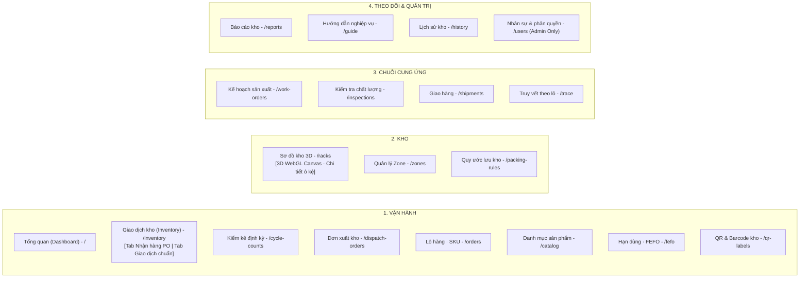

# DANH MỤC TOÀN BỘ CHỨC NĂNG HỆ THỐNG (FULL FEATURE CATALOG)
## HỆ THỐNG QUẢN LÝ KHO THÔNG MINH MASAN CONSUMER WMS
**Mã tài liệu:** WMS-CATALOG-01  
**Phiên bản:** Phase 7 Staging & Production Readiness  
**Ngày phát hành:** 15/11/2026  
**Chủ trì:** Antigravity Senior WMS Business Analyst & QA Team  
**Môi trường khảo sát:** Staging (`http://localhost:4350`) và QA (`http://localhost:4340`)  

---

### 1. TỔNG QUAN KIẾN TRÚC ĐIỀU HƯỚNG GIAO DIỆN (NAVIGATION ARCHITECTURE)

Hệ thống MASAN Consumer WMS được tổ chức theo thanh điều hướng bên trái (Sidebar Navigation) phân thành 4 nhóm nghiệp vụ chính, kết hợp với các màn hình chi tiết và các tab chức năng:

---

### 2. CHI TIẾT DANH MỤC CHỨC NĂNG THEO TỪNG PHÂN HỆ

#### PHÂN HỆ A: BẢNG ĐIỀU KHIỂN & GIÁM SÁT VẬN HÀNH (DASHBOARD)
- **Đường dẫn giao diện:** `/`
- **Quyền sử dụng:** Tất cả vai trò (`admin`, `warehouse_manager`, `warehouse_staff`).

| Mã chức năng | Tên chức năng | Công dụng nghiệp vụ | Thành phần giao diện & Nút bấm | Backend API tương ứng |
|---|---|---|---|---|
| `DASH-01` | Thẻ chỉ số tổng tồn kho (Total Inventory) | Hiển thị tổng số lượng sản phẩm vật lý (pcs) hiện có trong toàn bộ các phân khu kho. | Card hiển thị số: `21,059 sản phẩm`. | `GET /api/inventory/transactions`, `GET /api/parts` |
| `DASH-02` | Thống kê danh mục SKU (Total SKUs) | Đếm tổng số lượng mặt hàng (SKU) Masan Consumer đang được quản lý. | Card hiển thị số: `50 SKUs`. | `GET /api/parts` (Unique SKU aggregation) |
| `DASH-03` | Theo dõi đơn chờ xuất (Pending Outbound) | Số lượng đơn hàng xuất kho đang trong trạng thái chờ xử lý hoặc đã giữ tồn. | Card hiển thị số đơn: `3 đơn chờ xuất`. | `GET /api/inventory/dispatches` |
| `DASH-04` | Giám sát hàng chờ kiểm định (Pending QC) | Số lượng hàng hóa mới tiếp nhận đang chờ bộ phận QC kiểm định ngoại quan và chỉ tiêu. | Card cảnh báo màu vàng: `12,300 đơn vị`. | `GET /api/inspections/lot-status` |
| `DASH-05` | Giám sát hàng cách ly tạm (On Hold) | Số lượng hàng hóa bị bộ phận QC đánh giá LỖI (NG) hoặc hư hỏng chờ hủy/trả NCC. | Card cảnh báo màu đỏ: `750 đơn vị`. | `GET /api/inspections/lot-status` |
| `DASH-06` | Cảnh báo hạn dùng (<60 ngày) | Số lượng lô hàng sắp hết hạn trong vòng 60 ngày cần ưu tiên đẩy bán hoặc xuất khuyến mãi. | Card cảnh báo cam: `49 đơn vị`. | `GET /api/parts` (Hạn date so sánh thời gian thực) |
| `DASH-07` | Tỉ lệ lấp đầy sức chứa kệ (Rack Utilization) | Đo lường công suất sử dụng vị trí lưu trữ trên toàn bộ hệ thống giá kệ. | Thanh tiến trình (Progress bar): `20% (147/740 ô kệ)`. | `GET /api/inventory/heatmap` |
| `DASH-08` | Biểu đồ luồng nhập/xuất 7 ngày | Trực quan hóa biến động số lượng hàng nhập và hàng xuất trong tuần gần nhất. | Biểu đồ vùng/cột Recharts tương tác theo ngày. | `GET /api/inventory/transaction-summary?days=7` |
| `DASH-09` | Dòng sự kiện giao dịch trực tiếp (Live Stream) | Cập nhật thời gian thực các thao tác nhập, xuất, chuyển vị trí vừa diễn ra trong kho. | Danh sách luồng sự kiện (Feed) có nhãn thời gian và người thực hiện. | `GET /api/history` |
| `DASH-10` | Danh mục công việc cần xử lý ngay (Action Items)| Nhắc việc thủ kho: Biên bản sai lệch chờ duyệt, phiếu kiểm định tồn đọng. | Danh sách thẻ công việc kèm nút chuyển hướng nhanh. | Client-side rule engine |

---

#### PHÂN HỆ B: QUẢN LÝ NHẬP KHO & ĐỐI CHIẾU PO (INBOUND RECEIVING)
- **Đường dẫn giao diện:** `/inventory?tab=receiving`
- **Quyền sử dụng:** Nhân viên kho (`warehouse_staff`) tạo phiếu; Quản lý (`warehouse_manager`/`admin`) phê duyệt.

| Mã chức năng | Tên chức năng | Công dụng nghiệp vụ | Thành phần giao diện & Nút bấm | Backend API tương ứng |
|---|---|---|---|---|
| `INB-01` | Tạo phiếu nhận hàng theo PO | Tiếp nhận hàng hóa giao từ nhà máy Masan hoặc nhà cung cấp nguyên vật liệu. | Form nhập liệu: Mã PO, Mã SKU, Tên hàng, Số lô, Ngày hết hạn. | `POST /api/receiving` |
| `INB-02` | Đối chiếu nhận đủ (PO Match) | Tự động xác thực số lượng thực nhận bằng số lượng kế hoạch PO. | Ô nhập: `expectedQuantityPcs` và `receivedQuantityPcs`. Nút: "Ghi nhận phiếu nhận hàng". | `POST /api/receiving` (`discrepancyType: MATCH`) |
| `INB-03` | Xử lý nhận thiếu hàng (Shortage) | Tự động tính chênh lệch âm và phát sinh Biên bản sai lệch giao thiếu. | Hệ thống tự tính: `received < expected`. Hiển thị nhãn vàng `SHORTAGE`. | `POST /api/receiving` (`status: DISCREPANCY_PENDING`) |
| `INB-04` | Xử lý nhận thừa hàng (Overage) | Phát hiện giao thừa so với đơn đặt hàng và yêu cầu giải trình lý do. | Hệ thống tự tính: `received > expected`. Hiển thị nhãn xanh dương `OVERAGE`. | `POST /api/receiving` (`status: DISCREPANCY_PENDING`) |
| `INB-05` | Phân lập hàng hư hỏng về Dock Cách ly (Zone-Q) | Tách riêng các thùng hàng bị móp vỡ, rách bao bì và chuyển tự động về kệ Dock Zone-Q. | Ô nhập: `damagedQuantityPcs` và `discrepancyReason`. Tự gán `quarantineRackId`. | `POST /api/receiving` |
| `INB-06` | Quản lý phê duyệt biên bản sai lệch (SoD) | Quản lý kho xem xét biên bản giao nhận 3 bên và xác nhận nhập kho số lượng thực tế. | Nút: "Phê duyệt" màu xanh tại từng dòng biên bản sai lệch. Cấm nhân viên tạo tự bấm. | `POST /api/receiving/:id/approve` |
| `INB-07` | Thống kê KPI biên bản nhận hàng | Tổng hợp nhanh số biên bản chờ duyệt, đã duyệt, số lượng thiếu và số lượng hỏng. | 4 thẻ thống kê đầu trang: Biên bản chờ duyệt, Đã duyệt, Thiếu, Hàng hỏng Zone-Q. | `GET /api/receiving/summary` |
| `INB-08` | Tra cứu lịch sử phiếu nhận hàng | Tìm kiếm và xem lại toàn bộ các đợt tiếp nhận hàng hóa theo mã PO hoặc số phiếu REC. | Bảng dữ liệu có phân trang, thanh tìm kiếm mã PO và bộ lọc trạng thái. | `GET /api/receiving` |

---

#### PHÂN HỆ C: QUẢN LÝ XUẤT KHO & GIỮ TỒN MỀM FEFO (OUTBOUND DISPATCH)
- **Đường dẫn giao diện:** `/dispatch-orders`
- **Quyền sử dụng:** Quản lý kho điều phối giữ tồn; Nhân viên kho thực hiện soạn hàng và xuất xe.

| Mã chức năng | Tên chức năng | Công dụng nghiệp vụ | Thành phần giao diện & Nút bấm | Backend API tương ứng |
|---|---|---|---|---|
| `OUT-01` | Tạo đơn xuất kho giữ tồn mềm (Soft Reservation) | Giữ trước số lượng tồn kho theo nguyên tắc FEFO (hạn gần xuất trước) mà chưa trừ tồn vật lý. | Form: Mã tham chiếu DO, Chọn SKU, Số lượng xuất. Header: `Idempotency-Key`. | `POST /api/inventory/dispatches` |
| `OUT-02` | Tự động loại trừ hàng lỗi khỏi FEFO | Thuật toán quét kho tự động bỏ qua các lô hàng đang bị QC gắn cờ LỖI (NG) hoặc HOLD. | Tích hợp ngầm trong thuật toán phân bổ tồn kho khả dụng (ATP). | `GET /api/inventory/dispatches/availability` |
| `OUT-03` | Xác nhận soạn hàng (Picking Execution) | Nhân viên kho lấy hàng tại ô kệ chỉ định và xác nhận đã lấy đủ hàng vào xe đẩy gom. | Nút: "Xác nhận soạn (Pick)". Chuyển trạng thái thẻ đơn từ `RESERVED` sang `PICKED`. | `POST /api/inventory/dispatches/:id/pick` |
| `OUT-04` | Xác nhận xuất kho & Trừ tồn (Shipping) | Đóng hàng lên xe tải vận chuyển, trừ tồn kho sổ sách vĩnh viễn và ghi sổ cái giao dịch. | Nút: "Xác nhận xuất kho (Ship)". Chuyển trạng thái thẻ sang `SHIPPED`. | `POST /api/inventory/dispatches/:id/ship` |
| `OUT-05` | Hủy đơn giữ tồn & Giải phóng ATP (Cancel) | Khách hủy đơn hoặc xe không đến; lập tức giải phóng số lượng đã giữ về tồn khả dụng. | Nút: "Hủy giữ tồn (Cancel)". Đơn chuyển sang `CANCELLED`, hoàn trả 100% ATP. | `POST /api/inventory/dispatches/:id/cancel` |
| `OUT-06` | Tra cứu thẻ đơn xuất kho | Xem danh sách các đơn xuất đang hoạt động, tiến độ lấy hàng và danh sách phân bổ lô. | Danh sách thẻ đơn xuất có thanh tìm kiếm SKU và bộ lọc trạng thái. | `GET /api/inventory/dispatches` |

---

#### PHÂN HỆ D: QUẢN LÝ TỒN KHO & ĐIỀU CHUYỂN (INVENTORY OPERATIONS)
- **Đường dẫn giao diện:** `/inventory?tab=standard`
- **Quyền sử dụng:** Nhân viên kho thực thi điều chuyển; Quản lý kho giám sát.

| Mã chức năng | Tên chức năng | Công dụng nghiệp vụ | Thành phần giao diện & Nút bấm | Backend API tương ứng |
|---|---|---|---|---|
| `INV-01` | Nhập kho thủ công (Manual Inbound) | Nhập hàng lẻ không qua PO (hàng mẫu nghiên cứu R&D, hàng thu hồi sự kiện). | Form chọn loại giao dịch: `INBOUND`, chọn PART, số lượng, trọng lượng, ô kệ đích. | `POST /api/inventory/transactions` |
| `INV-02` | Xuất kho thủ công (Manual Outbound) | Xuất hủy hàng hỏng hoặc xuất mẫu kiểm nghiệm chất lượng nội bộ. | Form chọn loại giao dịch: `OUTBOUND`, chọn PART cần xuất, số lượng. | `POST /api/inventory/transactions` |
| `INV-03` | Điều chuyển vị trí ô kệ (Transfer) | Di chuyển hàng hóa từ kệ này sang kệ khác (hoặc từ Zone này sang Zone khác). | Form chọn `TRANSFER`, chọn PART nguồn, Kệ đích (`toRackId`), Ô đích (`toSlot`). | `POST /api/inventory/transactions` |
| `INV-04` | Kiểm soát quy tắc Một kệ - Một SKU | Ngăn chặn việc chuyển nhầm SKU khác ngành hàng vào kệ đã có hàng (chống nhiễm chéo). | Hệ thống tự kiểm tra khi submit, trả về mã lỗi `400/409` nếu vi phạm. | `assertRackProductFamily` logic |
| `INV-05` | Tra cứu tồn kho chi tiết (Inventory List) | Xem danh sách toàn bộ các PART tồn kho, số lô, hạn sử dụng, số lượng và vị trí lưu trữ. | Bảng dữ liệu chi tiết có bộ lọc theo Phân khu (Zone), Kệ (Rack) và tìm kiếm SKU. | `GET /api/parts`, `GET /api/containers` |

---

#### PHÂN HỆ E: SƠ ĐỒ KHO 3D TRỰC QUAN (3D DIGITAL TWIN)
- **Đường dẫn giao diện:** `/racks`
- **Quyền sử dụng:** Tất cả vai trò.

| Mã chức năng | Tên chức năng | Công dụng nghiệp vụ | Thành phần giao diện & Nút bấm | Backend API tương ứng |
|---|---|---|---|---|
| `3D-01` | Không gian kho 3 chiều tương tác (WebGL Canvas) | Mô phỏng không gian kho thời gian thực với các khối kệ, lối đi và phân khu Zone A, B, C. | Khung hình 3D điều khiển bằng chuột: Xoay (Rotate), Thu phóng (Zoom), Di chuyển (Pan). | Three.js WebGL Engine |
| `3D-02` | Trực quan hóa trạng thái chất lượng ô kệ | Đổi màu các kiện hàng trên kệ theo kết quả QC (Xanh lá: Đạt, Vàng: Chờ duyệt, Đỏ: Cách ly). | Mã màu tự động gán vào khối hộp (Mesh) dựa trên dữ liệu chất lượng lô hàng. | `GET /api/inspections/lot-status` |
| `3D-03` | Bộ lọc Phân khu & Chọn kệ (Zone/Rack Filter)| Lọc nhanh khung nhìn để chỉ hiển thị các dãy kệ thuộc phân khu đang quan tâm. | Dropdown chọn Zone (`ZONE-A`, `ZONE-B`,...) và Dropdown chọn Kệ (`R01`, `R02`,...). | Client-side 3D Scene Manager |
| `3D-04` | Xem chi tiết ô kệ & Sức chứa (Bin Inspector) | Click trực tiếp vào một ô trên mô hình 3D để xem mặt hàng lưu trữ, số carton, kg, CBM. | Modal popup chi tiết ô kệ: Tên sản phẩm, số lượng, sức chứa đã dùng / còn trống. | `GET /api/containers/:id` |
| `3D-05` | Kích hoạt điều chuyển từ sơ đồ 3D | Bấm nút điều chuyển ngay trên popup ô kệ mà không cần gõ lại mã vị trí nguồn. | Nút "Điều chuyển vị trí" trong modal, tự động mở form điều chuyển với nguồn điền sẵn. | Liên kết sang `/inventory` |

---

#### PHÂN HỆ F: KIỂM ĐỊNH CHẤT LƯỢNG (QUALITY CONTROL - QC)
- **Đường dẫn giao diện:** `/inspections`
- **Quyền sử dụng:** Giám sát Chất lượng (`staging.qc@masan.local` / `warehouse_manager`).

| Mã chức năng | Tên chức năng | Công dụng nghiệp vụ | Thành phần giao diện & Nút bấm | Backend API tương ứng |
|---|---|---|---|---|
| `QC-01` | Tạo phiếu kiểm định chất lượng lô hàng | Ghi nhận kết quả lấy mẫu kiểm tra ngoại quan, bao bì, hạn dùng theo chuẩn IATF 16949. | Form: Chọn SKU, Số lô, Cỡ mẫu (Sample Size), Số đạt (Pass), Số lỗi (Fail), Mã lỗi. | `POST /api/inspections` |
| `QC-02` | Phán quyết ĐẠT (Judgment: OK) | Đánh dấu lô hàng đạt chuẩn an toàn thực phẩm, mở khóa trạng thái `AVAILABLE` cho xuất kho. | Nút chọn: `Phán quyết: OK`. Hệ thống cập nhật bảng `inventory_lots`. | `POST /api/inspections` (`judgment: OK`) |
| `QC-03` | Phán quyết LỖI (Judgment: NG) & Cách ly | Đánh dấu lô hàng không đạt, lập tức khóa trạng thái `BLOCKED/HOLD`, ngăn xuất kho. | Nút chọn: `Phán quyết: NG`, chọn mã lỗi (`D-SEAL`, `D-DAMAGED`, `D-FOREIGN`). | `POST /api/inspections` (`judgment: NG`) |
| `QC-04` | Phân lập chất lượng theo SKU (TRC-04) | Đảm bảo phán quyết lỗi của SKU này không làm ảnh hưởng đến SKU khác có cùng số lô. | Cơ chế phân phạm vi chất lượng `quality_scope_id` trong database. | `inspections.service.ts` logic |
| `QC-05` | Tra cứu danh bạ chất lượng lô hàng | Tìm kiếm lịch sử kiểm định theo mã phiếu (`INS-***`), số lô sản xuất hoặc mã lỗi. | Bảng danh mục 147+ phiếu kiểm định có thanh tìm kiếm và bộ lọc theo kết luận. | `GET /api/inspections` |
| `QC-06` | Dashboard chỉ số chất lượng | Theo dõi tỉ lệ kiểm định đạt (Pass Rate), số phiếu NG, số phiếu đang chờ thẩm tra lại. | 4 thẻ thống kê đầu trang: Tổng phiếu, Tỉ lệ đạt (%), Phiếu NG, Phiếu HOLD. | `GET /api/inspections/lot-status` |

---

#### PHÂN HỆ G: KIỂM KÊ KHO HAI VÒNG ĐỘC LẬP (CYCLE COUNTING)
- **Đường dẫn giao diện:** `/cycle-counts`
- **Quyền sử dụng:** Quản lý mở đợt; Staff đếm vòng 1; Inventory Auditor đếm vòng 2; Admin phê duyệt.

| Mã chức năng | Tên chức năng | Công dụng nghiệp vụ | Thành phần giao diện & Nút bấm | Backend API tương ứng |
|---|---|---|---|---|
| `CYC-01` | Khởi tạo phiên kiểm kê định kỳ | Quản lý kho chọn vị trí kệ cần kiểm đếm và chỉ định 2 nhân sự kiểm đếm độc lập. | Form: Chọn Phân khu, Chọn Kệ, Chọn Ô & PART, Chỉ định Counter 1 và Counter 2. | `POST /api/inventory/cycle-counts` |
| `CYC-02` | Đếm mù vòng 1 (Blind Count Round 1) | Nhân viên thứ nhất đếm thực tế và nhập số liệu (hoàn toàn không thấy số liệu sổ sách). | Form nhập: Số lượng (pcs), Số thùng (cartons), Trọng lượng (kg). Nút: "Ghi nhận lần đếm 1". | `POST /api/inventory/cycle-counts/:id/count` |
| `CYC-03` | Đếm độc lập vòng 2 (Blind Count Round 2) | Kiểm toán viên độc lập đếm lại và nhập số liệu (không thấy số liệu của người đếm 1). | Form nhập: Số lượng, Số thùng, Trọng lượng. Nút: "Ghi nhận lần đếm 2". | `POST /api/inventory/cycle-counts/:id/count` |
| `CYC-04` | Kiểm soát phân quyền SoD chống tự duyệt | Ngăn chặn người tạo phiếu hoặc người tham gia đếm tự bấm phê duyệt điều chỉnh số dư. | Nút duyệt bị ẩn hoặc backend ném ngoại lệ `403 Forbidden` khi cố tình duyệt. | `MasanAccessGuard` & SoD logic |
| `CYC-05` | Đối chiếu & Phê duyệt cấp Admin (Approval) | Quản trị viên đối chiếu kết quả 2 vòng đếm, nhập lý do kiểm toán và xác nhận điều chỉnh. | Nút: "Phê duyệt điều chỉnh". Nhập ô "Lý do phê duyệt". Tự động tạo bút toán điều chỉnh. | `POST /api/inventory/cycle-counts/:id/approve` |
| `CYC-06` | Hủy bỏ đợt kiểm kê (Void Session) | Đóng phiên kiểm kê khi phát hiện tồn kho bị biến động giữa chừng hoặc sai sót vị trí. | Nút: "Hủy bỏ đợt kiểm kê". Nhập lý do hủy. Chuyển trạng thái sang `CLOSED`. | `POST /api/inventory/cycle-counts/:id/void` |
| `CYC-07` | Xuất báo cáo kiểm kê CSV | Tải tệp tin kết quả đối soát các đợt kiểm kê đã hoàn tất phục vụ kiểm toán tài chính. | Nút: "Xuất CSV" đầu bảng lịch sử kiểm kê. | Client-side CSV Exporter |

---

#### PHÂN HỆ H: THEO DÕI HẠN DÙNG & XẾP HẠNG FEFO (FEFO MONITORING)
- **Đường dẫn giao diện:** `/fefo`
- **Quyền sử dụng:** Tất cả vai trò.

| Mã chức năng | Tên chức năng | Công dụng nghiệp vụ | Thành phần giao diện & Nút bấm | Backend API tương ứng |
|---|---|---|---|---|
| `FEFO-01` | Bảng phân loại cảnh báo hạn dùng | Phân chia toàn bộ tồn kho thành 3 nhóm: Hết hạn/Nguy cơ cao (<30 ngày), Cận date (30-90 ngày), An toàn. | Bảng dữ liệu có gắn thẻ màu trạng thái (Badge): Đỏ, Vàng, Xanh lá. | `GET /api/parts` |
| `FEFO-02` | Thứ tự ưu tiên xuất kho tự động | Liệt kê danh sách các lô hàng theo thứ tự ngày hết hạn tăng dần (lô date gần nhất xếp đầu). | Cột "Thứ tự ưu tiên FEFO" (Priority Rank) đánh số thứ tự từ 1 đến N. | Client-side FEFO Sorter |
| `FEFO-03` | Lọc hạn dùng theo ngành hàng | Lọc danh sách theo ngành Thực phẩm khô, Gia vị nước mắm hoặc Nước giải khát. | Dropdown chọn ngành hàng và thanh tìm kiếm theo tên SKU. | Client-side Filtering |

---

#### PHÂN HỆ I: TRUY XUẤT NGUỒN GỐC CHUỖI CUNG ỨNG (TRACEABILITY)
- **Đường dẫn giao diện:** `/trace`
- **Quyền sử dụng:** Tất cả vai trò.

| Mã chức năng | Tên chức năng | Công dụng nghiệp vụ | Thành phần giao diện & Nút bấm | Backend API tương ứng |
|---|---|---|---|---|
| `TRC-01` | Tra cứu chuỗi hành trình lô hàng | Nhập số lô sản xuất để xem toàn bộ vòng đời: Ngày sản xuất, Ngày nhận, Kệ lưu, Đơn xuất, Xe giao. | Ô tìm kiếm: "Nhập số lô sản xuất (VD: DQA-COMMON-01)". Nút: "Tra cứu". | `GET /api/inspections`, `GET /api/receiving` |
| `TRC-02` | Sơ đồ cây phả hệ lô hàng (Genealogy Tree) | Trực quan hóa mối liên kết giữa Lô nguyên liệu -> Lô thành phẩm -> Đơn hàng khách hàng. | Biểu đồ timeline dạng khối bước tiến trình (Step Progress View). | Client-side Tree Renderer |

---

#### PHÂN HỆ J: DANH MỤC SẢN PHẨM & QUẢN TRỊ NGƯỜI DÙNG (CATALOG & USERS)
- **Đường dẫn giao diện:** `/catalog` và `/users`
- **Quyền sử dụng:** `/catalog`: Tất cả vai trò; `/users`: Chỉ Quản trị viên (`admin`).

| Mã chức năng | Tên chức năng | Công dụng nghiệp vụ | Thành phần giao diện & Nút bấm | Backend API tương ứng |
|---|---|---|---|---|
| `CAT-01` | Danh mục sản phẩm Masan Consumer | Xem quy cách chuẩn của 50 SKU Masan (kích thước thùng mm, khối CBM, cân nặng kg, hạn dùng). | Bảng danh mục sản phẩm kèm ảnh minh họa và thông số kỹ thuật bao bì. | `GET /api/parts` (Distinct Catalog View) |
| `USR-01` | Quản lý danh sách người dùng kho | Xem danh sách tài khoản, email đăng nhập, vai trò hệ thống và trạng thái hoạt động. | Bảng người dùng có hiển thị vai trò (Admin, Quản lý kho, Nhân viên). | `GET /api/auth/users` |
| `USR-02` | Thêm mới tài khoản & Gán vai trò | Tạo tài khoản mới cho thủ kho, QC, kế toán và cấp quyền theo ma trận RBAC. | Nút: "Thêm người dùng mới". Form nhập: Tên, Email, Mật khẩu, Chọn vai trò. | `POST /api/auth/users` |
| `USR-03` | Đổi mật khẩu & Khóa tài khoản | Đặt lại mật khẩu cho nhân viên quên mật khẩu hoặc vô hiệu hóa tài khoản nhân viên nghỉ việc. | Nút "Sửa" và "Khóa" tại từng dòng tài khoản. | `PATCH /api/auth/users/:id` |
