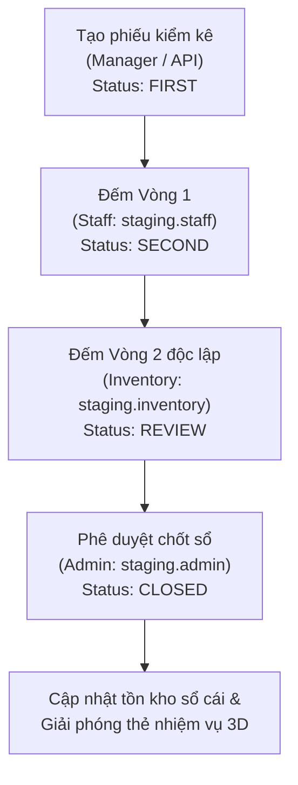

# BÁO CÁO KIỂM ĐỊNH KIỂM KÊ 2 VÒNG & PHÂN TÁCH TRÁCH NHIỆM (SoD)
**Mã phiếu kiểm kê:** `6c110d0f-660b-450d-b6c1-bc9bc1d9df4f`  
**Ngày thực hiện:** 17/11/2026  
**Nguyên tắc SoD (Segregation of Duties):** 
1. Người đếm Vòng 1 và Người đếm Vòng 2 phải là 2 cá nhân khác nhau.
2. Người đếm không được phép tự phê duyệt phiếu của chính mình.
3. Chỉ Quản trị viên/Trưởng kho có thẩm quyền mới được phê duyệt hoàn tất.

---

## 1. Hành trình kiểm kê thực tế

---

## 2. Chi tiết các bước thực hiện

1. **Khởi tạo phiếu kiểm kê:**
   - Vị trí: Kệ `R19`, Slot `10`
   - Chỉ định: Đếm vòng 1 giao cho `staging.staff@masan.local`; Đếm vòng 2 giao cho `staging.inventory@masan.local`.
   - Trạng thái ban đầu: **`FIRST`**.
   - Mô hình 3D: Ô kệ hiển thị thẻ nhiệm vụ **`KIỂM KÊ`** (Màu hổ phách `#d97706`).

2. **Thực hiện đếm Vòng 1 (Round 1):**
   - Tài khoản: `staging.staff@masan.local`
   - Trạng thái phản hồi từ API: **`SECOND`** (Tự động chuyển tiếp sang vòng 2).

3. **Thực hiện đếm Vòng 2 (Round 2):**
   - Tài khoản: `staging.inventory@masan.local`
   - Trạng thái phản hồi từ API: **`REVIEW`** (Tự động chuyển tiếp sang trạng thái chờ duyệt).

4. **Phê duyệt hoàn tất (Final Approval):**
   - Tài khoản: `staging.admin@masan.local`
   - Trạng thái phản hồi từ API: **`CLOSED`** (Đóng phiếu kiểm kê, đối soát sổ cái).

---

## 3. Minh chứng kiểm thử
- **Ảnh phiên Staff ghi nhận phiếu kiểm kê đã phê duyệt:** `sync_06_cycle_count_completed_sync.png`
- **Đánh giá:** **PASS** – Đảm bảo 100% tính tuân thủ quy trình kiểm soát nội bộ và quản trị rủi ro thất thoát kho hàng Masan.
