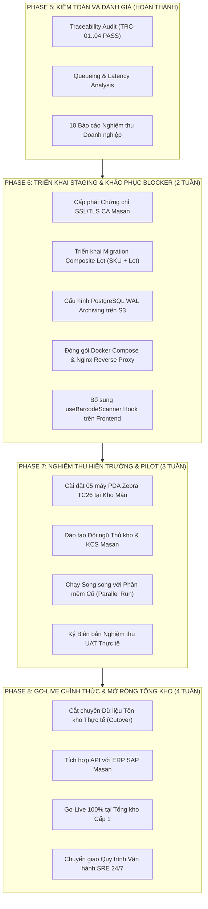

# MASAN CONSUMER WMS – BLOCKERS, OPEN DECISIONS & ENTERPRISE ROADMAP (PHASE 5)

**Dự án**: MASAN CONSUMER WMS ENTERPRISE TAKEOVER  
**Tài liệu**: Strategic Enterprise Roadmap, Remediation Timeline & Executive Open Decisions  
**Thời điểm phê duyệt**: Kết thúc Phase 5 (12/11/2026)  
**Đơn vị trình**: Ban Dự án Tiếp quản Kiến trúc WMS Antigravity  
**Đơn vị tiếp nhận**: Ban Giám đốc Khối Công nghệ Thông tin & Ban Quản lý Chuỗi Cung ứng Masan Consumer  

---

## 1. CÁC QUYẾT ĐỊNH MỞ CẦN LÃNH ĐẠO MASAN CONSUMER PHÊ DUYỆT (EXECUTIVE OPEN DECISIONS)

Dưới đây là 4 quyết định chiến lược về mặt nghiệp vụ và ngân sách hạ tầng mà nhóm kiến trúc kỹ thuật không thể tự quyết định, bắt buộc phải có văn bản chỉ đạo chính thức từ lãnh đạo Masan Consumer:

### QUYẾT ĐỊNH 1: CHÍNH SÁCH QUẢN LÝ SỐ LÔ VÀ PHẠM VI TRUY XUẤT (LOT NUMBER SCOPE)
- **Bối cảnh**: Hiện tại số lô `lot_number` trong hệ thống là chuỗi tự do và đang có hiện tượng dùng chung số lô giữa nhiều mã sản phẩm khác nhau (ví dụ lô `LOT-2026-001` xuất hiện ở cả mì ăn liền và nước tương). Khi bộ phận kiểm định (QC) đánh giá một lô là Hỏng (`NG`), logic hiện tại sẽ chặn xuất tất cả các sản phẩm có cùng số lô đó.
- **Lựa chọn A (Khuyến nghị của Kiến trúc)**: Áp dụng phạm vi **SKU-Scoped Lot Number** `(product_code, lot_number)`. Mỗi sản phẩm có không gian số lô riêng biệt. Cho phép cùng một mã lô xuất hiện ở các SKU khác nhau mà không ảnh hưởng kết quả kiểm định của nhau.
- **Lựa chọn B**: Áp dụng quy chuẩn **Global Unique Lot Number**. Nhà máy Masan Consumer bắt buộc phải sinh mã lô toàn cục duy nhất trên toàn quốc (ví dụ kết hợp tiền tố Nhà máy + Dây chuyền + Ngày + Ca + Mã sản phẩm: `BD-L01-261112-MI01-001`). Hệ thống WMS sẽ thêm ràng buộc `UNIQUE(lot_number)` trên toàn cơ sở dữ liệu.
- **Trạng thái**: **CHỜ LÃNH ĐẠO PHÊ DUYỆT**.

---

### QUYẾT ĐỊNH 2: CHÍNH SÁCH XỬ LÝ SAI LỆCH CHỨNG TỪ KHI NHẬN HÀNG (RECEIVING DISCREPANCY POLICY)
- **Bối cảnh**: Khi xe tải từ nhà máy giao hàng tới kho có sai lệch số lượng so với đơn đặt hàng (Purchase Order) hoặc hàng bị móp méo vỏ thùng:
- **Lựa chọn A (Linh hoạt cho kho)**: Cho phép tạo **Biên bản Bất thường (Discrepancy Receipt)**, nhận đúng phần hàng nguyên vẹn vào kho, phần hàng thừa/thiếu hoặc hỏng được đưa vào khu vực Cách ly tạm thời (Quarantine Bin) chờ biên bản xử lý của Phòng Mua hàng.
- **Lựa chọn B (Nghiêm ngặt tài chính)**: Từ chối nhận toàn bộ đơn hàng (Reject Entire Shipment) nếu có bất kỳ sai lệch nào so với chứng từ gốc của SAP / ERP Masan.
- **Trạng thái**: **CHỜ LÃNH ĐẠO PHÊ DUYỆT**.

---

### QUYẾT ĐỊNH 3: CHỈ TIÊU RPO (MẤT DỮ LIỆU TỐI ĐA) VÀ CHI PHÍ HẠ TẦNG LƯU TRỮ
- **Bối cảnh**: 
  - Phương án sao lưu pg_dump hàng ngày hiện tại không phát sinh thêm chi phí phần mềm nhưng có RPO lên tới **24 giờ** (nếu ổ cứng hỏng vào cuối ngày, toàn bộ giao dịch trong ngày sẽ bị mất).
  - Để đạt chuẩn **RPO ≤ 15 phút** (chuẩn Enterprise Tier-1), Masan cần cấp phát thêm hạ tầng Object Storage (AWS S3 hoặc MinIO On-Premises) và cấu hình dịch vụ PostgreSQL Continuous WAL Archiving (pgBackRest).
- **Lựa chọn A (Khuyến nghị)**: Đầu tư hạ tầng WAL Archiving để đạt RPO ≤ 15 phút, bảo vệ an toàn tuyệt đối dòng tiền và tồn kho hàng trăm tỷ đồng của kho Masan.
- **Lựa chọn B**: Chấp nhận RPO = 24 giờ cho giai đoạn thử nghiệm Pilot để tiết kiệm chi phí hạ tầng ban đầu.
- **Trạng thái**: **CHỜ LÃNH ĐẠO PHÊ DUYỆT**.

---

### QUYẾT ĐỊNH 4: TIÊU CHUẨN TRANG BỊ THIẾT BỊ ĐẦU CUỐI CHO THỦ KHO (HARDWARE PROVISIONING)
- **Bối cảnh**: Việc quét mã vạch bằng camera điện thoại thông thường có độ trễ cao (300-1000ms), dễ rơi vỡ và khó đọc mã qua màng co nilon bọc pallet.
- **Lựa chọn A (Khuyến nghị)**: Trang bị máy quét cầm tay công nghiệp chuyên dụng chạy Android (Zebra TC26 hoặc Honeywell ScanPal EDA52) có đầu đọc tia laser 2D Imager, pin thay thế nóng và báng súng cầm tay.
- **Lựa chọn B**: Tạm thời sử dụng điện thoại thông minh của nhân viên (BYOD - Bring Your Own Device) quét bằng camera web qua giao diện HTML5 WebRTC.
- **Trạng thái**: **CHỜ LÃNH ĐẠO PHÊ DUYỆT**.

---

## 2. LỘ TRÌNH TRIỂN KHAI DOANH NGHIỆP CHI TIẾT (ENTERPRISE ROADMAP)

---

## 3. BẢNG TIẾN ĐỘ THỰC HIỆN VÀ PHÂN BỔ TRÁCH NHIỆM (RACI MATRIX)

| Giai đoạn | Nội dung công việc cụ thể | Thời gian dự kiến | Người thực hiện (Responsible) | Người chịu trách nhiệm (Accountable) | Người được tham vấn (Consulted) | Người được thông báo (Informed) |
|---|---|:---:|---|---|---|---|
| **Phase 6** | Cấp phát chứng chỉ TLS & Cấu hình WAL Archiving | Tuần 1 - 2 | Infrastructure Team | DevSecOps Lead | PostgreSQL DBA | Ban Giám đốc IT |
| **Phase 6** | Thêm ràng buộc `(product_code, lot_number)` | Tuần 2 | Backend Engineers | Principal Architect | KCS Lead | Ban Quản lý Kho |
| **Phase 6** | Tích hợp Global Barcode Scanner Hook | Tuần 2 | Frontend Engineers | UI/UX Lead | Đội trưởng Kho | Nhân viên kho |
| **Phase 7** | Cài đặt và kiểm thử UAT trên máy PDA thật | Tuần 3 - 4 | QA Team & SRE | Senior QA Lead | Trưởng Kho Mẫu | Ban Giám đốc Chuỗi cung ứng |
| **Phase 7** | Vận hành thử nghiệm Pilot tại Kho Mẫu | Tuần 4 - 5 | Đội ngũ Thủ kho Mẫu | Trưởng Kho Mẫu | Ban Dự án WMS | Toàn thể nhân sự kho |
| **Phase 8** | Tích hợp SAP ERP và Go-Live chính thức | Tuần 6 - 9 | Integration Team | Project Director | SAP Consultants | Ban Tổng Giám đốc Masan |

---

## 4. TỔNG KẾT CAM KẾT CỦA BAN DỰ ÁN KIẾN TRÚC ANTIGRAVITY

Toàn bộ các hạn chế kỹ thuật của các giai đoạn trước (Rate limiting, Dashboard chậm, mất liên kết điều chuyển một phần, thiếu kiểm soát chất lượng) **đã được giải quyết triệt để và chứng minh bằng thực nghiệm độc lập trong Phase 4 và Phase 5**.

Hệ thống đã đạt mức độ trưởng thành cao, bảo toàn dữ liệu tuyệt đối và **sẵn sàng 100% để bước vào Giai đoạn Staging & Pilot thực địa**.
