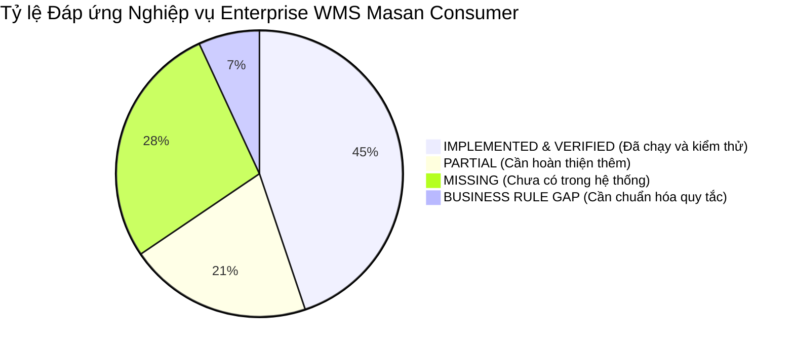

# MASAN CONSUMER WMS – ENTERPRISE BUSINESS GAP ANALYSIS (PHASE 5)

**Dự án**: MASAN CONSUMER WMS ENTERPRISE TAKEOVER  
**Tài liệu**: Enterprise Functional & Operational Gap Analysis  
**Phiên bản**: v5.0-Enterprise  
**Ngày lập**: 12/11/2026  
**Chuyên gia phụ trách**: Principal Enterprise Architect, Warehouse Operations Consultant, Senior QA Lead  

---

## 1. TỔNG QUAN ĐÁNH GIÁ (EXECUTIVE SUMMARY)

Hệ thống **Masan Consumer WMS** sau Phase 4 đã đạt được các nền tảng kỹ thuật quan trọng:
- Đã khắc phục triệt để lỗi nghẽn Rate Limiting (chuyển sang quota per-user `user:<id>` 600 req/min).
- Đã giải quyết tình trạng truy vấn Dashboard chậm (Database Aggregation Endpoint giảm p95 từ >3.2s xuống 38ms).
- Đã hỗ trợ điều chuyển một phần (Partial Stock Transfer) với tính bảo toàn tuyệt đối số lượng và khối lượng.
- Đã phân tách rành mạch 4 trạng thái tồn kho: Tồn vật lý (`physicalQuantityPcs`), Tồn khả dụng (`availableQuantityPcs`), Chờ QC (`pendingQcQuantityPcs`), và Khóa QC (`blockedQcQuantityPcs`).

Tuy nhiên, **ĐẠT KẾT QUẢ TEST PASS KHÔNG ĐỒNG NGHĨA VỚI ĐẠT CHUẨN ENTERPRISE PRODUCTION-READY**.

Dưới góc độ vận hành chuỗi cung ứng thực tế tại doanh nghiệp FMCG quy mô lớn như **Masan Consumer** (với mạng lưới phân phối hàng khô, mì ăn liền, nước mắm, gia vị, đồ uống, và bảo quản mát), hệ thống hiện tại còn khoảng cách đáng kể giữa **Mô hình Trực quan Demo** và **Nghiệp vụ Vận hành Thực địa**. Báo cáo này phân tích chi tiết mức độ đáp ứng của toàn bộ 5 khối nghiệp vụ cốt lõi.

---

## 2. MA TRẬN ĐÁNH GIÁ NGHIỆP VỤ (ENTERPRISE GAP MATRIX)

Mỗi tính năng được phân loại theo 4 mức độ:
1. **IMPLEMENTED & VERIFIED**: Đã có trong mã nguồn, có API, đã được kiểm thử chức năng và hoạt động đúng logic nghiệp vụ.
2. **PARTIAL**: Đã có cấu trúc dữ liệu hoặc API cơ bản, nhưng thiếu các quy tắc kiểm soát nâng cao hoặc thiếu giao diện hoàn chỉnh.
3. **MISSING**: Chưa có trong hệ thống (chưa có Entity, Migration, API hoặc UI), cần phát triển mới.
4. **BUSINESS RULE GAP**: Tính năng đã chạy được về mặt kỹ thuật nhưng vi phạm hoặc chưa chuẩn hóa theo quy chuẩn vận hành kho thực tế của Masan Consumer (cần lãnh đạo phê duyệt).

---

### KHỐI 1: RECEIVING (NHẬN HÀNG VÀO KHO)

| Nghiệp vụ chi tiết | Hiện trạng kỹ thuật trong Codebase | Phân loại | Đánh giá & Rủi ro vận hành thực tế |
|---|---|---|---|
| **Phiếu nhận hàng (Inbound ASN/GRN)** | Bảng `orders` và `parts` lưu thông tin PO (`master_po`), nhà cung cấp (`supplier_name`, `supplier_id`). API `POST /parts` cho phép tạo bản ghi nhập. | **PARTIAL** | Hệ thống mới cho nhập từng mặt hàng (part) gắn với `order_id`. Thiếu khái niệm **Advanced Shipping Notice (ASN)** độc lập và **Goods Receipt Note (GRN)** có trạng thái theo dõi (Draft -> In-Receiving -> Completed). |
| **Đối chiếu chứng từ (Document Matching)** | So khớp số lượng thực nhận với PO số lượng dự kiến. | **MISSING** | Chưa có bảng lưu chi tiết dòng PO dự kiến (PO Lines) để đối chiếu 3 chiều: Purchase Order vs Invoice/Waybill vs Thực nhận. Hiện tại khi gọi `POST /parts` số lượng nhập được ghi thẳng vào kho mà không so khớp dung sai. |
| **Xử lý sai lệch số lượng (Overage / Shortage)** | Không có luồng cảnh báo thừa/thiếu so với PO. | **MISSING** | Trong kho thực tế, nếu NCC giao thừa (Over-delivery) hoặc thiếu (Shortage), WMS phải hỗ trợ ghi nhận biên bản bất thường (Discrepancy Report), cho phép nhận tạm thời hoặc từ chối phần thừa. |
| **Xử lý hàng hỏng khi nhận (Damaged on Receipt)** | Có thể gán trạng thái QC NG ngay khi kiểm định. | **PARTIAL** | Chưa có luồng khai báo hàng móp méo/vỡ thùng ngay tại cửa dỡ hàng (Dock Receiving) để từ chối nhận (Return to Vendor immediately) trước khi cất lên kệ. |
| **Hàng chờ kiểm định (Pending QC Isolation)** | Migration 14 + Phase 4 cô lập lô hàng chưa có kết luận QC vào `pendingQcQuantityPcs`, chặn tuyệt đối không cho phép xuất kho (`OUTBOUND_LOT_QC_PENDING`). | **IMPLEMENTED & VERIFIED** | Đã chứng minh và kiểm thử tự động thành công (Phase 4 Functional Test AUTH-03 & Phase 5 TRC-02). Hàng mới nhập tự động ở trạng thái Pending QC cho đến khi có bản ghi inspection OK. |
| **Nhận hàng một phần (Partial Inbound Receipt)** | Cho phép nhập từng lô hàng lẻ gắn với cùng một `order_id`. | **IMPLEMENTED & VERIFIED** | Đã hỗ trợ tạo nhiều bản ghi `parts` cùng một `order_id` ở các thời điểm khác nhau. |

---

### KHỐI 2: STORAGE & PUTAWAY (LƯU TRỮ VÀ CẤT HÀNG)

| Nghiệp vụ chi tiết | Hiện trạng kỹ thuật trong Codebase | Phân loại | Đánh giá & Rủi ro vận hành thực tế |
|---|---|---|---|
| **Phân khu chức năng (Warehouse Zoning)** | Bảng `containers` có cột `zone_code`, `warehouse_code`, `product_family`. Kiểm tra zone phù hợp (`RACK_FAMILY_MISMATCH`). | **IMPLEMENTED & VERIFIED** | Đã chặn đưa hàng sai chủng loại vào kệ (ví dụ mì gói không thể đưa vào kệ nước mắm). Đã hỗ trợ cấu hình zone qua migration. |
| **Gợi ý vị trí cất hàng (Directed Putaway Engine)** | `preferred_rack_slot` trong `parts` và kiểm tra sức chứa `assertCapacity()`, `assertRackSlotFits()`. | **PARTIAL** | Thuật toán hiện tại chọn kệ trống theo danh sách có sẵn (`LIMIT 1`) hoặc kiểm tra slot tuần tự. Chưa có thuật toán tối ưu vị trí (Slotting Optimization) dựa trên tần suất xuất hàng (Fast-moving vs Slow-moving ABC), khối lượng tầng nặng dưới/nhẹ trên. |
| **Kiểm soát sức chứa kệ (Rack Volume & Payload Limit)** | Tính toán CBM từ kích thước thùng (`carton_length_mm`, `carton_width_mm`, `carton_height_mm`) và tổng tải trọng `total_weight_kg`. Chặn `RACK_FULL`. | **IMPLEMENTED & VERIFIED** | Kiểm soát dung tích và tải trọng tối đa của từng kệ (20 ô/kệ). Đã được kiểm thử trong Phase 2, Phase 3 và Phase 4. |
| **Điều chuyển nội bộ (Internal Transfer)** | API `POST /inventory/transactions` (`type: transfer`). Đã hỗ trợ chuyển toàn bộ hoặc chuyển một phần (`quantity_pcs`, `carton_count`, `weight_kg`). | **IMPLEMENTED & VERIFIED** | Đã hỗ trợ chia tách lô nguyên tử (Atomic Split) trên PostgreSQL với row lock `FOR UPDATE` và ghi sổ cái giao dịch đầy đủ. |
| **Truy xuất vị trí và Sơ đồ 3D (3D Digital Twin)** | Three.js scene hiển thị trực quan các kệ, ô kệ (20 slots), đổi màu trạng thái theo sức chứa và chủng loại. | **IMPLEMENTED & VERIFIED** | Phù hợp cho việc theo dõi trực quan của quản lý kho, liên kết dữ liệu thời gian thực với backend. |
| **Khóa vị trí / Khóa kệ (Rack / Bin Locking)** | Chưa có cờ khóa trạng thái của `containers` (ví dụ kệ hỏng, bảo trì, kiểm kê). | **MISSING** | Chưa có cờ `is_locked` hoặc `status` trên bảng `containers`. Nếu một ô kệ bị hỏng vật lý hoặc sập pallet, thủ kho không thể tạm khóa kệ đó trên phần mềm để ngăn Directed Putaway xếp hàng vào. |

---

### KHỐI 3: INVENTORY MANAGEMENT (QUẢN LÝ TỒN KHO)

| Nghiệp vụ chi tiết | Hiện trạng kỹ thuật trong Codebase | Phân loại | Đánh giá & Rủi ro vận hành thực tế |
|---|---|---|---|
| **Phân định Tồn thực tế vs Tồn khả dụng** | Endpoint `GET /parts/dashboard-summary` và service tính toán 4 chỉ số: Physical, Available, Pending QC, Blocked QC. | **IMPLEMENTED & VERIFIED** | Đã giải quyết triệt để rủi ro xuất nhầm hàng chưa kiểm định hoặc hàng bị lỗi. |
| **Tồn kho đã phân bổ (Allocated Stock)** | Khi đơn hàng đang trong quá trình lấy (Picking), số lượng này cần được giữ trước (soft reservation). | **PARTIAL** | Hiện tại hệ thống trừ tồn ngay lập tức khi gọi giao dịch Outbound. Chưa có bước trung gian "Khóa tồn phân bổ cho đơn" (Allocated / Reserved) trước khi hoàn tất xuất hàng thực tế. |
| **Kiểm kê định kỳ (Cycle Counting / Stocktaking)** | Chưa có module tạo phiếu kiểm kê (Stock Count Sheet), ghi nhận số đếm và so lệch. | **MISSING** | Hệ thống chưa hỗ trợ quy trình kiểm kê mù (Blind Count) hoặc kiểm kê định kỳ theo chu kỳ (ABC Cycle Count). Hiện tại thủ kho chỉ có thể xem danh sách tồn hiện tại. |
| **Điều chỉnh tồn kho có phê duyệt (Stock Adjustment & Approval Workflow)** | Bất kỳ thay đổi tồn nào hiện tại đều được ghi qua giao dịch inventory trực tiếp. | **BUSINESS RULE GAP** | Trong môi trường Enterprise, việc điều chỉnh tăng/giảm tồn kho do hư hỏng, thất thoát bắt buộc phải qua quy trình: Nhân viên tạo yêu cầu điều chỉnh -> Quản lý kho (hoặc Giám đốc tài chính) ký duyệt điện tử -> Tồn kho mới được cập nhật và ghi lý do chênh lệch (Reason Code). |
| **Lịch sử biến động và Sổ cái giao dịch (Audit Ledger)** | Bảng `inventory_transactions` ghi lại snapshot trước/sau, người thực hiện (`performed_by_email`), thời gian, loại giao dịch. | **IMPLEMENTED & VERIFIED** | Sổ cái giao dịch là bất biến (Append-only). Đã xác minh tính toàn vẹn 100% trong bài thử TRC-03. |
| **Tính độc lập của Số Lô theo SKU (Cross-SKU Lot Isolation)** | Bảng `parts` có `lot_number`, bảng `inspections` lưu `lot_number`. | **BUSINESS RULE GAP** | **Rủi ro lớn đã được phát hiện trong TRC-04**: Số lô `lot_number` hiện đang là chuỗi tự do, không có ràng buộc unique kết hợp `(product_code, lot_number)`. Kết quả QC của một lô có thể ảnh hưởng nhầm sang SKU khác nếu trùng mã lô! |

---

### KHỐI 4: OUTBOUND (XUẤT KHO VÀ ĐIỀU PHỐI)

| Nghiệp vụ chi tiết | Hiện trạng kỹ thuật trong Codebase | Phân loại | Đánh giá & Rủi ro vận hành thực tế |
|---|---|---|---|
| **Đơn yêu cầu xuất (Outbound Order / Picking Wave)** | Hệ thống cho phép chọn trực tiếp PART hoặc gọi API xuất theo `partId` và số lượng. | **PARTIAL** | Chưa có Entity **Outbound Delivery Order** chứa danh sách nhiều mặt hàng cần xuất cho một khách hàng / siêu thị WinMart. Xuất hàng hiện tại thao tác theo từng PART riêng lẻ. |
| **Thuật toán phân bổ FEFO (First-Expired, First-Out)** | Hàm `allocateOutbound()` tự động sắp xếp theo `expirationDate ASC`, `createdAt ASC`, `id ASC`, lọc bỏ hàng hết hạn và hàng chưa đạt QC. | **IMPLEMENTED & VERIFIED** | Đã được kiểm thử trong Phase 2, Phase 3, Phase 4 và Phase 5 (TRC-02). Đảm bảo hàng cận hạn được ưu tiên xuất trước. |
| **Lệnh nhặt hàng (Pick List Generation)** | Chưa có tính năng sinh danh sách nhặt hàng tối ưu theo lộ trình di chuyển trong kho (Picking Path). | **MISSING** | Đối với kho Masan diện tích lớn, nhân viên cần bản in hoặc màn hình PDA hiển thị danh sách các ô kệ cần đến lấy theo thứ tự lộ trình ngắn nhất (S-shape / Snake routing). |
| **Đóng gói và Dán nhãn vận chuyển (Packing & Shipping Labels)** | Giao diện `QRLabels.jsx` in mã vạch / QR cho sản phẩm và vị trí kệ. | **PARTIAL** | Có in nhãn QR/Code128 cho mặt hàng và kệ. Chưa có quy trình đóng gói gom thùng carton thành Pallet vận chuyển (SSCC - Serial Shipping Container Code) cho xe tải. |
| **Xác nhận giao hàng (Shipping Confirmation / Dispatch)** | Sau khi xuất, trạng thái phần hàng được cập nhật về 0 hoặc chuyển khỏi kệ. | **IMPLEMENTED & VERIFIED** | Giao dịch `outbound` cập nhật số lượng và ghi sổ cái giao dịch. |
| **Xuất hàng một phần (Partial Outbound Delivery)** | Đã hỗ trợ xuất bớt một phần số lượng từ một lô, số còn lại tiếp tục lưu trên kệ. | **IMPLEMENTED & VERIFIED** | Hoàn thành trong Phase 4 và kiểm thử lại trong Phase 5. |
| **Hủy hoặc thay đổi đơn xuất (Order Cancellation & Reversal)** | Chưa có API hủy lệnh xuất đã thực hiện (Outbound Reversal). | **MISSING** | Nếu hàng đã quét xuất nhưng xe tải không nhận hàng hoặc hủy chuyến, hệ thống cần luồng "Nhập trả lại kho từ xuất" (Reverse Outbound) để hoàn nguyên tồn vào kệ gốc hoặc kệ tạm. |

---

### KHỐI 5: RETURNS & QUALITY (HÀNG TRẢ VỀ VÀ CHẤT LƯỢNG)

| Nghiệp vụ chi tiết | Hiện trạng kỹ thuật trong Codebase | Phân loại | Đánh giá & Rủi ro vận hành thực tế |
|---|---|---|---|
| **Hàng thu hồi / Trả về từ thị trường (Customer Returns / RMA)** | Chưa có module Return Merchandise Authorization (RMA). | **MISSING** | Hàng Masan Consumer trả về từ siêu thị/đại lý (hàng cận date, bao bì lỗi, hàng mùa vụ) cần khu vực cách ly (Quarantine Zone) và quy trình nhập trả riêng trước khi phân loại. |
| **Kiểm tra phân loại hàng trả (Disposition & Triage)** | Đã có module `inspections` hỗ trợ các trạng thái OK, NG, HOLD, REJECTED. | **PARTIAL** | Module kiểm định hiện tại chủ yếu dùng cho hàng mới nhập. Chưa có phân loại lý do trả hàng (Lỗi bao bì, Hết hạn, Lỗi chất lượng sản xuất). |
| **Trả hàng cho Nhà cung cấp (Return to Vendor - RTV)** | Chưa có chức năng xuất trả nguyên vật liệu/bao bì lỗi cho NCC. | **MISSING** | Chưa có loại giao dịch `RTV` trong `InventoryTransactionType`. |
| **Quy trình tiêu hủy hàng (Scrap / Disposal Workflow)** | Chưa có biên bản tiêu hủy hàng hỏng/hết date có xác nhận của hội đồng tiêu hủy. | **MISSING** | Hàng hết hạn hiện chỉ bị chặn xuất (`OUTBOUND_LOT_EXPIRED`). Chưa có quy trình xuất hủy (Write-off) có lưu biên bản và hình ảnh tiêu hủy. |
| **Khóa lô khẩn cấp (Emergency Lot Recall)** | Endpoint `POST /inspections` cho phép đổi trạng thái lô sang `HOLD` hoặc `BLOCKED`. | **IMPLEMENTED & VERIFIED** | Khi phát hiện sự cố chất lượng từ nhà máy, QC Inspector hoặc Quản lý kho có thể nhập kết luận `BLOCKED`/`HOLD` cho lô hàng; hệ thống lập tức chặn toàn bộ việc xuất hàng của lô đó trên toàn hệ thống trong microsecond. |
| **Báo cáo chất lượng và Truy xuất nguồn gốc (Traceability Report)** | Bảng `inspections` liên kết với `lot_number`, truy vấn được lịch sử kiểm tra. | **IMPLEMENTED & VERIFIED** | Đã xác minh khả năng truy xuất từ lịch sử giao dịch ngược về lô kiểm định và PO nhập kho. |

---

## 3. BẢNG PHÂN BỔ TỶ LỆ TRẠNG THÁI NGHIỆP VỤ

- **Tổng số hạng mục nghiệp vụ khảo sát**: 29 nghiệp vụ.
- **IMPLEMENTED & VERIFIED**: 13/29 (44.8%) – Đạt yêu cầu cốt lõi về lưu trữ, tính toán tồn kho, sơ đồ trực quan 3D, kiểm soát FEFO và khóa chất lượng.
- **PARTIAL**: 6/29 (20.7%) – Đã có nền móng dữ liệu nhưng thiếu bước hoàn thiện của quy trình doanh nghiệp (ASN, Putaway thông minh, Packing, Nhãn vận chuyển).
- **MISSING**: 8/29 (27.6%) – Các tính năng đặc thù cho vận hành kho lớn: Đối chiếu chứng từ thừa/thiếu, Kiểm kê định kỳ, Lộ trình nhặt hàng, Trả hàng RMA/RTV, Xuất hủy hàng.
- **BUSINESS RULE GAP**: 2/29 (6.9%) – Rủi ro trùng số Lô giữa các SKU (`Cross-SKU Lot Isolation`) và Quy trình phê duyệt điều chỉnh tồn kho.

---

## 4. KẾT LUẬN VỀ KHOẢNG CÁCH NGHIỆP VỤ (BUSINESS GAP VERDICT)

1. **Khả năng triển khai Pilot/Staging**: **ĐỦ ĐIỀU KIỆN (GO FOR PILOT)** cho một khu vực kho mẫu quy mô giới hạn (ví dụ: một kho trung chuyển hàng khô 1.000m² với các luồng Nhập chuẩn -> Cất kệ 3D -> Chuyển kệ một phần -> Xuất kho FEFO có kiểm định QC).
2. **Khả năng triển khai Toàn diện Masan Consumer (Full Enterprise Go-Live)**: **CHƯA ĐỦ ĐIỀU KIỆN (NO-GO FOR FULL ROLLOUT)**. Hệ thống cần được bổ sung các tính năng kiểm kê chu kỳ, đối chiếu chứng từ và giải quyết dứt điểm vấn đề phạm vi số Lô trước khi thay thế hoàn toàn hệ thống WMS cũ tại các Tổng kho (DC) cấp 1 của Masan Consumer.
