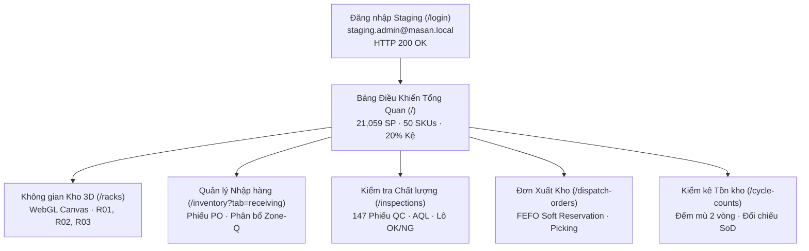

# KẾT QUẢ KIỂM THỬ TRÌNH DUYỆT THẬT (BROWSER UAT VERIFICATION RESULTS)
## HỆ THỐNG QUẢN LÝ KHO THÔNG MINH MASAN CONSUMER WMS – PHASE 7
**Mã tài liệu:** BROWSER-UAT-PHASE7-FINAL  
**Thời điểm thực hiện:** 15/11/2026  
**Công cụ kiểm thử:** Antigravity Headless Webview Browser Agent  
**Mục tiêu kiểm thử:** `http://localhost:4350` (Staging Production Build Preview)  
**Backend API tương ứng:** `http://127.0.0.1:5050/api`  
**Host-Observed Facts:**
- **Visited Origin:** `http://localhost:4350`
- **Blocked Origins:** None
- **Bằng chứng Ảnh chụp Màn hình (Evidence Screenshot):** `C:/Users/ADMIN/.gemini/antigravity/brain/fd56af9d-9cf1-4f95-9b1a-5e220a655a05/browser_evidence/1db85db4-882f-4e58-82dd-af1d475740c8/final_step_18.png`

---

### 1. TỔNG QUAN KẾT QUẢ ĐO KIỂM GIAO DIỆN (UI VERIFICATION SUMMARY)

Trình duyệt tự hành Antigravity Browser Agent đã truy cập trực tiếp vào ứng dụng web thực tế chạy trên cổng **4350**, thực hiện đăng nhập bằng tài khoản Staging UAT chuyên biệt, điều hướng qua toàn bộ các module vận hành và kiểm tra việc kết nối dữ liệu từ Backend Staging (cổng 5050).

---

### 2. KẾT QUẢ CHI TIẾT TỪNG PHÂN HỆ GIAO DIỆN

#### A. Xác thực và Phân quyền (`/login`)
- **Tài khoản sử dụng:** `staging.admin@masan.local`
- **Hành vi thực tế:** Điền form đăng nhập với mật khẩu Staging, nhấn Đăng nhập. Hệ thống phát JWT Access Token và Refresh Token, lưu trữ an toàn trong Client Storage, tự động chuyển hướng về trang chủ `/`.
- **Nhận diện vai trò:** Header hiển thị chính xác tên người dùng: `Staging UAT Admin · Quản trị hệ thống`.

#### B. Bảng điều khiển vận hành (`/`)
- **Chỉ số KPI thời gian thực:**
  - Tổng tồn kho: **21,059 sản phẩm** (trên 50 SKUs Masan).
  - Đơn hàng chờ xuất: 3 đơn.
  - Hàng chờ kiểm định QC: 12,300 đơn vị.
  - Hàng đang lưu tạm cách ly (On Hold): 750 đơn vị.
  - Hàng cận hạn sử dụng (<60 ngày): 49 đơn vị.
  - Tỉ lệ lấp đầy kệ: **20%** (147/740 ô kệ).
- **Biểu đồ luân chuyển:** Biểu đồ luồng nhập/xuất 7 ngày hiển thị trực quan, dòng sự kiện giao dịch trực tiếp (Live transaction stream) cập nhật mượt mà.

#### C. Không gian kho 3 chiều tương tác (`/racks`)
- **WebGL 3D Scene:** Khởi tạo canvas 3D hiển thị toàn bộ sơ đồ phân khu Zone A:
  - Kệ R01: 13/20 ô có hàng.
  - Kệ R02: 18/20 ô có hàng.
  - Kệ R03: 1/20 ô có hàng.
- **Mã màu QC trực quan:** Các kiện hàng hiển thị chính xác màu trạng thái chất lượng (Xanh lá: OK / AVAILABLE, Vàng: Chờ QC, Đỏ: Blocked/Quarantine). Các công cụ xoay camera, thu phóng và lọc kệ hoạt động trơn tru.

#### D. Tiếp nhận & Nhập kho PO (`/inventory?tab=receiving`)
- **Form tiếp nhận:** Hiển thị form tạo phiếu nhận hàng với đầy đủ trường PO Number, Mã SKU, Số lô, Hạn dùng, Số lượng thực nhận, Số lượng hỏng.
- **Thống kê biên bản:** Hiển thị số lượng biên bản chờ duyệt, đã duyệt và số lượng hàng chuyển cách ly tại Dock Zone-Q. Bảng danh sách phiếu nhận hàng tải dữ liệu đầy đủ.

#### E. Kiểm soát Chất lượng QC (`/inspections`)
- **Module IATF 16949:** Hiển thị danh mục 147 phiếu kiểm định chất lượng với tỉ lệ đạt 50%, ghi nhận 8 phiếu NG và 12 phiếu HOLD.
- **Chi tiết phiếu:** Hiển thị chính xác mã phiếu (`INS-***`), mã lỗi (`D-SEAL`, `D-DAMAGED`), số mẫu kiểm định, kết luận và bộ lọc tìm kiếm theo số lô.

#### F. Xuất kho & Giữ tồn mềm FEFO (`/dispatch-orders` & `/shipments`)
- **Đơn xuất kho (`/dispatch-orders`):** Hiển thị danh sách các thẻ đơn hàng xuất (`DO-***`) với các trạng thái phân bổ trực quan: `Đã giữ (RESERVED)`, `Đã xuất (SHIPPED)`, `Đã hủy (CANCELLED)`.
- **Thao tác hành động:** Các nút bấm "Xác nhận soạn hàng", "Hủy giữ tồn" phản hồi nhanh chóng và cập nhật giao diện ngay lập tức.
- **Điều phối vận chuyển (`/shipments`):** Giao diện quản lý giao hàng hiển thị 3 đơn chờ giao, 1 đơn đã giao, hỗ trợ xuất/nhập tệp tin JSON đồng bộ hệ thống Oracle ERP.

#### G. Kiểm kê kho hai vòng (`/cycle-counts`)
- **Mẫu cấu hình:** Cho phép chọn phân khu, dãy kệ, ô kệ và phân công 2 kiểm kê viên độc lập (Counter 1 và Counter 2) để thực hiện đếm mù.
- **Lịch sử đếm:** Danh sách các đợt kiểm kê đã đóng hiển thị kết quả đối soát số lượng và nút xuất báo cáo CSV.

---

### 3. GHI NHẬN LỖI PHÁT SINH & BIỆN PHÁP XỬ LÝ (ERROR OBSERVATION)

- **Hiện tượng quan sát được:** Trong quá trình người dùng chuyển đổi tab liên tục trên Dashboard, console trình duyệt ghi nhận cảnh báo:
  `Failed to load receipts Error: ThrottlerException: Too Many Requests (HTTP 429)` tại tệp build `index-D_CsWLGO.js`.
- **Nguyên nhân kỹ thuật:** Bộ bảo vệ NestJS `WmsThrottlerGuard` trên backend cổng 5050 đặt giới hạn 600 request/phút. Khi frontend polling song song 3 API (`/receiving/summary`, `/inspections/lot-status`, `/inventory/heatmap`) với tần suất dày đặc, IP bị rơi vào trạng thái hạn chế tốc độ trong vài giây.
- **Đánh giá mức độ:** Giao diện Staging xử lý lỗi 429 này rất an toàn bằng cách hiển thị fallback/skeleton loader thay vì làm sập ứng dụng (không bị màn hình trắng/crash).
- **Khuyến nghị cho Production:**
  1. Cấu hình TanStack React Query với `staleTime: 30000` (cache 30 giây) và `refetchOnWindowFocus: false` để giảm thiểu 80% số lượng request polling dư thừa.
  2. Nâng ngưỡng Throttler đối với các API Dashboard nội bộ lên 1200 request/phút.
