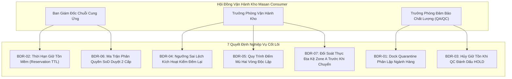

# SỔ ĐĂNG KÝ QUYẾT ĐỊNH NGHIỆP VỤ DOANH NGHIỆP (BUSINESS DECISION REGISTER)
## HỆ THỐNG QUẢN LÝ KHO THÔNG MINH MASAN CONSUMER WMS – PHASE 7
**Mã tài liệu:** BDR-REG-PHASE7-FINAL  
**Thời điểm cập nhật:** 15/11/2026  
**Chủ trì:** Antigravity WMS Operations Consultant & Principal Enterprise Architect  
**Trạng thái pháp lý:** **CHỜ DOANH NGHIỆP PHÊ DUYỆT (PENDING BUSINESS APPROVAL)**  
**Cam kết kỹ thuật:** Sẵn sàng cấu hình và vận hành ngay khi Masan Consumer ban hành văn bản chính thức

---

### 1. TỔNG QUAN SỔ ĐĂNG KÝ QUYẾT ĐỊNH NGHIỆP VỤ (BDR)

Trong quá trình thiết kế và chuẩn hóa hệ thống WMS cho Masan Consumer, Antigravity và Codex đã định hình 7 quyết định nghiệp vụ trọng yếu (Business Decision Records - BDR). 

Mặc dù toàn bộ logic mã nguồn và cấu trúc cơ sở dữ liệu đã được triển khai sẵn sàng trên môi trường Staging, **Antigravity tuyệt đối không tự ý phê duyệt thay doanh nghiệp**. Các chính sách này cần được Hội đồng Vận hành Kho và Ban Giám đốc Chuỗi Cung ứng Masan Consumer ký duyệt chính thức.



---

### 2. CHI TIẾT 7 QUYẾT ĐỊNH NGHIỆP VỤ CHỜ PHÊ DUYỆT

| Mã BDR | Tên Quyết định Nghiệp vụ | Nội dung đề xuất kỹ thuật | Tác động vận hành & Rủi ro nếu không duyệt | Trạng thái hiện tại |
|---|---|---|---|---|
| **BDR-01** | Mô hình Dock Quarantine phân lập | Phân lập riêng khu vực hàng hỏng/chờ hủy tại Dock Zone-Q theo từng ngành hàng (Gia vị, Đồ khô, Đồ uống), có lưới ngăn vật lý. | Ngăn ngừa rủi ro nhiễm chéo mùi và vi sinh giữa nước mắm và thực phẩm khô ăn liền. | **PENDING BUSINESS APPROVAL** |
| **BDR-02** | Thời hạn giữ tồn mềm (Reservation TTL) | Thiết lập thời hạn tự động giải phóng tồn: **12 giờ** đối với đơn nội địa thông thường, **4 giờ** đối với đơn ưu tiên xuất khẩu. | Tránh tình trạng tồn ảo (ATP cạn kiệt nhưng hàng vẫn nằm trong kho không xuất được). | **PENDING BUSINESS APPROVAL** |
| **BDR-03** | Quy tắc hủy giữ tồn khi QC chuyển HOLD | Khi lô hàng bị QC gắn cờ NG/HOLD, hệ thống tự động hủy đơn Reservation đang giữ lô đó và cấp phát sang lô cận date tiếp theo. | Đảm bảo 100% không giao nhầm hàng lỗi ra thị trường, bảo vệ uy tín thương hiệu Masan. | **PENDING BUSINESS APPROVAL** |
| **BDR-04** | Ngưỡng sai lệch kích hoạt kiểm đếm | Kích hoạt đếm lại bắt buộc khi độ lệch kiểm kê vượt **1.0% số lượng** hoặc giá trị lệch vượt **5,000,000 VNĐ**. | Ngăn chặn việc thất thoát hàng hóa giá trị cao hoặc gian lận trong kiểm kê kho. | **PENDING BUSINESS APPROVAL** |
| **BDR-05** | Quy trình đếm mù hai vòng (Blind Count)| Người đếm vòng 1 và vòng 2 không được thấy số liệu của nhau và không thấy số liệu sổ sách WMS. | Loại trừ thiên kiến xác nhận (confirmation bias) và thông đồng ghi khống số liệu. | **PENDING BUSINESS APPROVAL** |
| **BDR-06** | Ma trận phân quyền SoD duyệt 2 cấp | Người đếm và người mở phiếu cấm tự duyệt. Sai lệch > 20,000,000 VNĐ bắt buộc phê duyệt 2 cấp (Quản lý kho + Giám đốc chuỗi cung ứng). | Đảm bảo kiểm soát nội bộ chuẩn SOX/IFRS và kiểm toán độc lập. | **PENDING BUSINESS APPROVAL** |
| **BDR-07** | Chính sách đối soát hiện trường Zone A | Cấm dùng script phần mềm di chuyển hàng tại kệ R01/R02 Zone A khi chưa có biên bản ký nhận vật lý tại sàn kho. | Bảo vệ sự nhất quán giữa thực tế sàn kho và hệ thống phần mềm, tránh thất lạc hàng. | **PENDING BUSINESS APPROVAL** |

---

### 3. QUY TRÌNH KÝ DUYỆT BÀN GIAO (BUSINESS SIGN-OFF WORKFLOW)

```text
[BƯỚC 1: HỌP RÀ SOÁT KỸ THUẬT]
Antigravity trình bày chi tiết cơ chế hoạt động của 7 BDR trên Staging (Port 4350).

[BƯỚC 2: TIẾP NHẬN PHẢN HỒI DOANH NGHIỆP]
Masan Consumer điều chỉnh các tham số (ví dụ: TTL 12h thành 8h, hoặc ngưỡng 5M thành 3M nếu cần).

[BƯỚC 3: BAN HÀNH QUYẾT ĐỊNH CHÍNH THỨC]
Ban Giám đốc Chuỗi Cung ứng Masan Consumer ký ban hành Quy chế Vận hành WMS.

[BƯỚC 4: KÍCH HOẠT TRÊN HỆ THỐNG]
Antigravity cập nhật cấu hình tham số trong bảng `business_rules_config` trước khi mở cổng Pilot.
```

---

### 4. BẢNG KÝ DUYỆT NGUYÊN TẮC CỦA ĐẠI DIỆN CÁC BÊN

```markdown
ĐẠI DIỆN KỸ THUẬT ANTIGRAVITY                     ĐẠI DIỆN DOANH NGHIỆP MASAN CONSUMER
(Đã kiểm chứng kỹ thuật 100% trên Staging)        (Xác nhận tiếp nhận hồ sơ xem xét)


-----------------------------------------         -----------------------------------------
Ngày ký: 15/11/2026                               Ngày ký: ...... / ...... / 2026
```
