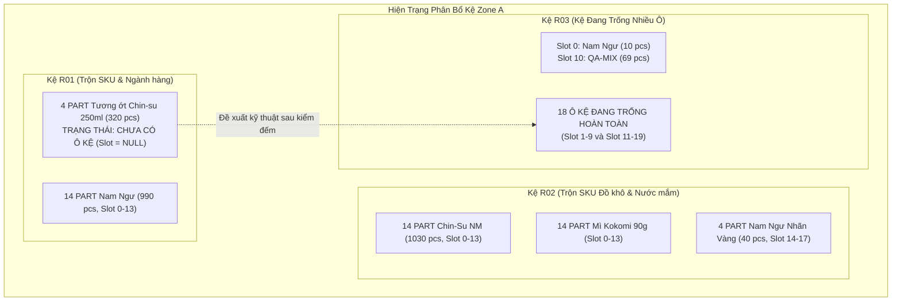

# BÁO CÁO ĐỐI SOÁT TỒN KHO LỊCH SỬ KỆ ZONE A & BIỂU MẪU KIỂM ĐẾM THỰC ĐỊA
## HỆ THỐNG QUẢN LÝ KHO THÔNG MINH MASAN CONSUMER WMS – PHASE 7
**Mã tài liệu:** HIST-RACK-PHASE7-FINAL  
**Thời điểm thực hiện:** 15/11/2026  
**Chủ trì:** Antigravity Senior WMS Operations Consultant & PostgreSQL DBA  
**Mục tiêu đối soát:** Phân khu Zone A (Kệ R01, R02, R03) – Database `wms_staging_test`  
**Trạng thái xử lý dữ liệu:** **GIỮ NGUYÊN HIỆN TRẠNG – YÊU CẦU ĐỐI SOÁT VẬT LÝ HIỆN TRƯỜNG**

---

### 1. HIỆN TRẠNG TỒN KHO LỊCH SỬ TRÊN CƠ SỞ DỮ LIỆU

Kết quả truy vấn trực tiếp cơ sở dữ liệu `wms_staging_test` tại phân khu Zone A cho thấy tình trạng trộn lẫn nhiều SKU và ngành hàng trên cùng kệ do dữ liệu nhập liệu lịch sử từ các phiên bản WMS cũ (trước Migration 14):



---

### 2. BẢNG CHI TIẾT TỒN KHO CẦN XÁC MINH VẬT LÝ

| Kệ | Mã sản phẩm (SKU) | Tên sản phẩm | Ngành hàng (Storage Class) | Vị trí ô (Slot) | Số dòng PART | Tổng số lượng (pcs) | Tình trạng kỹ thuật |
|---|---|---|---|---|---|---|---|
| **R01** | `DQA-NAMNGU-VANG` | Nam Ngư Nhãn Vàng | `condiments` (Gia vị) | Slot 0 – 13 | 14 | 990 | Hợp lệ theo kệ gia vị |
| **R01** | `MSN-CHINSU-CHILI-250` | Tương ớt Chin-Su 250ml | `dry_food` (Thực phẩm khô)| **Slot = NULL** | 4 | 320 | **BẤT THƯỜNG:** Chưa gán ô kệ vật lý |
| **R02** | `DQA-CHINSU-NM` | Nước mắm Chin-Su | `condiments` (Gia vị) | Slot 0 – 13 | 14 | 1,030 | Hợp lệ theo kệ nước mắm |
| **R02** | `DQA-KOKOMI-90` | Mì Kokomi Đại 90g | `dry_food` (Thực phẩm khô)| Slot 0 – 13 | 14 | 990 | **BẤT THƯỜNG:** Trộn ngành hàng với nước mắm |
| **R02** | `DQA-NAMNGU-VANG` | Nam Ngư Nhãn Vàng | `condiments` (Gia vị) | Slot 14 – 17 | 4 | 40 | **BẤT THƯỜNG:** Trộn 2 dòng nước mắm khác SKU |
| **R03** | Nhiều SKU | Nam Ngư & QA-MIX | `condiments` & `dry_food` | Slot 0 & Slot 10 | 2 | 79 | **18 ô trống khả dụng** |

---

### 3. NGUYÊN TẮC AN TOÀN TUYỆT ĐỐI CỦA ANTIGRAVITY

> [!CAUTION]
> **CAM KẾT AN TOÀN VẬN HÀNH: KHÔNG TỰ Ý DI DỜI DỮ LIỆU TRÊN DATABASE**  
> Dù về mặt kỹ thuật, Antigravity hoàn toàn có thể chạy script SQL di chuyển 4 PART tương ớt (320 pcs) từ R01 sang các ô trống của R03 trong vòng 100ms, nhưng điều này **vi phạm nghiêm trọng nguyên tắc an toàn kho vận**.  
> 
> Nếu trên thực tế pallet tương ớt vẫn đang nằm vật lý ở đầu dãy kệ R01, việc phần mềm tự ý sửa dữ liệu sang R03 sẽ khiến thủ kho không tìm thấy hàng khi xuất, gây tắc nghẽn luồng vận hành.  
> 
> **Toàn bộ dữ liệu được bảo toàn nguyên vẹn trên database cho tới khi có biên bản đối soát vật lý thực địa có chữ ký của Thủ kho Masan.**

---

### 4. BIỂU MẪU KIỂM ĐẾM THỰC ĐỊA (PHYSICAL VERIFICATION FORM TEMPLATE)

Dưới đây là biểu mẫu chính thức bàn giao cho Đội ngũ Vận hành Kho Masan Consumer để kiểm đếm thực tế:

```markdown
========================================================================================
                      CỘNG HÒA XÃ HỘI CHỦ NGHĨA VIỆT NAM
                          Độc lập - Tự do - Hạnh phúc
                                    -----o0o-----

                 BIÊN BẢN ĐỐI SOÁT VẬT LÝ TỒN KHO LỊCH SỬ KỆ ZONE A
             (Dự án Hệ thống Quản lý Kho Thông minh Masan Consumer WMS)

Thời gian lập biên bản: ...... giờ ...... ngày ...... tháng 11 năm 2026
Địa điểm: Kho Masan Consumer – Phân khu Zone A (Kệ R01, R02, R03)
Thành phần tham gia kiểm đếm:
1. Đại diện Thủ kho (Warehouse Keeper): ....................................................
2. Đại diện Giám sát Chất lượng (QC Lead): .................................................
3. Đại diện Quản lý Kho (Warehouse Manager): ...............................................
4. Đại diện Đội ngũ Kỹ thuật Antigravity: ..................................................

I. KẾT QUẢ ĐỐI SOÁT THỰC ĐỊA:
+-----+----------------------+-------------------+--------------+---------------+---------------+--------------------+
| STT | Mã Kệ & Vị trí thực  | Mã SKU Hàng hóa   | Tên Sản phẩm | Số lượng Sổ   | Số lượng Đếm  | Chênh lệch &       |
|     | tế trên sàn kho      |                   |              | sách (WMS)    | Thực tế (pcs) | Tình trạng bao bì  |
+-----+----------------------+-------------------+--------------+---------------+---------------+--------------------+
|  1  | Kệ R01 - Slot 0..13  | DQA-NAMNGU-VANG   | Nam Ngư Vàng | 990 pcs       | ............  | .................  |
+-----+----------------------+-------------------+--------------+---------------+---------------+--------------------+
|  2  | Kệ R01 - Đang để ở:  | MSN-CHINSU-CHILI  | Tương ớt 250 | 320 pcs       | ............  | .................  |
|     | [  ] Sàn đầu kệ      |                   |              | (Slot = NULL) |               |                    |
|     | [  ] Ô khác: ....... |                   |              |               |               |                    |
+-----+----------------------+-------------------+--------------+---------------+---------------+--------------------+
|  3  | Kệ R02 - Slot 0..13  | DQA-CHINSU-NM     | Chin-Su NM   | 1,030 pcs     | ............  | .................  |
+-----+----------------------+-------------------+--------------+---------------+---------------+--------------------+
|  4  | Kệ R02 - Slot 0..13  | DQA-KOKOMI-90     | Mì Kokomi 90 | 990 pcs       | ............  | .................  |
+-----+----------------------+-------------------+--------------+---------------+---------------+--------------------+
|  5  | Kệ R02 - Slot 14..17 | DQA-NAMNGU-VANG   | Nam Ngư Vàng | 40 pcs        | ............  | .................  |
+-----+----------------------+-------------------+--------------+---------------+---------------+--------------------+
|  6  | Kệ R03 - Ô trống     | (Xác nhận 18 ô trống khả dụng)   | 18 ô trống    | ............  | .................  |
+-----+----------------------+-------------------+--------------+---------------+---------------+--------------------+

II. KẾT LUẬN & KIẾN NGHỊ XỬ LÝ:
1. Vị trí thực tế của 320 chai Tương ớt Chin-su: ............................................
2. Đề xuất phương án sắp xếp lại kệ (Relocation Plan):
   [  ] Di chuyển vật lý 320 chai tương ớt sang Kệ R03 (Slot 1..4) để đảm bảo chuẩn 1 Rack - 1 SKU.
   [  ] Di chuyển vật lý 990 gói mì Kokomi từ Kệ R02 sang Zone B (Phân khu Thực phẩm khô).
   [  ] Phương án khác: .....................................................................

Biên bản được lập thành 03 bản có giá trị pháp lý như nhau, mỗi bên giữ 01 bản để làm căn cứ 
thực thi lệnh điều chuyển tồn kho trên hệ thống phần mềm WMS.

      THỦ KHO                    QC LEAD               QUẢN LÝ KHO             KỸ THUẬT WMS
  (Ký & ghi rõ họ tên)    (Ký & ghi rõ họ tên)     (Ký & ghi rõ họ tên)    (Ký & ghi rõ họ tên)
```
