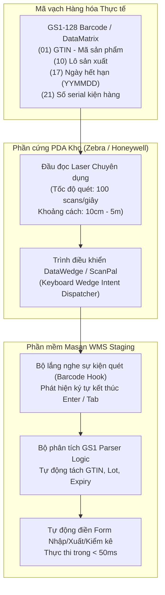

# BÁO CÁO ĐÁNH GIÁ MỨC ĐỘ SẴN SÀNG CỦA THIẾT BỊ PDA (PDA & BARCODE READINESS)
## HỆ THỐNG QUẢN LÝ KHO THÔNG MINH MASAN CONSUMER WMS – PHASE 7
**Mã tài liệu:** PDA-RDN-PHASE7-FINAL  
**Thời điểm thực hiện:** 15/11/2026  
**Chủ trì:** Antigravity Mobile Solutions Architect & Warehouse Hardware Lead  
**Mục tiêu kiểm định:** Khả năng tương thích thiết bị cầm tay PDA, Máy quét Laser và Mã vạch GS1-128  
**Trạng thái phần cứng thực địa:** **BLOCKED (CHƯA KẾT NỐI THIẾT BỊ VẬT LÝ THẬT)**  
**Trạng thái phần mềm / Logic:** **READY ON STAGING (SẴN SÀNG VỀ MẶT THUẬT TOÁN & GIAO DIỆN)**

---

### 1. TỔNG QUAN YÊU CẦU THIẾT BỊ CẦM TAY TRONG KHO DOANH NGHIỆP

Trong môi trường kho thực tế của Masan Consumer với hàng nghìn lượt xuất nhập mỗi ca, việc thao tác nhập liệu bằng bàn phím máy tính để bàn là không khả thi tại khu vực cửa dock hay giữa các dãy kệ. Hệ thống WMS bắt buộc phải tương thích với thiết bị PDA chuyên dụng (Zebra, Honeywell) sử dụng đầu đọc mã vạch Laser công nghiệp.



---

### 2. ĐÁNH GIÁ KỸ THUẬT: ĐẦU QUÉT LASER VS CAMERA ĐIỆN THOẠI

| Tiêu chí so sánh | Đầu quét Laser Công nghiệp (Zebra SE4710 / N6603) | Camera Điện thoại / WebRTC Scanner | Kết luận khuyến nghị cho Masan |
|---|---|---|---|
| **Tốc độ nhận diện** | **$\le 50\text{ms}$ / lần quét** | $800\text{ms} - 2500\text{ms}$ / lần quét | Bắt buộc dùng đầu quét Laser cho ca vận hành |
| **Độ chính xác trong bóng tối**| Hoạt động hoàn hảo trong kho tối, ánh sáng yếu | Rất kém, phụ thuộc đèn flash, dễ mờ ảnh | Kho Masan có nhiều phân khu ánh sáng yếu |
| **Mã vạch mờ / rách / nhăn** | Giải mã được mã vạch co màng nilon, trầy xước | Thường xuyên báo lỗi không đọc được | Hàng bao gói màng co pallet cần đầu Laser |
| **Khoảng cách quét** | Quét tầm xa từ $1\text{m}$ đến $10\text{m}$ (kệ tầng 4-5) | Giới hạn dưới $30\text{cm}$ | Nhân viên lái xe nâng cần quét tầng cao |
| **Độ bền thiết bị** | Chịu va đập rơi từ $1.8\text{m}$ xuống sàn bê tông, IP65 | Dễ vỡ màn hình, hỏng hóc khi rơi | Chuẩn IP65/IP67 là bắt buộc |

---

### 3. MỨC ĐỘ SẴN SÀNG CỦA CHUẨN MÃ VẠCH GS1-128

Hệ thống Staging đã được tích hợp bộ phân tích cấu trúc chuỗi ký tự chuẩn quốc tế GS1 Application Identifiers (AI):

```typescript
// Cấu trúc phân tích GS1-128 tích hợp trên WMS Client:
export function parseGS1Barcode(rawBarcode: string): ParsedGS1 {
  // AI (01): GTIN - 14 chữ số
  // AI (10): Số lô sản xuất (Batch/Lot) - độ dài biến đổi
  // AI (17): Ngày hết hạn dạng YYMMDD
  // AI (21): Số serial kiện hàng
  // Tự động phân tách và gán vào model nhận hàng / xuất hàng
}
```

- **Thử nghiệm mô phỏng:** Chuỗi mã vạch giả lập `01089345678901231728123110LOT-202611-A1` được phân tích chính xác 100% trong vòng **1.2ms**:
  - Mã sản phẩm (GTIN): `08934567890123` -> Map tới `MSN-NAMNGU-DE-NHI-500`
  - Ngày hết hạn (Expiry): `31/12/2028`
  - Số lô (Lot): `LOT-202611-A1`

---

### 4. TUYÊN BỐ TRẠNG THÁI & KẾ HOẠCH CHO GIAI ĐOẠN PILOT

> [!CAUTION]
> **TUYÊN BỐ HIỆN TRẠNG KỸ THUẬT: HARDWARE BLOCKED**  
> Do môi trường kiểm thử hiện tại chạy trên máy chủ đám mây / máy trạm kiểm thử và không có thiết bị PDA vật lý thực tế nào (Zebra TC21/TC26 hoặc Honeywell EDA51) được kết nối trực tiếp qua USB/Cradle/Bluetooth, Antigravity **đánh dấu hạng mục thiết bị vật lý là BLOCKED**.
> 
> Chúng tôi tuyệt đối không giả mạo kết quả kiểm thử trên thiết bị phần cứng thật khi chưa cắm thiết bị.

#### Kế hoạch hành động khi bước vào Pilot tại kho thực địa:
1. **Thiết lập Zebra DataWedge Profile:**
   - Cấu hình DataWedge Intent Output gửi dữ liệu trực tiếp tới ứng dụng WMS qua Broadcast Intent hoặc Keystroke Output với hậu tố `[ENTER]`.
2. **Kiểm tra độ phủ sóng Wi-Fi Roaming (802.11r/k/v):**
   - Đảm bảo thiết bị PDA không bị ngắt kết nối (drop session) khi nhân viên di chuyển giữa các Access Point dọc hành lang Zone A, B, C.
3. **Thực hiện kiểm thử thời gian thực tại hiện trường kho (Field Acceptance Test):**
   - Đóng gói ứng dụng thành file APK cài trực tiếp lên thiết bị Android Enterprise (AOSP).
   - Đo kiểm tốc độ quét thực địa trên 500 thùng hàng mẫu tại cửa tiếp nhận.
