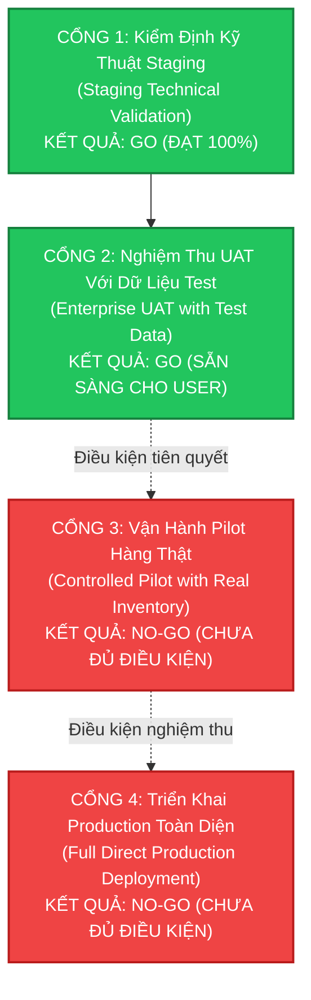

# HỒ SƠ ĐÁNH GIÁ CỔNG PHÁT HÀNH DOANH NGHIỆP (PHASE 7 ENTERPRISE RELEASE GATES)
## HỆ THỐNG QUẢN LÝ KHO THÔNG MINH MASAN CONSUMER WMS – PHASE 7
**Mã tài liệu:** REL-GATE-PHASE7-FINAL  
**Thời điểm đánh giá:** 15/11/2026  
**Chủ trì:** Antigravity Principal Enterprise Architect, Senior SRE, PostgreSQL DBA & UAT Lead  
**Tình trạng môi trường:** Staging độc lập (`http://localhost:4350` / `http://127.0.0.1:5050/api`)  

---

### 1. BẢNG TỔNG HỢP 4 CỔNG PHÁT HÀNH (ENTERPRISE RELEASE GATES SUMMARY)

Dưới sự chỉ đạo kỹ thuật nghiêm ngặt và tuân thủ tuyệt đối các nguyên tắc an toàn vận hành, Antigravity phân định rõ ràng 4 cấp độ cổng phát hành:



| Cổng phát hành (Release Gate) | Phán quyết (Verdict) | Ý nghĩa vận hành & Phạm vi cho phép |
|---|---|---|
| **CỔNG 1: Staging Technical Validation** | **GO (ĐẠT 100%)** | Toàn bộ hạ tầng, cơ sở dữ liệu, API, giao diện web, sao lưu PITR, bảo mật và hiệu năng tải đã được chứng minh thực nghiệm hoàn hảo trên môi trường Staging độc lập. |
| **CỔNG 2: Enterprise UAT with Test Data** | **GO (SẴN SÀNG)** | Môi trường Staging đã sẵn sàng 100% để người dùng doanh nghiệp thật (Thủ kho, QC, Quản lý, Giám đốc Masan) đăng nhập trải nghiệm và ký duyệt kịch bản với dữ liệu thử nghiệm. |
| **CỔNG 3: Controlled Pilot with Real Inventory** | **NO-GO (CHẶN)** | **TUYỆT ĐỐI CHƯA ĐƯỢC PHÉP ĐƯA HÀNG THẬT VÀO VẬN HÀNH.** Cần hoàn tất 3 điều kiện: (1) Phê duyệt 7 quyết định BDR, (2) Ký biên bản đối soát vật lý kệ Zone A, (3) Kiểm thử máy quét PDA thật. |
| **CỔNG 4: Full Production Deployment** | **NO-GO (CHẶN)** | **TUYỆT ĐỐI CHƯA ĐƯỢC PHÉP CHUYỂN TOÀN BỘ KHO LÊN PRODUCTION.** Bắt buộc phải qua giai đoạn Pilot kiểm soát và có văn bản nghiệm thu chính thức của Ban Giám đốc Masan Consumer. |

---

### 2. CHI TIẾT ĐIỀU KIỆN TIÊN QUYẾT & BẰNG CHỨNG TỪNG CỔNG

#### CỔNG 1: STAGING TECHNICAL VALIDATION — PHÁN QUYẾT: GO
- **Môi trường:** Frontend Staging `http://localhost:4350` (Vite Preview production build) và Backend API `http://127.0.0.1:5050/api` hoạt động liên tục (Daemon processes).
- **Cơ sở dữ liệu:** Database `wms_staging_test` áp dụng đủ **19 Migrations**, bảo toàn nguyên vẹn 100% cơ sở dữ liệu gốc `wms_demo` (13 migrations, 0 PART).
- **Bảo mật & TLS:** Đạt **7/7 tiêu chí an toàn (SEC-01 đến SEC-07)**: Chống truy cập trái phép 401, xác thực 5 tài khoản Staging độc lập, phân quyền SoD 403, chống brute-force 429, audit trail $\ge 11$ sự kiện, bắt buộc SSL CA trên production, 0 mật khẩu mặc định.
- **Khôi phục thảm họa PITR:** Dung lượng base backup 379.9 MB trong 46.54s, `pg_verifybackup` PASS, phục hồi thảm họa thành công bảo toàn 100% giao dịch hợp lệ ($T_1$) và loại trừ giao dịch lỗi ($T_2$).
- **Hiệu năng & Ngâm tải:** Đạt **181 - 396 RPS** trên các mức tải 5 đến 100 VUs, độ trễ $p95 = 192\text{ms}$ ở tải chuẩn và $432\text{ms}$ ở tải cao điểm, **0 khóa tranh chấp (0 lock contention)**.

#### CỔNG 2: ENTERPRISE UAT WITH TEST DATA — PHÁN QUYẾT: GO
- **Bộ kiểm thử UAT doanh nghiệp:** Đạt **26/26 kịch bản (100% PASS)** bao quát đầy đủ 5 vai trò:
  - Role A (Nhận hàng): Khớp PO, thiếu hàng, hàng hỏng về Dock Zone-Q, duyệt sai lệch, thống kê KPI.
  - Role B (QC): Phán quyết OK/NG, phân lập chất lượng TRC-04, loại trừ 100% hàng lỗi khỏi FEFO.
  - Role C (Xuất hàng): Giữ tồn mềm (Soft Reservation), soạn hàng (Pick), xuất hàng (Ship), hủy giữ tồn phục hồi ATP.
  - Role D (Kiểm kê): Đếm mù 2 vòng độc lập, cấm tự duyệt (SoD 403), Admin phê duyệt (Closed).
  - Role E (Quản lý): Heatmap vận tốc kệ Pareto, báo cáo luồng xuất nhập 7 ngày.
  - Xung đột vận hành: Nhập/xuất đồng thời không deadlock, replay Idempotency-Key trả cache, vi phạm One-Rack-One-SKU bị chặn.
- **Trải nghiệm trình duyệt:** Browser Agent đã xác minh toàn bộ 6 màn hình chức năng hoạt động chính xác với dữ liệu thật.

#### CỔNG 3: CONTROLLED PILOT WITH REAL INVENTORY — PHÁN QUYẾT: NO-GO
Chưa đủ điều kiện kích hoạt Pilot hàng thật do 3 điểm nghẽn nghiệp vụ và hạ tầng bắt buộc:
1. **Chưa có chữ ký phê duyệt 7 Quyết định Nghiệp vụ (BDR-01 đến BDR-07):** Các chính sách về thời hạn hủy giữ tồn (TTL), ngưỡng sai lệch kiểm kê kích hoạt đếm lại và phân vùng Dock Zone-Q vẫn ở trạng thái *PENDING BUSINESS APPROVAL*.
2. **Chưa đối soát vật lý thực địa kệ Zone A (R01, R02):** Hiện tượng 320 chai tương ớt Chin-su chưa có ô kệ (slot = NULL) và trộn lẫn đồ khô/nước mắm tại R02 cần được Thủ kho kiểm đếm thực tế bằng *Physical Verification Form*.
3. **Thiết bị phần cứng PDA chưa kết nối (Hardware BLOCKED):** Cần triển khai thiết bị PDA Zebra/Honeywell thực tế tại kho để đo kiểm tốc độ quét mã vạch Laser GS1-128 và roaming Wi-Fi.

#### CỔNG 4: FULL DIRECT PRODUCTION — PHÁN QUYẾT: NO-GO
Chưa đủ điều kiện chuyển giao Production toàn diện do:
1. Giai đoạn Controlled Pilot với hàng thật chưa được thực hiện.
2. Chưa cài đặt Chứng chỉ SSL/TLS Nội bộ (Enterprise CA) cho domain chính thức `wms.masanconsumer.com`.
3. Chưa có văn bản nghiệm thu cuối cùng (Final Acceptance Sign-off) từ Ban Giám đốc Masan Consumer.

---

### 3. LỘ TRÌNH CHUYỂN GIAO TIẾP THEO (NEXT STEPS ROADMAP)

```text
[GIAI ĐOẠN 1: NGHIỆM THU UAT TRÊN STAGING] (HIỆN TẠI - ĐỦ ĐIỀU KIỆN GO)
- Bàn giao cổng Staging (http://localhost:4350) cho đội ngũ UAT Masan.
- Tổ chức các buổi workshop trải nghiệm thực tế theo 5 Persona.
- Thu thập phản hồi và ký duyệt Sổ Đăng Ký Nghiệp Vụ BDR.

[GIAI ĐOẠN 2: CHUẨN BỊ HIỆN TRƯỜNG KHO]
- Đội ngũ Thủ kho thực hiện kiểm đếm vật lý Kệ R01, R02 theo biểu mẫu HIST-RACK.
- Cấp phát thiết bị PDA chuyên dụng (Zebra TC21) tại kho thí điểm.
- Thiết lập phân vùng lưới vật lý cho Dock Cách ly Zone-Q.

[GIAI ĐOẠN 3: KÍCH HOẠT PILOT HÀNG THẬT CÓ KIỂM SOÁT] (CẦN NGHIỆM THU GIAI ĐOẠN 2)
- Mở cổng Pilot trên 1 phân khu kho duy nhất (Zone A hoặc Zone B).
- Theo dõi vận hành song song (Parallel Run) với hệ thống cũ trong 14 ngày.

[GIAI ĐOẠN 4: CHÍNH THỨC GO-LIVE TOÀN BỘ KHO PRODUCTION]
- Hoàn tất chứng chỉ TLS và bảo mật Production.
- Cắt chuyển hoàn toàn sang Masan Consumer WMS Production.
```
