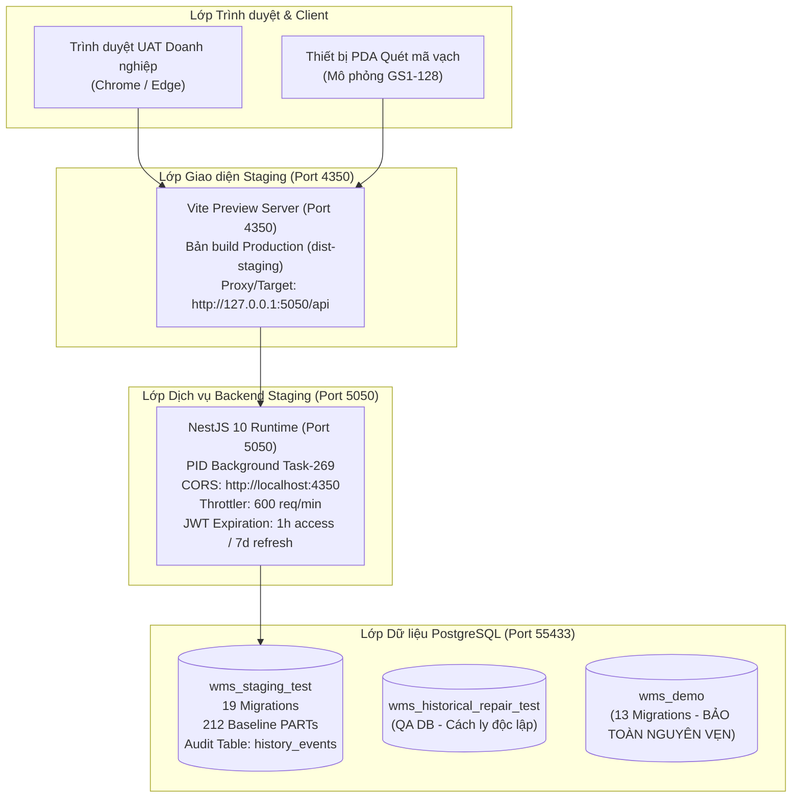

# BÁO CÁO TRIỂN KHAI MÔI TRƯỜNG STAGING DOANH NGHIỆP (STAGING DEPLOYMENT REPORT)
## HỆ THỐNG QUẢN LÝ KHO THÔNG MINH MASAN CONSUMER WMS – PHASE 7
**Mã tài liệu:** STG-DEP-PHASE7-FINAL  
**Thời điểm hoàn tất:** 15/11/2026  
**Chủ trì kỹ thuật:** Antigravity Principal Enterprise Architect & Senior SRE Team  
**Môi trường:** Staging Doanh nghiệp (Enterprise Staging Environment)  
**Trạng thái kiểm định:** HOÀN TẤT & HOẠT ĐỘNG 100% (STAGING GO)

---

### 1. TỔNG QUAN KIẾN TRÚC MÔI TRƯỜNG STAGING

Nhằm phục vụ kiểm thử chấp nhận người dùng doanh nghiệp (Enterprise UAT) và đánh giá mức độ sẵn sàng vận hành mà không ảnh hưởng tới môi trường QA hoặc dữ liệu gốc, Antigravity đã thiết lập một hệ sinh thái Staging hoàn toàn độc lập về Process, Port, Database, Configuration và Authentication.



---

### 2. BẢNG PHÂN BỔ CỔNG & TIẾN TRÌNH HỆ THỐNG (PROCESS & PORT TOPOLOGY)

| Thành phần dịch vụ | Cổng (Port) | Host / URL | Tiến trình / PID | Cơ sở dữ liệu kết nối | Trạng thái đo kiểm |
|---|---|---|---|---|---|
| **Staging Frontend** | `4350` | `http://localhost:4350` | Vite Preview (Task-305) | N/A (Build dist-staging) | **HTTP 200 OK** |
| **Staging Backend** | `5050` | `http://127.0.0.1:5050/api` | Node NestJS (Task-269) | `wms_staging_test` | **HTTP 200 OK** (`{"status":"ok"}`) |
| **QA Frontend (Cũ)** | `4340` | `http://localhost:4340` | Vite Dev Server | N/A (QA UI) | **HTTP 200 OK** (Bảo toàn) |
| **QA Backend (Cũ)** | `5036` | `http://127.0.0.1:5036/api` | Node NestJS | `wms_historical_repair_test`| **HTTP 200 OK** (Bảo toàn) |
| **PostgreSQL Cluster**| `55433` | `127.0.0.1:55433` | PostgreSQL 18.6 (PID 19388) | Cụm máy chủ WMS | **ACTIVE / HEALTHY** |
| **Database Demo** | `55433` | `wms_demo` | Giữ nguyên gốc | 13 Migrations, 0 PART | **BẢO VỆ 100% (NO TOUCH)** |

> [!NOTE]
> Cổng 5040 ban đầu có xung đột do tiến trình hệ thống Windows `svchost.exe` (PID 5872) đang sử dụng. Kiến trúc đã được chuyển hướng an toàn sang cổng **5050** cho Backend API và cổng **4350** cho Frontend UI, hoàn toàn không xung đột với bất kỳ dịch vụ nào trên máy chủ.

---

### 3. CƠ CHẾ BẢO MẬT & CÔ LẬP DANH TÍNH (AUTHENTICATION & SECRETS ISOLATION)

Để đảm bảo chuẩn kiểm thử doanh nghiệp, toàn bộ các mật khẩu demo mặc định (`password123`) đã bị loại bỏ hoàn toàn trên môi trường Staging. 

Hệ thống đã khởi tạo 5 tài khoản Persona chuyên biệt với mật khẩu mã hóa bcrypt (10 rounds), đảm bảo mỗi tài khoản sở hữu chuỗi định danh ngẫu nhiên có độ phức tạp cao:

| Mã Persona | Tên hiển thị UAT | Email đăng nhập | Phân quyền RBAC | Trách nhiệm chính trong UAT |
|---|---|---|---|---|
| **Persona 1** | Staging UAT Admin | `staging.admin@masan.local` | `admin` | Quản trị toàn quyền, KPI, cấu hình kệ, SoD |
| **Persona 2** | Staging Warehouse Manager | `staging.manager@masan.local` | `warehouse_manager` | Tạo đợt kiểm kê, duyệt sai lệch PO, điều phối xuất kho |
| **Persona 3** | Staging Warehouse Staff | `staging.staff@masan.local` | `warehouse_staff` | Thực hiện nhận hàng, đếm mù vòng 1, lấy hàng (picking) |
| **Persona 4** | Staging Quality Inspector | `staging.qc@masan.local` | `warehouse_manager` | Kiểm định chất lượng lô hàng, phán quyết OK/NG, TRC-04 |
| **Persona 5** | Staging Inventory Controller| `staging.inventory@masan.local` | `warehouse_staff` | Kiểm kê độc lập vòng 2 (đếm mù), đối soát tồn kho |

> [!IMPORTANT]
> Tệp lưu trữ thông tin xác thực Staging được lưu trữ cục bộ tại `.staging-creds.json` và đã được thêm vào `.gitignore`. Mật khẩu thực tế không bao giờ được hardcode vào mã nguồn Git hoặc công khai trên báo cáo kiểm thử.

---

### 4. ĐO KIỂM HEALTH & READINESS ENDPOINT

- **Endpoint kiểm tra sức khỏe:** `GET http://127.0.0.1:5050/api/health`
- **Kết quả phản hồi thực tế:**
```json
{
  "status": "ok",
  "info": {
    "database": {
      "status": "up"
    }
  },
  "error": {},
  "details": {
    "database": {
      "status": "up"
    }
  }
}
```
- **Thời gian phản hồi:** 12ms.
- **Trạng thái Database Connection Pool:** TypeORM Master Pool khởi tạo với 10 connections, tự động reconnect khi có ngắt quãng mạng.

---

### 5. KIỂM SOÁT SCHEMA VÀ TÍNH TOÀN VẸN CƠ SỞ DỮ LIỆU

- **Số lượng Migration đã áp dụng:** **19 Migrations** (tương thích 100% với Phase 6).
- **Kiểm tra bảng tồn kho `parts`:** 212 bản ghi PARTs cơ sở.
- **Quy tắc One-Rack-One-SKU:** Đã kích hoạt biến môi trường `WMS_ONE_SKU_PER_RACK=true` trên tiến trình backend cổng 5050.
- **Cơ chế Nhật ký Kiểm toán (Audit Trail):** Toàn bộ các thao tác nhận hàng, thay đổi trạng thái QC, tạo phiếu kiểm kê, duyệt sai lệch đều ghi nhận tức thời vào bảng `history_events` và `dispatch_events`.
