# HỒ SƠ HÀNH TRÌNH NGƯỜI DÙNG DOANH NGHIỆP (ENTERPRISE USER JOURNEYS)
## HỆ THỐNG QUẢN LÝ KHO THÔNG MINH MASAN CONSUMER WMS – PHASE 7
**Mã tài liệu:** UAT-JOURNEYS-PHASE7-FINAL  
**Thời điểm hoàn tất:** 15/11/2026  
**Chủ trì:** Antigravity WMS Operations Consultant & UAT Lead  
**Môi trường:** Staging (`http://localhost:4350`)  
**Đối tượng kiểm thử:** 5 Persona Doanh nghiệp độc lập  

---

### 1. TỔNG QUAN CÁC HÀNH TRÌNH NGHIỆP VỤ (END-TO-END FLOWS)

Hồ sơ hành trình người dùng (User Journeys) mô tả chi tiết chuỗi thao tác thực tế theo từng vai trò nghiệp vụ (Persona), từ lúc đăng nhập, tương tác giao diện, gửi lệnh qua API, xác nhận cơ sở dữ liệu cho tới khi hoàn tất chu trình vận hành kho.

```mermaid
flowchart LR
    subgraph Flow_Inbound ["1. Luồng Nhập Hàng"]
        J1["Tài xế giao hàng\nPO & Phiếu giao"] --> J2["Nhân viên Nhận hàng\nĐối chiếu số lượng"]
        J2 --> J3{"Có hàng hỏng\nhoặc sai lệch?"}
        J3 -- Có --> J4["Cách ly Dock Zone-Q\nLập biên bản sai lệch"]
        J3 -- Không --> J5["Nhập kho trực tiếp\nChờ QC kiểm định"]
        J4 --> J6["Quản lý Kho\nXem xét & Phê duyệt"]
        J6 --> J5
    end

    subgraph Flow_QC ["2. Luồng Kiểm Soát Chất Lượng"]
        J5 --> Q1["QC Lấy mẫu theo AQL\nKiểm tra ngoại quan/date"]
        Q1 --> Q2{"Phán quyết chất lượng"}
        Q2 -- ĐẠT (OK) --> Q3["Trạng thái AVAILABLE\nKích hoạt lưu kho"]
        Q2 -- LỖI (NG) --> Q4["Trạng thái BLOCKED/HOLD\nKhóa tự động khỏi FEFO"]
    end

    subgraph Flow_Outbound ["3. Luồng Xuất Kho"]
        Q3 --> O1["Tạo Đơn Xuất Kho\nSoft Reservation (FEFO)"]
        O1 --> O2["Nhân viên Nhận lệnh Pick\nLấy hàng tại ô kệ"]
        O2 --> O3["Xác nhận Soạn hàng (PICKED)"]
        O3 --> O4["Xuất hàng (SHIPPED)\nTrừ tồn sổ sách"]
    end
```

---

### 2. CHI TIẾT 5 HÀNH TRÌNH NGƯỜI DÙNG (PERSONA JOURNEYS)

#### HÀNH TRÌNH 1: NHÂN VIÊN NHẬN HÀNG (PERSONA: STAGING WAREHOUSE STAFF)
- **Tài khoản:** `staging.staff@masan.local` | **Giao diện:** `/inventory?tab=receiving`
- **Mục tiêu:** Tiếp nhận lô hàng 500 thùng Nước mắm Nam Ngư Đệ Nhị và 600 gói Mì Kokomi từ nhà máy Masan HD.
- **Các bước thực hiện:**
  1. Đăng nhập hệ thống bằng thông tin xác thực Staging dành riêng cho nhân viên kho.
  2. Truy cập tab **Nhận hàng PO & Đối chiếu sai lệch**.
  3. Quét mã PO `PO-UAT-FULL-***`, nhập số lượng thực nhận 500 pcs (khớp 100% PO). Nhấn **Ghi nhận phiếu nhận hàng**. Hệ thống ghi nhận trạng thái `COMPLETED` với mã sai lệch `MATCH`.
  4. Tiếp tục nhận đơn `PO-UAT-DMG-***` (Mì Kokomi): Phát hiện 20 gói rách vỏ do dằn xóc khi bốc dỡ. Nhân viên nhập `damagedQuantityPcs: 20`, lý do `Thùng móp vỡ do xếp dỡ sai quy cách`.
  5. **Phản hồi hệ thống:** Hệ thống tự động chuyển 20 đơn vị hỏng về vị trí lưu tạm `quarantineRackId` (Kệ Dock Zone-Q), tạo biên bản sai lệch trạng thái `DISCREPANCY_PENDING`.
  6. Nhân viên kiểm tra danh sách: Phiếu hiển thị rõ ràng cảnh báo màu vàng chờ Quản lý kho duyệt.

---

#### HÀNH TRÌNH 2: GIÁM SÁT CHẤT LƯỢNG (PERSONA: STAGING QUALITY INSPECTOR)
- **Tài khoản:** `staging.qc@masan.local` | **Giao diện:** `/inspections`
- **Mục tiêu:** Đánh giá chất lượng các lô hàng mới nhận và xử lý cách ly lô nghi ngờ lỗi theo chuẩn IATF 16949 / ISO 22000.
- **Các bước thực hiện:**
  1. Đăng nhập với quyền Giám sát Chất lượng. Truy cập module **Phiếu Kiểm tra Chất lượng (QC)**.
  2. Chọn lô `DQA-NAMNGU-VANG-L2` vừa nhập. Lấy mẫu ngẫu nhiên 50 chai, kiểm tra độ kín nắp và hạn dùng (Pass: 50, Fail: 0). Chọn phán quyết `OK`. Hệ thống cập nhật trạng thái lô thành `AVAILABLE`.
  3. Chọn lô `DQA-CHINSU-NM-L2`: Kiểm tra 50 mẫu phát hiện 10 chai rò rỉ xốt tại cổ chai (Fail: 10, Mã lỗi: `D-DAMAGED`). Chọn phán quyết `NG`.
  4. **Phản hồi hệ thống:** Trạng thái lô chuyển ngay sang `BLOCKED/HOLD`. Hệ thống tự động gắn cờ cách ly trong bảng `inventory_lots`.
  5. **Kiểm chứng phân lập TRC-04:** QC kiểm tra lô dùng chung `DQA-COMMON-01`. Dù sản phẩm Chin-Su bị đánh giá NG, dòng sản phẩm Nam Ngư cùng lô vẫn giữ nguyên trạng thái `AVAILABLE`.

---

#### HÀNH TRÌNH 3: ĐIỀU PHỐI XUẤT KHO (PERSONA: STAGING WAREHOUSE MANAGER)
- **Tài khoản:** `staging.manager@masan.local` | **Giao diện:** `/dispatch-orders`
- **Mục tiêu:** Cấp phát đơn hàng xuất khẩu 20 thùng nước mắm theo nguyên tắc FEFO nghiêm ngặt (First Expired, First Out).
- **Các bước thực hiện:**
  1. Quản lý truy cập màn hình **Đơn Xuất Kho & Giữ Tồn Mềm (Soft Reservation)**.
  2. Tạo đơn xuất `DO-UAT-***` cho SKU `DQA-NAMNGU-VANG`, số lượng 20 đơn vị kèm `Idempotency-Key`.
  3. **Phản hồi thuật toán FEFO:** Hệ thống quét toàn bộ các lô đang khả dụng (`AVAILABLE`), tự động bỏ qua các lô `BLOCKED/HOLD`, ưu tiên phân bổ hàng tại ô kệ có ngày hết hạn gần nhất. Đơn xuất chuyển sang trạng thái `RESERVED`.
  4. Nhân viên kho cầm phiếu xuất tiến hành lấy hàng tại vị trí kệ chỉ định, nhấn **Xác nhận soạn hàng (Pick)** -> đơn chuyển sang `PICKED`.
  5. Đóng hàng lên xe vận chuyển, quản lý nhấn **Xác nhận xuất kho (Ship)** -> đơn chuyển sang `SHIPPED`, trừ tồn kho vật lý vĩnh viễn.
  6. **Kịch bản ngoại lệ:** Thử nghiệm tạo đơn 10 đơn vị rồi nhấn **Hủy giữ tồn (Cancel)** -> Tồn khả dụng ATP lập tức phục hồi đủ 100% trong vòng 71ms.

---

#### HÀNH TRÌNH 4: KIỂM TOÁN VIÊN KIỂM KÊ (PERSONA: STAGING INVENTORY CONTROLLER)
- **Tài khoản:** `staging.inventory@masan.local` & `staging.staff@masan.local` | **Giao diện:** `/cycle-counts`
- **Mục tiêu:** Thực hiện quy trình đếm mù hai vòng độc lập (Two-Round Blind Recount) chống gian lận tồn kho.
- **Các bước thực hiện:**
  1. Quản lý mở đợt kiểm kê cho PART tại Kệ R01, chỉ định Nhân viên Staff làm Người đếm 1 và Kiểm toán viên Inventory làm Người đếm 2. Trạng thái phiên là `FIRST`.
  2. **Vòng 1 (Đếm mù):** Staff tới kệ đếm thực tế được 90 pcs (hệ thống không hiển thị số lượng tồn sổ sách). Staff nhập 90 pcs -> Trạng thái phiên chuyển sang `SECOND`.
  3. **Vòng 2 (Đếm độc lập):** Kiểm toán viên tới vị trí, đếm độc lập và nhập 90 pcs (hoàn toàn không thấy số liệu Staff vừa nhập) -> Trạng thái chuyển sang `REVIEW`.
  4. **Kiểm tra SoD:** Staff và Quản lý mở đợt thử duyệt phiếu -> Hệ thống trả về `403 Forbidden` (Quy tắc SoD: Người đếm và Người tạo tuyệt đối không được tự duyệt).
  5. Quản trị viên Admin (`staging.admin@masan.local`) kiểm tra thấy 2 vòng đếm trùng khớp 100%, tiến hành phê duyệt với lý do kiểm toán rõ ràng. Phiếu chuyển sang `CLOSED`.

---

#### HÀNH TRÌNH 5: QUẢN TRỊ VIÊN HỆ THỐNG (PERSONA: STAGING UAT ADMIN)
- **Tài khoản:** `staging.admin@masan.local` | **Giao diện:** `/` (Dashboard) & `/racks` (3D Warehouse)
- **Mục tiêu:** Giám sát toàn diện vận hành kho thời gian thực, mật độ hoạt động của các dãy kệ và xử lý các tình huống bất thường.
- **Các bước thực hiện:**
  1. Đăng nhập cổng quản trị, Dashboard hiển thị tức thời các chỉ số: Tổng tồn kho 21,059 đơn vị (50 SKUs), tỉ lệ lấp đầy kệ 20% (147/740 ô), 12,300 đơn vị chờ QC, 750 đơn vị cách ly tạm.
  2. Truy cập **3D Warehouse Scene (`/racks`)**: Mô hình không gian 3 chiều hiển thị trực quan các dãy kệ Zone A (R01, R02, R03) với các khối màu sắc thể hiện trạng thái QC (Xanh lá: OK, Vàng: Chờ QC, Đỏ: Blocked).
  3. Tra cứu biểu đồ nhiệt Heatmap: Hệ thống phân tích tần suất hoạt động theo nguyên lý Pareto 80/20, làm nổi bật các ô kệ có vận tốc xuất nhập cao (vận tốc nhóm A).
  4. Quản trị viên rà soát toàn bộ nhật ký truy cập và sự kiện thay đổi trạng thái trong bảng `history_events`, đảm bảo tính minh bạch và toàn vẹn dữ liệu.
